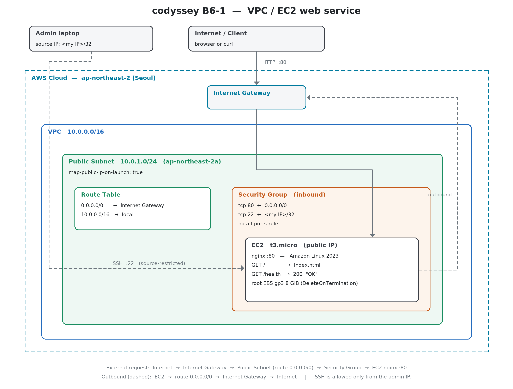

# 내가 만든 웹사이트를 인터넷에 올려 누구나 쓰게 하기

AWS 에서 **VPC 로 격리된 네트워크를 직접 설계**하고, Public Subnet 의 EC2 에 웹 서버를 올려
외부에서 접속 가능한 웹 서비스를 완성한다. 코디세이 B6-1 미션 산출물이다.

- **리전**: `ap-northeast-2` (서울) — 스크립트와 IAM 정책 양쪽에 고정돼 있다
- **구성**: VPC 1 / Public Subnet 1 / Internet Gateway 1 / EC2 1대(t3.micro, nginx)
- **접근 제어**: HTTP(80) 는 전체 공개, SSH(22) 는 **내 IP 에서만**
- **권한**: `AdministratorAccess` 없이, 실습에 필요한 액션만 나열한 IAM 정책 1개

---

## ⚠ 제출 전에 채워야 하는 곳

이 저장소는 **구성·검증·정리를 자동화한 코드와 문서**까지 완성돼 있다.
아래 세 가지는 **본인 AWS 계정에서 실행해야만** 나오는 값이라 비어 있다.

| 채울 곳 | 무엇을 |
| --- | --- |
| 이 README 의 「외부 접속 검증」 절 | 선택한 방식(A/B)과 **실제 퍼블릭 IP** |
| [`docs/screenshots/`](docs/screenshots/) | 접속 결과 스크린샷 **1장 이상** |
| [`docs/troubleshooting.md`](docs/troubleshooting.md) 의 `결과` 칸 | 실제 실행 로그 |
| [`docs/cleanup-checklist.md`](docs/cleanup-checklist.md) 4절 | 정리 실행 결과 |

`bash infra/04_verify.sh | tee docs/verification.txt` 한 번이면 위 값 대부분이 파일로 남는다.

---

## 1. 아키텍처



원본 파일: [`docs/architecture.png`](docs/architecture.png) / 벡터 편집용 [`docs/architecture.svg`](docs/architecture.svg)
(둘 다 [`docs/build_architecture.py`](docs/build_architecture.py) 가 같은 좌표에서 생성한다)

### 외부 요청이 EC2 까지 도달하는 경로

```text
브라우저  →  Internet Gateway  →  Public Subnet  →  Security Group  →  EC2 (nginx :80)
             ①                    ②                 ③                  ④
```

| 단계 | 없으면 어떻게 되나 | 이 저장소에서 담당하는 곳 |
| --- | --- | --- |
| ① IGW 가 VPC 에 **연결**돼 있어야 한다 | VPC 는 인터넷과 물리적으로 이어지지 않는다 | `01_network.sh` |
| ② Route Table 에 `0.0.0.0/0 → IGW` 가 있어야 한다 | 패킷이 IGW 로 갈 길을 모른다. **연결만으로는 부족하다** | `01_network.sh` |
| ③ Security Group 인바운드에 80 이 열려야 한다 | 서브넷까지 온 패킷이 인스턴스 앞에서 버려진다 | `02_security_group.sh` |
| ④ 인스턴스에 **퍼블릭 IP** 가 있고 nginx 가 살아 있어야 한다 | 바깥에서 부를 주소가 없거나, 주소는 있는데 응답이 없다 | `03_instance.sh` + `user-data.sh` |

②가 핵심이다. **Public Subnet 을 "퍼블릭"으로 만드는 것은 이름이 아니라 라우팅**이다.
서브넷 이름을 `public` 으로 지어도 기본 경로가 없으면 사설 서브넷이다.

---

## 2. 실행 순서

### 사전 준비

1. AWS 계정에 **IAM 사용자**를 만들고 [`iam/codyssey-b6-1-policy.json`](iam/codyssey-b6-1-policy.json) 을 연결한다
   → 방법은 [`iam/README.md`](iam/README.md)
2. 그 사용자의 액세스 키로 `aws configure` (루트 계정 키는 쓰지 않는다)
3. `aws --version` 과 `aws sts get-caller-identity` 로 확인

### 구축

```bash
bash infra/01_network.sh          # VPC / Subnet / IGW / Route Table
bash infra/02_security_group.sh   # 보안 그룹 (내 IP 자동 감지)
bash infra/03_instance.sh         # 키페어 / AMI 조회 / EC2 기동 + nginx
bash infra/04_verify.sh           # 요구사항 자동 검증
```

각 스크립트는 만든 리소스 ID 를 `infra/.state` 에 적는다. **다시 실행해도 새로 만들지 않고
기존 것을 재사용**한다.

여기서 한 가지를 구분한다. 리소스 **생성**은 ID 가 있으면 건너뛰지만,
생성에 딸린 **부속 작업**(DNS 속성, 퍼블릭 IP 자동할당, IGW 연결, 기본 경로, 서브넷 연결)은
건너뛰지 않고 **매번 현재 상태를 조회해 없으면 채운다.** 그래서 1회차가 부속 작업 도중에 죽어도
고친 뒤 그대로 다시 돌리면 누락분이 복구된다. (이걸 안 하면 ID 만 남은 채 재실행이 "재사용"으로
통과해 기본 경로가 영영 생기지 않는다 — 증상은 "인스턴스는 running 인데 브라우저에서 안 열림"이다.)

### 검증

```bash
bash infra/04_verify.sh | tee docs/verification.txt
```

요구사항 ID 마다 PASS / FAIL 을 찍는다. "된다고 썼다"가 아니라 "확인했다"를 남기기 위한 것이다.

```text
── 네트워크 구성 ─────────────────────────────────────────────
[PASS] B6-1-N1      VPC 1개 존재
       B6-1-N1      VPC CIDR: 10.0.0.0/16
[PASS] B6-1-N4      Route Table 에 0.0.0.0/0 → IGW 경로 존재
       B6-1-N4      기본 경로: 0.0.0.0/0 → igw-0abc...
...
```

### 정리 (반드시)

```bash
bash infra/99_cleanup.sh
```

의존 관계의 역순으로 지우고, 태그로 다시 훑어 잔여 리소스가 없는지 확인한다.
자세한 항목은 [`docs/cleanup-checklist.md`](docs/cleanup-checklist.md).

---

## 3. 외부 접속 검증

**선택한 방식: (B) 헬스체크 — `GET http://<퍼블릭IP>/health`**

과제는 (A) 브라우저 접속과 (B) 헬스체크 중 하나를 고르게 한다. (B) 를 택한 이유는
**결과가 눈이 아니라 값으로 남기 때문**이다. 상태 코드와 고정 응답 문자열은 스크립트가
자동으로 비교할 수 있어, `04_verify.sh` 가 매번 같은 기준으로 판정한다.
(A) 도 함께 확인하며, `04_verify.sh` 는 둘 다 검사한다.

| 항목 | 값 |
| --- | --- |
| 퍼블릭 IP | `<배포 후 채우기 — infra/.state 의 PUBLIC_IP>` |
| 접속 URL (A) | `http://<퍼블릭IP>/` |
| 헬스체크 URL (B) | `http://<퍼블릭IP>/health` |
| 기대 응답 | `200 OK` / 본문 `OK` |

```bash
$ curl -i http://<퍼블릭IP>/health
HTTP/1.1 200 OK
Server: nginx
Content-Type: text/plain

OK
```

스크린샷은 [`docs/screenshots/`](docs/screenshots/) 에 넣는다 (넣을 목록은 그 폴더의 README 참고).

---

## 4. 보안 — 무엇을 열고 무엇을 닫았나

| 방향 | 포트 | 소스 | 이유 |
| --- | --- | --- | --- |
| 인바운드 | tcp 80 | `0.0.0.0/0` | 웹 서비스는 누구나 들어와야 한다 |
| 인바운드 | tcp 22 | `<내 IP>/32` | 관리 포트. **나만** |
| 인바운드 | 그 외 | — | 없음 |
| 아웃바운드 | 전체 | — | 기본값. 패키지 설치와 업데이트에 필요하다 |

`0.0.0.0/0` 에 대한 **전체 포트(0-65535) 허용 규칙은 만들지 않는다**(과제 금지 사항).
이건 주의로 지키지 않고 **코드로 막는다**:

- `02_security_group.sh` 는 `SSH_CIDR=0.0.0.0/0` 을 받으면 **실행을 거부**한다
- 규칙을 넣은 직후 [`infra/check_sg.py`](infra/check_sg.py) 가 스스로 점검하고, 어기면 종료 코드 1
- `04_verify.sh` 가 같은 검사를 다시 한다 (판정 로직은 한 파일에만 있어 둘이 어긋나지 않는다)

### SSH 를 굳이 좁히는 이유

22 번을 전체 공개하면 몇 분 안에 자동화된 로그인 시도가 들어온다.
키 인증만 허용해도 로그는 지저분해지고, 언젠가 설정 하나가 어긋나면 그게 문이 된다.
**"임시로 열고 잊는" 것이 사고의 전형적인 모양**이라, 애초에 만들 수 없게 했다.

내 IP 가 바뀌어 접속이 안 되면 → [`docs/troubleshooting.md`](docs/troubleshooting.md) 사례 2.

---

## 5. 권한 — 최소권한 원칙

[`iam/codyssey-b6-1-policy.json`](iam/codyssey-b6-1-policy.json) 하나만 붙인다.

- `AdministratorAccess` **미부여** — `04_verify.sh` 가 매번 확인한다
- `s3:*`, `rds:*` 등 실습과 무관한 서비스 권한 **없음**
- `iam:CreateUser`, `iam:AttachUserPolicy` 같은 **권한 상승 경로 없음**
- 대부분의 Statement 에 `aws:RequestedRegion = ap-northeast-2` 조건 → 다른 리전 생성 자체가 거부된다

### Security Group 과 IAM 은 무엇이 다른가

| | Security Group | IAM |
| --- | --- | --- |
| 대상 | **패킷** — 인스턴스에 도달하는 트래픽 | **API 호출** — AWS 를 조작하는 요청 |
| 질문 | "이 주소에서 이 포트로 들어와도 되나" | "이 사용자가 이 리소스에 이 작업을 해도 되나" |
| 어겼을 때 | 연결이 끊기거나 타임아웃 | `AccessDenied` / `UnauthorizedOperation` |
| 이 실습의 예 | 80 은 공개, 22 는 내 IP | EC2 는 만들 수 있지만 S3 는 못 본다 |

둘은 **서로를 대신하지 못한다.** SG 를 아무리 좁혀도 IAM 이 열려 있으면
콘솔에서 규칙을 바꿔 버릴 수 있고, 반대로 IAM 이 좁아도 SG 가 열려 있으면 트래픽은 들어온다.

권한이 모자라 실패하면 → 정책을 넓히지 말고 오류 메시지의 액션 하나만 추가한다.
방법은 [`iam/README.md`](iam/README.md) 마지막 절.

---

## 6. 과금 방지

| 장치 | 어디에 |
| --- | --- |
| 생성 시점부터 `Project=codyssey-b6-1` 태그로 **추적** | 모든 `create-*` 호출 |
| 루트 EBS `DeleteOnTermination=true` — 고아 볼륨이 안 남는다 | `03_instance.sh` |
| NAT Gateway / ELB / RDS 를 **만들지 않고**, IAM 정책에도 권한이 없다 | `iam/codyssey-b6-1-policy.json` |
| 정리 후 태그로 다시 훑어 잔여 확인, 남으면 실패 처리 | `99_cleanup.sh` |
| 리전 조건으로 타 리전 생성 차단 | IAM 정책 |

프리 티어 범위: t3.micro 1대 + EBS 8GiB. **EIP 는 할당하지 않는다** —
연결되지 않은 EIP 는 시간당 과금되는데, 인스턴스를 지우는 순간 정확히 그 상태가 되기 때문이다.

---

## 7. 파일 구조

```text
codyssey_B6-1/
├── infra/
│   ├── 00_env.sh              # 공통 설정·헬퍼 (다른 스크립트가 source)
│   ├── 01_network.sh          # VPC / Subnet / IGW / Route Table
│   ├── 02_security_group.sh   # 보안 그룹 + 자기 점검
│   ├── 03_instance.sh         # 키페어 / AMI / EC2 기동
│   ├── 04_verify.sh           # 요구사항 ID별 PASS·FAIL 검증
│   ├── 99_cleanup.sh          # 역순 삭제 + 잔여 확인
│   ├── check_sg.py            # 보안 그룹 판정 로직 (02 와 04 가 공유)
│   └── user-data.sh           # 부팅 시 nginx 설치 + /health
├── iam/
│   ├── codyssey-b6-1-policy.json
│   └── README.md              # 적용 방법, 무엇을 왜 뺐는지
├── docs/
│   ├── architecture.png / .svg / build_architecture.py
│   ├── troubleshooting.md     # 증상→가설→검증→조치→결과→재발방지
│   ├── cleanup-checklist.md
│   ├── 설계_노트.md            # 트래픽 흐름·SG vs IAM·과금·확장(ALB) 설명
│   └── screenshots/
└── tests/                     # AWS 계정 없이 도는 검증
```

## 8. 더 읽을 것

[`docs/설계_노트.md`](docs/설계_노트.md) 에 아래를 정리해 두었다.

- VPC / Subnet / Route Table / IGW 가 각각 무엇을 하고, 없으면 무엇이 안 되는가
- Security Group 과 IAM 의 차이, 최소 권한을 지키는 이유
- 가설 → 검증 순서를 지키는 이유와 점검 순서
- 과금 대표 요인과 삭제가 역순이어야 하는 이유
- **인스턴스를 2대로 늘린다면** 무엇이 병목이고 무엇을 추가하나 (ALB / 다중 AZ / 상태 분리)
- **Billing 에 예상치 못한 비용이 찍혔다면** 무엇부터 의심하고 어떻게 추적하나

## 9. 테스트

```bash
python3 -m unittest discover -s tests -t tests -v
```

45개 테스트가 **AWS 계정 없이** 10초 안에 끝난다.
[`tests/fake_aws.py`](tests/fake_aws.py) 를 `aws` 라는 이름으로 `PATH` 앞에 두고
스크립트를 **실제로 실행한 뒤**, 기록된 호출을 검사한다.

| 검사하는 것 | 예 |
| --- | --- |
| 명령 구성 | `create-route` 가 `0.0.0.0/0 → igw-...` 인가 |
| 금지 규칙 | 전체 포트 허용을 만들지 않는가, `SSH_CIDR=0.0.0.0/0` 을 거부하는가 |
| 리전 고정 | **모든** 호출에 `--region ap-northeast-2` 가 붙는가 |
| 과금 안전장치 | `DeleteOnTermination=true` 인가, 추적 태그를 다는가 |
| 삭제 순서 | terminate → SG → route table → IGW → subnet → VPC 순인가 |
| 잔여 확인 | EC2 / EBS / EIP / IGW / VPC 5종을 모두 조회하는가 |
| 재실행 안전성 | 두 번째 실행이 리소스를 새로 만들지 않는가 |
| **부분 실패 복구** | 기본 경로 생성이 실패한 뒤 재실행하면 그 경로를 채우는가 |
| 키 파일 권한 | `.pem` 이 `0400` 인가 |

**이 테스트가 확인하지 못하는 것**: 실제 AWS 의 응답, 권한, 과금, 네트워크 도달성.
그건 계정에서 `bash infra/04_verify.sh` 로만 확인된다. 두 층을 섞어 말하지 않기 위해
테스트 파일 첫머리에도 같은 한계를 적어 두었다.

---

## 10. 보너스 (선택 과제)

- **HTTPS 적용** — 미구현. 무료 서브도메인 + Let's Encrypt 로 확장할 수 있다.
  현재 SG 는 443 을 열지 않으므로 규칙 추가가 먼저다.
- **Docker 배포** — 미구현. `user-data.sh` 에서 nginx 대신 `docker run -p 80:80` 으로 바꾸면 된다.
