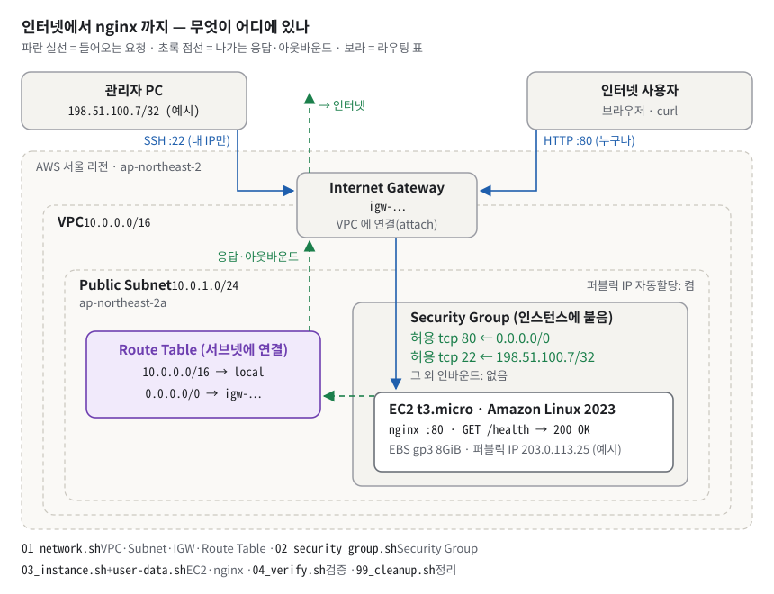
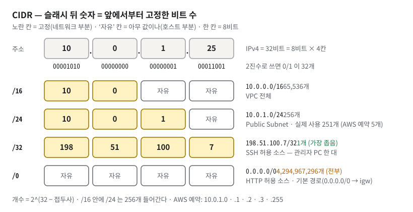
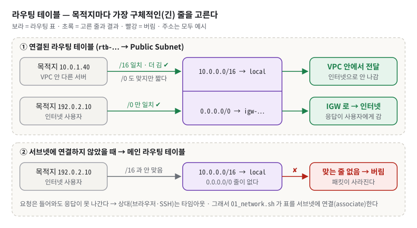
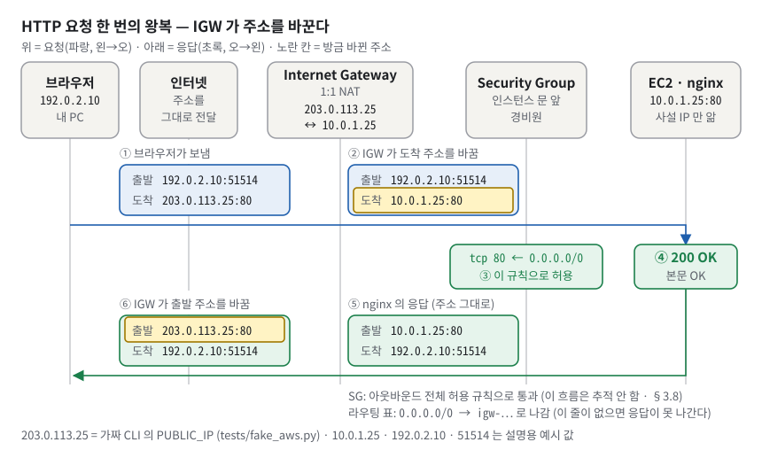
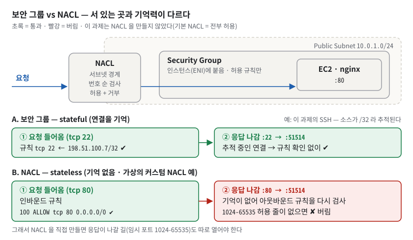
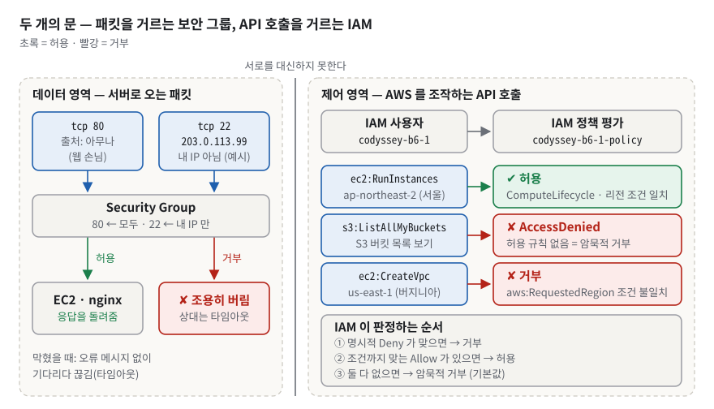
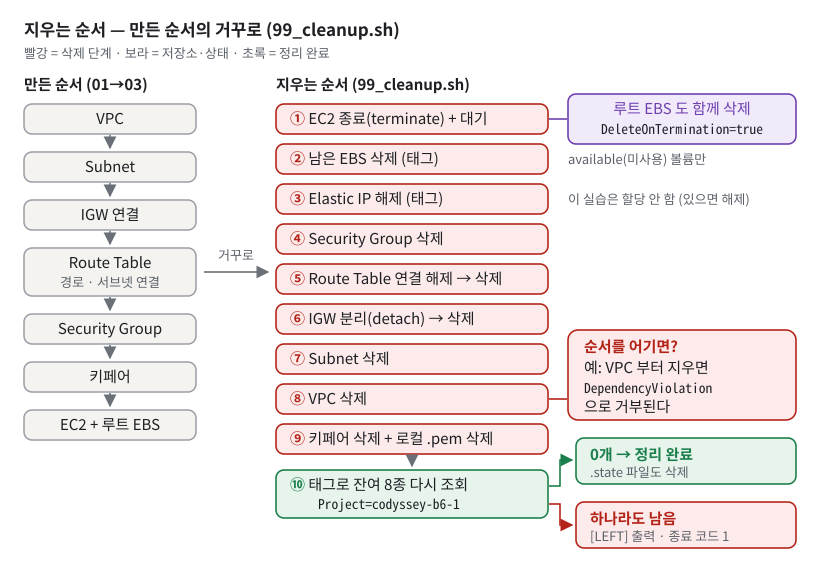
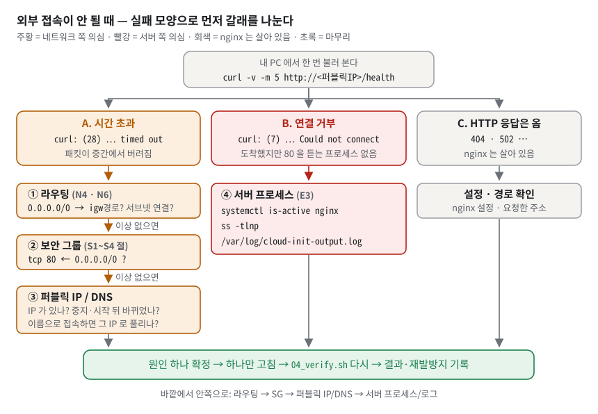
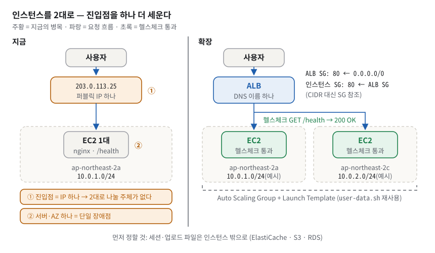
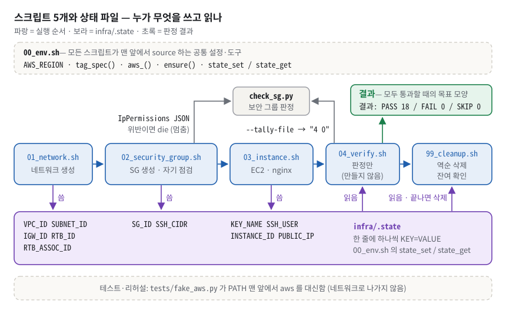

# B6-1 · 내가 만든 웹사이트를 인터넷에 올려 누구나 쓰게 하기 — 구술 평가 대비 학습 문서

> 온라인 가게를 여는 일에 빗대 보자. 먼저 담장 두른 내 전용 부지(VPC)를 받고, 그 안에 한 구역(서브넷)을 긋는다. 담장에 정문(Internet Gateway)을 달고, 로비 안내판(라우팅 테이블)에 "단지 밖으로 가는 것은 전부 정문으로"라고 적는다. 가게 건물(EC2) 현관에는 경비원(보안 그룹)이 서서 "매장(80번)은 누구나, 창고(22번)는 사장님만"이라는 명단을 들고 있다. 카운터 직원(nginx)은 "영업 중이에요?"(`/health`)라고 물으면 "OK"라고 답한다. 관리사무소 열쇠 대장(IAM)에는 "이 직원은 가게 공사만 할 수 있다"고 적혀 있다. 장사가 끝나면 지은 순서의 거꾸로 전부 철거하고, 남은 것이 없는지 장부로 다시 확인한다.
>
> 정확히 말하면: AWS CLI 를 부르는 Bash 스크립트(`infra/01~04`, `infra/99`)로 서울 리전(`ap-northeast-2`)에 **VPC `10.0.0.0/16` → Public Subnet `10.0.1.0/24` → Internet Gateway → Route Table(`0.0.0.0/0 → IGW`) → Security Group(80 은 전체, 22 는 내 IP 만) → EC2 `t3.micro`(nginx, `GET /health` → 200 `OK`)** 를 만든다. 그다음 요구사항 ID 마다 PASS/FAIL 을 찍어 검증하고, 의존 관계의 역순으로 지운 뒤 태그로 남은 것이 없는지 확인한다. 권한은 `AdministratorAccess` 없이 액션 37개만 나열한 IAM 정책 하나다. (처음 보는 말은 §3 에서 하나씩 푼다. 급하면 부록 A 용어집을 본다.)

**읽는 법.**
① 처음이면 §1 부터 끝까지 정독한다(코드·출력 블록을 뺀 본문만 약 3시간 20분. 한 번에 다 읽기 어려우면 §1~§3 과 §4~§8 을 나눠 읽는다. 긴 실행 출력 블록은 훑어 읽어도 된다). ② 평가 전날이면 §1 · §5 · §6 · §7 만 다시 본다. ③ 평가 30분 전이면 §8 만 본다.
§6 의 접이식 문답은 **질문만 보고 먼저 소리 내어 답해 본 뒤** 펼친다. 펼쳐서 읽기만 하면 평가장에서 입이 열리지 않는다.

> [!IMPORTANT]
> **이 저장소는 아직 실제 AWS 계정에서 한 번도 실행되지 않았다.** `infra/.state`, `docs/verification.txt`, 스크린샷이 모두 없고 README 의 퍼블릭 IP 칸은 비어 있다. 평가 전에 반드시 [§7.1](#71-가장-큰-약점-실행-증빙이-없다--평가-전에-할-일) 의 실습 순서대로 한 번 돌려 증빙을 채운다. 이 문서는 그 전제에서 "무엇을 보여 주고 어떻게 말할지"를 준비한다.

> [!NOTE]
> **이 문서에 실린 실행 출력은 네 종류다.** 출력마다 출처를 붙였다.
> - **실측** — 저장소 복사본에서 직접 실행한 출력이다(2026-09-23, 커밋 `de6d778`). 원본 저장소는 건드리지 않았다.
> - **가짜 CLI 리허설** — AWS 계정이 없어서 저장소의 가짜 `aws` 프로그램(`tests/fake_aws.py`)을 `aws` 라는 이름으로 앞세우고 `infra/*.sh` 를 **진짜로 실행**한 출력이다. 스크립트 코드는 전부 실제로 돌았다. 그러나 `vpc-0fake0001` 같은 ID 와 퍼블릭 IP `203.0.113.25` 는 가짜 값이고, AWS 가 실제로 그렇게 동작하는지는 증명하지 않는다.
> - **nginx 샌드박스** — `infra/user-data.sh` 가 만드는 `health.conf` 를 그대로 생성해 로컬 nginx 1.28.3 으로 띄운 출력이다. 포트만 80 에서 18090 으로, 문서 루트만 샌드박스 폴더로 바꿨다.
> - **AWS 공식 문서** — 실행할 수 없는 AWS 동작은 공식 문서 문장으로 확인하고 그렇게 밝혔다. 확인하지 못한 교과서 사실은 "일반적으로"라고 쓴다.
>
> `203.0.113.x`, `198.51.100.x`, `192.0.2.x` 는 문서용으로 예약된 주소(RFC 5737)라 실제 인터넷 주소가 아니다. 저장소 테스트가 쓰는 값(`203.0.113.25`, `198.51.100.7`)을 그대로 따랐고, 저장소에 없는 값은 "(예시)"라고 붙였다.

## 1. 한눈에 보기

### 1.1 이 과제를 한 문장으로

**비유.** 머리말의 가게 비유를 떠올리자. 이 과제에서 평가자가 확인하려는 것은 "가게가 문을 열었다"가 아니다. **손님이 정문 → 안내판 → 경비원 → 카운터로 어떻게 오는지, 각 단계가 빠지면 무엇이 막히는지**를 설명할 수 있느냐다.

**비유의 한계.** 비유 속 담장·정문·경비원은 물리적인 벽과 사람이지만 AWS 에서는 전부 소프트웨어 규칙이다. 또 경비원(보안 그룹)은 명단에 없는 손님을 **아무 말 없이** 무시한다. 그래서 실패의 증상이 "거절"이 아니라 "한참 기다리다 타임아웃"이 된다. 이 한 가지가 트러블슈팅 질문의 절반을 푼다([§3.7](#37-tcp-연결과-실패의-두-얼굴--타임아웃-vs-거부)).

**정확한 정의.** 외부 사용자의 HTTP 요청이 EC2 의 nginx 까지 도달하려면 다섯 가지가 **모두** 맞아야 한다.

1. Internet Gateway 가 VPC 에 **연결(attach)** 돼 있다.
2. 서브넷에 **연결(associate)** 된 라우팅 테이블에 `0.0.0.0/0 → IGW` 줄이 있다.
3. 인스턴스에 **퍼블릭 IP** 가 있다.
4. 보안 그룹이 tcp 80 을 `0.0.0.0/0` 에서 허용한다.
5. nginx 가 80 번 포트를 모든 인터페이스에서 듣고 있다.

이 저장소는 1~2 와 3 의 전제(서브넷의 퍼블릭 IP 자동할당, `infra/01_network.sh:56-59`)를 `infra/01_network.sh`, 4 를 `infra/02_security_group.sh`, 3(인스턴스를 그 서브넷에 띄워 실제로 IP 를 받음)·5 를 `infra/03_instance.sh` + `infra/user-data.sh` 가 만든다. `infra/04_verify.sh` 는 아무것도 만들지 않고 AWS 에 다시 물어 판정만 한다. `infra/99_cleanup.sh` 는 역순으로 지운다.


*그림 1. 인터넷 사용자와 관리자의 요청이 정문(IGW) → 서브넷 → 보안 그룹을 지나 nginx 에 닿고, 응답은 라우팅 표의 0.0.0.0/0 줄을 따라 IGW 로 나간다.*

그림 1 에서 봐야 할 것은 네 가지다.

- **파란 실선(요청)은 두 종류다.** 오른쪽 위 "인터넷 사용자"의 HTTP:80 은 누구나 들어온다. 왼쪽 위 "관리자 PC"의 SSH:22 는 `198.51.100.7/32`(예시) 한 곳에서만 들어온다. **둘 다 Internet Gateway 를 지난다.** 저장소의 `docs/architecture.png` 는 SSH 선이 IGW 를 건너뛰게 그려져 있는데, 그것은 틀린 그림이다([§7.5](#75-기타--직접-발견한-것들)).
- **보라색 라우팅 표는 서브넷에 붙어 있다.** `10.0.0.0/16 → local` 은 VPC 안끼리, `0.0.0.0/0 → igw-…` 는 그 밖의 모든 곳이다. 초록 점선(응답·아웃바운드)이 이 두 번째 줄을 타고 IGW 로 나간다. 들어오는 요청만 생각하면 이 줄이 왜 필요한지 놓친다([§3.5](#35-라우팅-테이블--가장-구체적인-줄이-이긴다)).
- **보안 그룹 틀은 서브넷이 아니라 EC2 를 감싼다.** 보안 그룹은 인스턴스의 네트워크 카드에 붙는다. 서브넷 경계를 지키는 것은 NACL 이다([§3.9](#39-nacl--서브넷-경계의-무상태-검문소)). NACL 은 그림 1 에 그리지 않았다. 위치는 그림 5 에 있다.
- **하단 두 줄은 담당 스크립트다.** 평가자가 "이건 어디서 만들었나요?"라고 물으면 이 줄을 떠올린다.

### 1.2 평가자는 무엇을 보나

체크리스트(`AWS VPC EC2 배포 체크리스트`)는 4영역 17문항이다. 1-4 문항만 하위 항목 (A)(B)가 있다.

| 영역 | 문항 수 | 묻는 것 | 이 문서에서 대비하는 곳 |
| --- | --- | --- | --- |
| 1. 기능 동작 검증 | 5 | 네트워크 구성, SSH·웹 서버, 보안 그룹, 외부 접속(A/B), 정리 5종 | §5 시연 리허설 · §6.1 |
| 2. 구현 구조 설명 | 4 | 다이어그램 기준 흐름, SG 최소화 기준, A/B 선택과 구성, 추적·정리 기준 | §4 코드 투어 · §6.2 |
| 3. 핵심 개념 이해 | 4 | 기본 경로가 필요한 이유, SG 와 IAM 의 차이·최소 권한, 22/DB 포트를 열면 안 되는 이유, 가설→검증 | §3 배경 개념 · §6.3 |
| 4. 확장 사고 · 트러블슈팅 | 4 | 외부 접속 실패 점검 순서, IAM 권한 부족 대응, 인스턴스 2대 확장, 예상 밖 과금 | §3.12 · §3.14~3.16 · §6.4 |

1절 5문항은 **보여 줘야** 하는 문항이다. 그런데 실계정 실행 증빙이 아직 없다. 그래서 §5 는 "가짜 CLI 리허설로 지금 보여 줄 수 있는 것"과 "실계정에서 확보해 두어야 할 화면"을 문항마다 나란히 둔다.

### 1.3 30초 자기소개 스크립트

> "서울 리전에 VPC·퍼블릭 서브넷·인터넷 게이트웨이·라우팅 테이블·보안 그룹·EC2 를 콘솔이 아니라 스크립트로 만드는 구성을 짰습니다. 만들기·검증·정리 스크립트가 따로 있고, 검증 스크립트는 요구사항마다 PASS/FAIL 을 남기며, 정리 스크립트는 지운 뒤 태그로 남은 것이 없는지 다시 확인합니다. 핵심 설계는 두 가지입니다. 퍼블릭 서브넷은 이름이 아니라 라우팅이 만든다는 점, 그리고 SSH 를 전체 공개하는 설정은 스크립트가 아예 거부한다는 점입니다. 실계정 실행 증빙은 아직 없어서, 테스트 55개(그중 32개는 가짜 AWS CLI 로 스크립트를 실제로 실행)와 가짜 CLI 리허설로 보여 드리겠습니다."

다섯 문장, 소리 내어 읽으면 30초 남짓이다. 파일 이름(`01_network.sh` 등)은 평가자가 "어디서요?"라고 물을 때 댄다. 마지막 문장은 상태에 맞게 바꾼다. 실계정 실습([§7.1](#71-가장-큰-약점-실행-증빙이-없다--평가-전에-할-일))을 마쳤다면 "실계정에서 돌린 결과는 `docs/verification.txt` 에 PASS 18 / FAIL 0 / SKIP 0 으로 남겼습니다"로 끝낸다.

## 2. 명세 정독 — 무엇을 요구받았나

### 2.1 요구사항 지도

ID 는 저장소 README 0.4 절의 `R*` 체계를 그대로 쓴다. 제출물은 `D1~D4`, 보너스는 `B1·B2`. 상태 표시: ✅ 충족 · ⚠️ 부분 · ❌ 미충족 · 🔍 실계정이 있어야 확인 가능(코드는 준비됨). 상태 칸의 N1·E1·S1 같은 기호는 `infra/04_verify.sh` 가 찍는 판정 ID 다(전체 목록은 [§4.2](#42-핵심-시나리오-따라가기)).

**(가) 원문과 상태.** 평가자가 "요구사항 하나씩 짚어 보죠"라고 할 때 쓰는 표다.

| ID | 원문 요지 (PDF 그대로) | 상태 |
| --- | --- | --- |
| `R1-1` | VPC 1개를 생성한다. | 🔍 판정 N1 |
| `R1-2` | Public Subnet 1개를 생성한다. | 🔍 판정 N2 |
| `R1-3` | Internet Gateway를 VPC에 연결한다. | 🔍 판정 N3 |
| `R1-4` | Public Subnet의 Route Table에 0.0.0.0/0 → Internet Gateway 경로가 존재해야 한다. | 🔍 판정 N4·N6 |
| `R1-5` | Public Subnet에 배치된 인스턴스는 인터넷으로 아웃바운드 통신이 가능해야 한다. (예: curl https://example.com 성공) — 원문(추출 잔재 정리) | 🔍 SSH 가 되어야 판정. 실패 시 SKIP([§7.3](#73-검증-스크립트가-조용히-통과하는-곳)) |
| `R2-1` | Public Subnet에 EC2 인스턴스 1대를 생성한다. | 🔍 판정 E1 |
| `R2-2` | SSH로 인스턴스에 접속할 수 있어야 한다. | 🔍 판정 E2 |
| `R2-3` | 웹 서버(Nginx 등)를 설치하고 실행 상태여야 한다. | 🔍 판정 E3 (설정은 샌드박스 실측) |
| `R2-4` | 인스턴스에서 curl http://localhost 요청이 200 응답을 반환해야 한다. — 원문(추출 잔재 정리) | 🔍 판정 E4 |
| `R3-1` | Security Group 인바운드는 원칙적으로 필요한 포트만 허용한다. | ✅ (판정기 S1 은 추가 공개 포트를 FAIL 로 잡지 못함 — [§7.2](#72-보안-그룹-판정기의-사각지대)) |
| `R3-2` | HTTP(80)는 0.0.0.0/0 에서 접근 가능해야 한다. | ✅ |
| `R3-3` | SSH(22)는 학습자 개인 IP(또는 지정된 IP 대역)에서만 접근 가능해야 한다. | ✅ |
| `R3-4` | 0.0.0.0/0 에 대해 전체 포트(0-65535) 허용 규칙은 생성하지 않는다. | ✅ |
| `R4-1` | 실습에 사용하는 IAM 사용자(또는 Role) 1개를 사용한다. | 🔍 사용자 캡처 없음 |
| `R4-2` | 해당 IAM 권한은 EC2/VPC/Security Group 구성에 필요한 범위로 제한한다. | ✅ 액션 범위(7 Statement · 액션 37개) / ⚠️ 리소스 범위 — 삭제·종료 액션도 `Resource: *`([§7.5](#75-기타--직접-발견한-것들)) |
| `R4-3` | 관리자 권한(AdministratorAccess)은 부여하지 않는다. | ✅ (I5 판정의 한계는 §7.3) |
| `R5-1` | (A) 브라우저에서 `http://<퍼블릭IP>` 로 접속했을 때 페이지가 정상 표시된다. / (B) `GET http://<퍼블릭IP>/health` 호출이 200을 반환하며 고정된 응답(예: “OK”)을 확인할 수 있다. | ❌ 증빙 0건 (코드는 샌드박스로 200 `OK` 확인) |
| `R5-2` | 선택한 방식(A/B)은 README.md 에 명시한다. | ⚠️ 방식 (B) 명시, IP 는 플레이스홀더 |
| `R6-1` | 실습 종료 후, 생성한 리소스를 정리하고 체크리스트에 “종료/삭제 완료” 근거를 남긴다. | ❌ 결과 칸이 "예시" |
| `R6-2` | 최소한 다음 항목은 정리 완료를 확인해야 한다: EC2, EBS(볼륨), Elastic IP, Internet Gateway, VPC | ⚠️ 장치 완비, 기록 없음 |
| `D1` | `docs/architecture.(png\|pdf)` 1개 — VPC, Subnet, Internet Gateway, EC2, Security Group 구성 요소와 외부 → 서비스 트래픽 흐름 | ✅ (SSH 선 위치는 고칠 것) |
| `D2` | 선택한 방식(A/B)과 접속 정보(URL 또는 IP)를 README.md 에 기재 + 접속 결과 스크린샷 1장 이상 | ❌ 스크린샷 0장 |
| `D3` | `docs/troubleshooting.(md\|pdf)` 1개 — 최소 1건 이상 증상 → 가설 → 검증 → 조치 → 결과 → 재발방지 | ⚠️ `결과` 3칸 모두 `(실행 후 채우기)` |
| `D4` | `docs/cleanup-checklist.md` 1개 + (선택) Billing 화면 또는 리소스 목록 스크린샷 | ✅ 파일 / ⚠️ 결과 공란 |

**(나) 쉬운 말과 내 구현.** 같은 ID 를 "무슨 뜻이고, 왜 요구하고, 내 코드 어디에 있나"로 다시 본다.

| ID | 쉬운 말 · 왜 이런 요구를? | 내 구현 |
| --- | --- | --- |
| `R1-1` | 내 전용 사설 네트워크 하나 — 남과 격리된 공간에서 주소를 직접 설계해 보라고 | `infra/01_network.sh:24-35` |
| `R1-2` | VPC 안에 인터넷과 통할 구역 하나 — 인스턴스는 서브넷에 뜨고, 서브넷이 AZ 를 정한다 | `infra/01_network.sh:41-59` |
| `R1-3` | 담장에 정문을 단다 — VPC 는 처음에 인터넷과 이어져 있지 않다 | `infra/01_network.sh:61-80` |
| `R1-4` | 안내판에 "밖으로는 정문" 한 줄 — 정문만 있고 길이 없으면 패킷이 못 간다 | 경로 `infra/01_network.sh:95-106`, 서브넷 연결 `infra/01_network.sh:108-118` |
| `R1-5` | 서버가 밖으로도 나갈 수 있어야 — 패키지 설치·업데이트. 인바운드와 아웃바운드는 다른 문제다 | 판정 `infra/04_verify.sh:181-184` |
| `R2-1` | 가상 서버 한 대 — 컴퓨팅 자원 배포 | `infra/03_instance.sh:57-67` |
| `R2-2` | 원격 관리 접속 — 운영자는 서버 안을 봐야 한다 | 키페어 `infra/03_instance.sh:16-28`, SG 22 `infra/02_security_group.sh:67` |
| `R2-3` | nginx 설치·실행 — 프로세스가 떠 있어야 응답한다 | `infra/user-data.sh:14-25`, `infra/user-data.sh:66-68` |
| `R2-4` | 서버 안에서 자기 자신에게 물어 200 — 내부가 200 이면 외부 실패의 원인은 인스턴스 밖으로 좁혀진다 | 자기 점검 `infra/user-data.sh:70-77`, 판정 `infra/04_verify.sh:171-175` |
| `R3-1` | 필요한 문만 연다 — 열린 포트 = 공격받을 수 있는 면 | `infra/02_security_group.sh:66-67` (규칙 2개뿐) |
| `R3-2` | 웹은 누구나 — 서비스는 공개가 목적 | `infra/02_security_group.sh:66` |
| `R3-3` | 관리 포트는 나만 — 22 전체 공개 = 무차별 대입 표적 | `infra/02_security_group.sh:17-37`, `infra/check_sg.py:76-83` |
| `R3-4` | "다 열기" 금지 — 임시로 열고 잊는 사고의 절대 금지선 | 만드는 코드 없음 + 판정 `infra/check_sg.py:56-59` |
| `R4-1` | 루트 말고 전용 사용자 1명 — 계정 위계 분리, 사고 반경 제한 | 절차 `iam/README.md:6-25`, 루트 판정 `infra/04_verify.sh:133-137` |
| `R4-2` | 필요한 버튼만 — 키 유출·실수의 피해 반경 제한 | `iam/codyssey-b6-1-policy.json:1-106` |
| `R4-3` | 만능 권한 금지 — 최소 권한 원칙 | 정책에 없음 + 판정 `infra/04_verify.sh:139-146` |
| `R5-1` | 밖에서 실제로 들어와지는지 증명 — 끝에서 끝까지(end-to-end) 검증 | `infra/user-data.sh:51-55`, 판정 `infra/04_verify.sh:151-164` |
| `R5-2` | README 에 A/B 를 적는다 — 채점자가 무엇을 볼지 알게 | `README.md:678-690` |
| `R6-1` | 다 지우고 지운 증거를 남긴다 — 클라우드는 끄기 전까지 과금 | `infra/99_cleanup.sh:1-152`, `docs/cleanup-checklist.md:65-87` |
| `R6-2` | 5종 정리 확인 — 과금 대표 항목 | 항목 `docs/cleanup-checklist.md:21-29`, 자동 확인 `infra/99_cleanup.sh:126-142` |
| `D1` | 구성도 한 장 — 그려 보면 오개념이 드러난다 | `docs/architecture.png` (+ `docs/build_architecture.py`) |
| `D2` | 방식·IP·캡처 — 재현 가능한 증거 | `README.md:676-701`, `docs/screenshots/README.md:5-13` |
| `D3` | 고장 기록 6단계 — 가설-검증 사고법 | `docs/troubleshooting.md:12-89` (3건) |
| `D4` | 정리 체크리스트 — 과금 방지 | `docs/cleanup-checklist.md:1-87` |

요약하면 **코드와 문서는 요구를 빠짐없이 덮는다. 비어 있는 것은 "실행해서 얻은 값"뿐이다.** 저장소 README 0.10 절도 스스로 "필수 20개 중 충족 6 / 부분 2 / 미충족 2 / 로컬검증불가 10"이라고 판정했다(`README.md:388`).

### 2.2 지켜야 할 제약과 그 이유

| 원문 (그대로) | 왜 이런 제약을 거나 | 이 저장소의 장치 |
| --- | --- | --- |
| "0.0.0.0/0 에 대해 전체 포트(0-65535) 허용 규칙은 생성하지 않는다." (기능 요구 3 과 제약 사항 「보안」에서 두 번) | "일단 다 열고 나중에 좁히자"의 나중은 오지 않는다. 다 열어 두면 어디서 막히는지 정보도 잃는다 | 만드는 코드가 없다 + `infra/check_sg.py:56-59` 가 생성 직후(`infra/02_security_group.sh:75-76`)와 최종 검증(`infra/04_verify.sh:112`)에서 두 번 판정 |
| "SSH(22)는 학습자 개인 IP(또는 지정된 IP 대역)에서만 접근 가능해야 한다." | 관리 포트는 자동화된 공격의 표적이다 | `infra/02_security_group.sh:23-37` 이 `0.0.0.0/0` 을 받으면 실행 거부 + `/24` 보다 넓으면 FAIL |
| "운영/관리 목적 포트(예: SSH)는 임시로 열었다가 잊는 사고가 잦으므로, 소스 제한(내 IP)을 유지한다." — 원문(추출 잔재 정리) | 사고는 "임시 규칙"에서 난다 | `0.0.0.0/0` SSH 규칙을 애초에 못 만들게 한다 |
| "관리자 권한(AdministratorAccess)은 부여하지 않는다." / "예: 실습과 무관한 서비스(S3/RDS 등) 권한은 부여하지 않음" | Admin 만 피하면 되는 게 아니다. `AmazonS3FullAccess` 를 붙여도 위반이다 | 정책에 `s3:`·`rds:`·`AdministratorAccess` 없음 + 판정 I5 |
| "루트 계정은 사용하지 않으며, 별도로 생성한 IAM 사용자/Role로만 콘솔에 접근한다." — 원문(추출 잔재 정리) | 루트는 어떤 정책으로도 제한되지 않는다 | `infra/04_verify.sh:133-137` 이 실행 주체의 ARN(AWS 리소스·주체의 전체 이름, §3.12)이 `:root` 로 끝나면 FAIL. 원문은 **콘솔** 접근도 IAM 사용자로 하라고 하므로, 캡처도 그 사용자로 로그인해서 찍는다([§7.1](#71-가장-큰-약점-실행-증빙이-없다--평가-전에-할-일) 1단계) |
| "모든 리소스는 서울 리전(ap-northeast-2)에 생성한다." | 다른 리전에 만들면 콘솔에서 안 보여 정리가 누락되고 과금된다 | EC2·SSM·STS 호출에 `--region` 을 붙이는 `aws_()`(`infra/00_env.sh:63`) + IAM `aws:RequestedRegion` 조건. `--region` 없이 `aws` 를 부르는 곳은 글로벌 서비스인 IAM 조회 한 곳(`infra/04_verify.sh:140`)뿐이다 |
| "프리 티어 범위 내에서 진행한다." / 인스턴스 "t2.micro 또는 t3.micro", 스토리지 "8~10GiB", 키페어 "1개 생성 후 안전하게 보관(재발급 불가 전제)" | 비용 사고 방지 | `infra/00_env.sh:17-18` (`t3.micro`, `8`), `chmod 400` 키 파일 |
| "실습 종료 후 생성한 리소스는 모두 종료/삭제하여 과금이 발생하지 않도록 한다." | 클라우드는 끄기 전까지 과금한다 | `infra/99_cleanup.sh` + 태그 잔여 확인 |
| "과금 방지를 위해 아래 리소스는 생성 시점부터 “정리 대상”으로 추적한다." | 무엇을 만들었는지 모르면 지울 수도 없다 | 모든 `create-*` 에 `Project=codyssey-b6-1` 태그(`infra/00_env.sh:72-75`) |

### 2.3 출력·형식 규칙

**제출물 경로는 고정이다.** `docs/architecture.(png|pdf)`, `docs/troubleshooting.(md|pdf)`, `docs/cleanup-checklist.md`. 이름이 다르면 "제출 최소 규격" 불일치로 읽힐 수 있다.

**외부 접속 검증 문구(원문).** "(A) 브라우저로 `http://<퍼블릭IP>` 접속" / "(B) `GET http://<퍼블릭IP>/health` 호출", 출력은 "정상 응답(예: 200 OK / “OK” 또는 고정 문구)". 그리고 "선택한 방식(A/B)과 접속 정보(URL 또는 IP)를 README.md 에 기재 + 접속 결과 스크린샷 1장 이상".

**트러블슈팅 6단계(원문).** "증상 → 가설 → 검증 → 조치 → 결과 → 재발방지". 템플릿 항목명은 증상(문제 상황) / 원인 가설 / 검증 방법 / 조치 내용 / 결과 / 재발 방지.

**결과 예시는 정답이 아니다.** 원문은 "실제 문구와 디자인은 달라도 된다"고 하고 화면 예시로 "Welcome to nginx!" 또는 "Hello Cloud", 응답 예시로 "200 OK" / "OK" 를 든다. 이 저장소는 첫 화면에 `Hello Cloud`, `/health` 본문에 `OK` 를 쓴다. VPC `10.0.0.0/16` 과 서브넷 `10.0.1.0/24` 도 원문 예시 값이며, 저장소는 같은 값을 골랐다(`infra/00_env.sh:14-15`).

> [!WARNING]
> **PDF 추출 잔재에 속지 않는다.** 원문 텍스트에 `curl <https://example.com >`, `curl <http://localhost >` 처럼 꺾쇠가 섞여 있는데, 하이퍼링크 표시가 새어 나온 것이다. 실제 명령은 `curl https://example.com`, `curl http://localhost` 다.

**이 저장소가 스스로 정한 출력 형식**(시연 때 이 모양을 보여 준다).

| 누가 | 형식 | 위치 |
| --- | --- | --- |
| 공통 로그 | `[INFO]` / `[ OK ]` / `[WARN]` / `[FAIL]` + 메시지 | `infra/00_env.sh:34-37` |
| 판정 줄 | `[PASS] %-12s %s` / `[FAIL] …` / `[SKIP] …` — 요구사항 ID 가 12칸 | `infra/04_verify.sh:23-25` |
| 근거 줄 | 앞 7칸 공백 + `%-12s %s: %s` — 판정이 아니라 실제 값 | `infra/04_verify.sh:36-38` |
| 요약 | ` 결과: PASS %d / FAIL %d / SKIP %d` | `infra/04_verify.sh:195` |
| 잔여 확인 | `[ OK ] %-18s 남은 것 없음` / `[LEFT] %-18s %s` | `infra/99_cleanup.sh:120-122` |

### 2.4 보너스 과제

| 보너스 | 원문 요지 | 상태 | 확장한다면 |
| --- | --- | --- | --- |
| B1 HTTPS | 무료 서브도메인 연결 + Let's Encrypt 등으로 HTTPS 인증서 | ❌ 미구현 (`README.md:852-853`) | 도메인 → certbot → SG 에 443 규칙 추가. IAM 은 SG 규칙 권한이 이미 있어 바꿀 필요 없다 |
| B2 Docker | EC2 에 Docker 설치, 컨테이너로 웹 서비스, 내부 curl 200 + 외부 1개, README 에 이미지명·실행 방식·포트 매핑, 스크린샷 2장 이상 | ❌ 미구현 (`README.md:854`) | `user-data.sh` 에서 nginx 패키지 대신 `docker run -p 80:80 …`. 실행해 본 적은 없다 |

보너스는 선택이라 감점 대상이 아니다. 물으면 "안 했다"고 먼저 말하고 확장 방법을 한 문장으로 붙인다.

## 3. 배경 개념 — 처음부터 차근차근

개념은 쉬운 것부터 쌓는다. 3.1~3.4 는 "주소와 공간", 3.5~3.9 는 "패킷이 지나는 길과 검문소", 3.10~3.11 은 "서버 안", 3.12 는 "AWS 를 조작하는 권한", 3.13~3.15 는 "운영하는 법", 3.16 은 "늘리는 법"이다. 각 칸은 비유 → 정의 → 숫자 → 이 과제의 코드 → 한 칸 아래 → 흔한 오해 순서다.

### 3.1 클라우드·리전·가용 영역 — 서버가 실제로 놓이는 곳

**비유로 먼저.** AWS 는 전 세계 도시에 데이터센터를 둔 거대한 임대업체다. **리전**은 도시(서울)이고, **가용 영역**은 그 도시 안에서 서로 멀찍이 떨어진 데이터센터 단지다. 한 단지가 정전돼도 다른 단지는 산다. 나는 "서울의 2a 단지에 서버 한 대"를 빌린다.

비유의 한계: 가용 영역은 건물 한 채가 아니라 하나 이상의 데이터센터 묶음이다. 또 `2a` 라는 이름이 어느 물리 단지인지는 계정마다 다를 수 있다(일반적으로 알려진 사실).

**정확히 말하면.** **리전(Region)** 은 지리적으로 분리된 AWS 인프라 묶음이고 서로 독립적이다. **가용 영역(AZ, Availability Zone)** 은 리전 안에서 전원·네트워크가 분리된 구역이다. 이 과제의 구성요소는 소속 단위가 다르다. **VPC 는 리전 단위**로 만들고, **서브넷·EC2·EBS 는 AZ 하나에 속한다.**

**구체적인 숫자로.** `AWS_REGION` 의 기본값은 `ap-northeast-2`(서울)이다. 서브넷 AZ 는 `${AWS_REGION}a`, 즉 `ap-northeast-2a` 가 된다. 가짜 CLI 리허설의 호출 기록을 보면 모든 줄이 `--region ap-northeast-2 …` 로 시작한다.

**이 과제에서는.** 원문 제약 "모든 리소스는 서울 리전(ap-northeast-2)에 생성한다"를 지키는 장치가 `infra/00_env.sh` 에 있다.

```bash
: "${AWS_REGION:=ap-northeast-2}"      # 서울 리전 (과제 제약: 변경 금지)   ← 10행
: "${SUBNET_AZ:=${AWS_REGION}a}"                                            ← 16행
aws_() { aws --region "$AWS_REGION" "$@"; }                                 ← 63행
```

`infra/00_env.sh:10` 이 기본값을 정하고, `infra/00_env.sh:63` 의 `aws_()` 함수가 EC2·SSM·STS 호출에 `--region` 을 붙인다. 예외는 하나다. 글로벌 서비스인 IAM 조회(`infra/04_verify.sh:140`)는 `aws iam …` 을 직접 불러 `--region` 이 없다. IAM 은 리전이 없어 결과는 같다. 참고로 N1·N2 판정(`infra/04_verify.sh:67`, `infra/04_verify.sh:71`)도 `aws_()` 대신 `bash -c "aws --region $AWS_REGION …"` 으로 `aws` 를 직접 부르지만, `--region` 을 손으로 붙여 결과는 같다. 테스트 `tests/test_infra.py:154-157` 이 "`01_network.sh` 의 모든 호출이 `--region ap-northeast-2` 인가"를 확인한다.

**한 칸 아래.** AWS CLI 는 `--region` 이 없으면 환경변수(`AWS_REGION`, `AWS_DEFAULT_REGION`)나 프로필 설정의 리전을 쓴다(일반적으로). 그래서 매번 `--region` 을 명시한다. 그런데 `: "${AWS_REGION:=…}"` 는 **"비어 있을 때만" 기본값을 넣는다.** 셸에 이미 `AWS_REGION=us-east-1` 이 있으면 그 값이 이긴다.

```text
$ AWS_REGION=us-east-1 bash infra/01_network.sh        # 가짜 CLI 리허설
[INFO] 리전: us-east-1 / 프로젝트: codyssey-b6-1
(호출 기록 첫 줄) … "--region", "us-east-1", "sts", "get-caller-identity"
```

즉 "서울 고정"은 스크립트 기본값일 뿐이다. 최후의 방어선은 IAM 정책의 `aws:RequestedRegion` 조건이다([§3.12](#312-iam-과-최소-권한--api-호출을-거르는-열쇠-대장)). 실계정이라면 다른 리전으로 가는 호출은 거기서 거부된다. 개선안은 [§7.5](#75-기타--직접-발견한-것들).

> [!WARNING]
> **흔한 오해.** "스크립트에 서울을 적었으니 절대 다른 리전에 안 만든다" → 틀리다. 환경변수로 덮인다. 막는 것은 IAM 조건이다. / "AZ = 건물 한 채" → 하나 이상의 데이터센터 묶음이다.

### 3.2 IP 주소와 포트 — 건물 주소와 방 번호

**비유로 먼저.** **IP 주소**는 건물 주소, **포트**는 그 건물의 방 번호다. 80호는 매장 창구(웹), 22호는 관리실(SSH)이다. **사설 IP** 는 회사 내선 번호라 회사 안에서만 통하고, **퍼블릭 IP** 는 그 내선에 연결된 **직통 번호**라 밖에서도 걸 수 있다. 직원(인스턴스)마다 직통 번호가 하나씩 따로 있다.

비유의 한계: 포트는 물리적인 문이 아니다. 운영체제(OS)가 프로그램에 붙여 주는 16비트 번호다.

**정확히 말하면.** **IPv4** 주소는 32비트이고, 점으로 나눈 4칸(각 0~255)으로 쓴다. **사설 대역**(RFC 1918) `10.0.0.0/8`, `172.16.0.0/12`, `192.168.0.0/16` 은 인터넷에서 직접 라우팅되지 않는다. **포트**는 0~65535 다. 자주 쓰는 포트는 22 SSH, 80 HTTP, 443 HTTPS, 3306 MySQL, 5432 PostgreSQL 이다. TCP 연결 하나는 (출발 IP, 출발 포트, 도착 IP, 도착 포트, 프로토콜) 다섯 값으로 구분된다. 이 다섯 값 묶음을 **5-튜플**이라 부른다. **TCP** 는 "보낸 순서대로, 빠짐없이" 전달을 보장하는 연결 방식이고, 웹(**HTTP**, 포트 80)과 SSH 가 그 위에서 돈다.

**DNS**(Domain Name System)는 전화번호부다. `example.com` 같은 이름을 IP 주소로 바꿔 준다. 이름으로 접속하면 먼저 DNS 에 물어 IP 를 받고, 그 IP 로 연결한다. EC2 에도 **퍼블릭 DNS 이름**(예: `ec2-203-0-113-25.ap-northeast-2.compute.amazonaws.com`, 모양은 예시)이 붙을 수 있고, 이 이름은 그 순간의 퍼블릭 IP 를 가리킨다. 이 이름이 붙으려면 VPC 의 DNS 속성 두 개가 켜져 있어야 한다([§3.4](#34-vpc-와-서브넷--담장-두른-부지와-그-안의-구획)).

**구체적인 숫자로.**

| 값 | 무엇 | 출처 |
| --- | --- | --- |
| `10.0.1.25` | 인스턴스의 사설 IP (서브넷 `10.0.1.0/24` 안) | 예시. 파이썬 `ipaddress` 로 확인하면 사설(`is_private=True`) |
| `203.0.113.25` | 인스턴스의 퍼블릭 IP | 가짜 CLI 값 `tests/fake_aws.py:77` |
| `198.51.100.7` | 관리자 PC 의 공인 IP | 테스트 값 `tests/test_infra.py:107` |

**이 과제에서는.** 두 곳에서 포트가 나온다. 보안 그룹은 "80 은 누구나, 22 는 내 IP"를 **허용**한다(`infra/02_security_group.sh:66-67`). nginx 는 80 을 **듣는다**(`infra/user-data.sh:44-45` 의 `listen 80 default_server;`, `listen [::]:80 default_server;`). 허용과 듣기는 별개다. 둘 다 맞아야 연결된다.

**한 칸 아래.** 서버가 포트를 "연다"는 것은 **소켓**(프로그램이 네트워크와 데이터를 주고받는 창구)을 만들어 `listen` 한다는 뜻이다. `ss -tln` 으로 본다. `0.0.0.0` 은 "모든 네트워크 인터페이스"다. `127.0.0.1` 에만 묶으면 같은 기계 안에서만 된다. 샌드박스에서 직접 확인했다.

```text
$ ss -tln | grep 18090          # user-data 설정 그대로 (포트만 18090) — 실측
LISTEN 0      511          0.0.0.0:18090      0.0.0.0:*
LISTEN 0      511             [::]:18090         [::]:*

$ ss -tln | grep 18092          # 일부러 127.0.0.1 에만 묶은 경우 — 실측
LISTEN 0      511        127.0.0.1:18092      0.0.0.0:*
$ curl -sS -m 3 -w ' (%{http_code})\n' http://127.0.0.1:18092/health
OK
 (200)
$ curl -sS -m 3 http://172.17.0.2:18092/health     # 같은 기계의 바깥 인터페이스 주소로
curl: (7) Failed to connect to 172.17.0.2 port 18092 after 0 ms: Could not connect to server
```

이것이 "안에서 `curl localhost` 는 200 인데 밖에서는 안 된다"의 한 원인이다. 클라이언트 쪽 출발 포트는 OS 가 고르는 **임시 포트(ephemeral port)** 다. 리눅스는 일반적으로 32768~60999 범위를 쓴다.

> [!WARNING]
> **흔한 오해.** "EC2 안에서 `ip addr` 을 치면 퍼블릭 IP 가 보인다" → 안 보인다. OS 는 사설 IP 만 안다([§3.6](#36-인터넷-게이트웨이와-퍼블릭-ip--정문과-직통-번호)). / "보안 그룹에서 포트를 열면 서버가 그 포트를 듣는다" → 허용과 프로세스는 별개다.

### 3.3 CIDR — 주소 범위를 한 줄로 쓰는 법

**비유로 먼저.** 주소의 앞부분을 고정하면 범위가 된다. "서울시 강남구"까지 고정하면 강남구의 모든 주소다. "서울시 강남구 역삼동"까지 고정하면 더 좁아진다. **고정한 자리가 많을수록 범위가 좁다.**

비유의 한계: 실제로는 10진수 칸이 아니라 2진 **비트** 단위로 고정한다. 그래서 `/20` 같은 경계는 10진수로 딱 떨어지지 않는다.

**정확히 말하면.** **CIDR**(Classless Inter-Domain Routing) 표기 `a.b.c.d/n` 은 "앞에서부터 n 비트를 고정한 주소 범위"다. 슬래시 뒤 숫자 n 을 **접두사 길이**(prefix length)라 부른다. 고정된 부분을 네트워크 부분, 나머지 32−n 비트를 호스트 부분이라 한다. 범위 안 주소 개수는 **2^(32−n)** 이다. 어떤 IP 가 범위 안에 있는지는 `(IP AND 마스크) == 네트워크 주소` 로 판정한다. `/24` 의 마스크는 `255.255.255.0` 이다.


*그림 2. /16·/24·/32·/0 은 앞에서부터 고정한 비트 수다 — 노란 칸이 많을수록 범위가 좁아진다.*

그림 2 의 윗줄은 주소 `10.0.1.25` 를 2진수로 편 것이다(`00001010.00000000.00000001.00011001`). 아래 네 막대에서 **노란 칸이 고정된 비트**다. `/16` 은 앞 두 칸, `/24` 는 앞 세 칸, `/32` 는 네 칸 전부를 고정한다. `/0` 은 아무것도 고정하지 않으므로 "모든 주소"다. 숫자가 **클수록 좁다**는 것이 핵심이다. `/32` 줄만 주소가 다른 것은 이 과제에서 `/32` 를 실제로 쓰는 곳, 즉 SSH 허용 소스 예시 주소 `198.51.100.7` 로 바꿔 그렸기 때문이다.

**구체적인 숫자로.** 파이썬 `ipaddress` 로 직접 계산한 값이다(실측).

| CIDR | 주소 개수 | 범위 | 이 과제에서 |
| --- | --- | --- | --- |
| `10.0.0.0/16` | 65,536 | `10.0.0.0` ~ `10.0.255.255` (마스크 `255.255.0.0`) | VPC |
| `10.0.1.0/24` | 256 (사용 가능 251) | `10.0.1.0` ~ `10.0.1.255` | Public Subnet |
| `198.51.100.7/32` | 1 | 그 주소 하나 | SSH 허용 소스 (가장 좁음) |
| `0.0.0.0/0` | 4,294,967,296 | 전부 | HTTP 허용 소스, 기본 경로 |

`/16` 안에 `/24` 는 256개 들어간다. 서브넷에서 사용 가능한 주소가 251개인 이유는 AWS 가 서브넷마다 5개를 예약하기 때문이다. AWS 공식 문서의 표현은 "The first four IP addresses and the last IP address in each subnet CIDR block are not available for your use"다. `10.0.1.0/24` 라면 `.0`(네트워크 주소), `.1`(VPC 라우터), `.2`(AWS 예약), `.3`(예약), `.255` 가 빠진다. `.2` 를 "DNS 서버"라고 외우면 틀린다. 같은 문서에 따르면 Amazon DNS 서버는 서브넷이 아니라 **VPC 대역의 +2 주소**, 이 과제라면 `10.0.0.2` 에 있다("The IP address of the DNS server is the base of the VPC network range plus two"). 서브넷마다 +2 를 예약해 둘 뿐이다. 그래서 인스턴스가 받을 수 있는 첫 주소는 `10.0.1.4` 다.

**이 과제에서는.** CIDR 은 네 곳에 나온다. VPC·서브넷 값(`infra/00_env.sh:14-15`), SSH 소스 `SSH_CIDR="${IP}/32"`(`infra/02_security_group.sh:20`), 판정기의 상수 `OPEN = "0.0.0.0/0"`(`infra/check_sg.py:26`), 그리고 SSH 소스의 넓이 검사다.

```python
    for cidr in ssh_sources:                                   # infra/check_sg.py:76
        try:
            net = ipaddress.ip_network(cidr, strict=False)     # 문자열 → 네트워크 객체
        except ValueError:
            problems.append(f"SSH 소스 CIDR 을 해석할 수 없다: {cidr}")
            continue
        if net.prefixlen < 24:                                 # /24 보다 넓으면(숫자가 작으면)
            problems.append(f"SSH 소스 대역이 지나치게 넓다: {cidr} (/24 이상으로 좁히세요)")
```

`infra/check_sg.py:76-83` 이다. `prefixlen` 은 슬래시 뒤 숫자다. 23 이하, 즉 512개 이상의 주소면 FAIL 이다. 실측 예: `198.51.0.0/16` 을 넣으면 `[FAIL]              SSH 소스 대역이 지나치게 넓다: 198.51.0.0/16 (/24 이상으로 좁히세요)` 가 나오고 종료 코드는 1 이다.

**한 칸 아래.** `/24` 기준은 AWS 규칙이 아니라 **이 저장소의 정책**이다. 원문이 "개인 IP(또는 지정된 IP 대역)"를 허용하므로, 학교·회사 대역 정도(최대 256개)까지 인정하고 그보다 넓으면 사실상 공개로 본 것이다. 기본값은 `/32` 다. AWS 서브넷 CIDR 은 `/16` ~ `/28` 사이여야 한다(공식 문서 "between a /28 netmask and /16 netmask"). `strict=False` 는 `198.51.100.7/24` 처럼 호스트 비트가 섞인 값도 받아들이게 한다.

> [!WARNING]
> **흔한 오해.** "`/32` 는 32개" → 1개다. / "`0.0.0.0/0` 은 주소 0.0.0.0 하나" → 모든 주소다. / "`/24` 가 `/16` 보다 넓다" → 좁다. 숫자는 "고정한 비트 수"다.

### 3.4 VPC 와 서브넷 — 담장 두른 부지와 그 안의 구획

**비유로 먼저.** **VPC** 는 담장 두른 내 사설 부지, **서브넷**은 부지 안에 그은 구획, 인스턴스는 구획 안의 건물이다. 부지 전체 주소는 `10.0.x.x`, 이 구획은 `10.0.1.x` 다.

비유의 한계: 담장은 물리 벽이 아니다. 다른 고객의 네트워크와 소프트웨어로 격리된 가상 네트워크다.

**정확히 말하면.** **VPC**(Virtual Private Cloud)는 내 계정 안에서 논리적으로 격리된 가상 네트워크다. 리전 단위이고 CIDR 블록 하나 이상을 가진다. **서브넷**은 VPC CIDR 의 일부이고 **AZ 하나에 속한다.** 인스턴스의 **ENI**(Elastic Network Interface, 가상 네트워크 카드)가 서브넷에 붙어 사설 IP 를 받는다. "퍼블릭 서브넷"과 "프라이빗 서브넷"은 서브넷의 설정값 이름이 아니다. **그 서브넷에 연결된 라우팅 테이블이 IGW 로 가는 경로를 가졌는지**로 정해진다.

**구체적인 숫자로.** 가짜 CLI 리허설에서 기록된 실제 호출이다.

```text
--region ap-northeast-2 ec2 create-subnet --vpc-id vpc-0fake0001 --cidr-block 10.0.1.0/24
  --availability-zone ap-northeast-2a
  --tag-specifications ResourceType=subnet,Tags=[{Key=Name,Value=codyssey-b6-1-public-subnet},{Key=Project,Value=codyssey-b6-1}]
  --query Subnet.SubnetId --output text
```

(한 줄짜리 기록을 읽기 좋게 줄바꿈했다.)

**이 과제에서는.** `infra/01_network.sh:24-59` 가 VPC 와 서브넷을 만든다. 서브넷을 만든 뒤 두 가지 부속 작업을 한다. 아래 코드의 `ensure` 는 이 저장소의 실행 도우미다. 명령을 실행해 성공하거나 "이미 되어 있다"는 오류면 성공으로 치고, 그 밖의 오류면 멈춘다([§3.13](#313-멱등성과-상태-파일--두-번-돌려도-한-번-돌린-것처럼)).

```bash
# EC2 에 퍼블릭 DNS 이름을 붙이려면 둘 다 켜야 한다. 매번 확인해 맞춘다.      ← 37행
ensure "VPC DNS 지원 활성화" aws_ ec2 modify-vpc-attribute --vpc-id "$VPC_ID" --enable-dns-support
ensure "VPC DNS 호스트명 활성화" aws_ ec2 modify-vpc-attribute --vpc-id "$VPC_ID" --enable-dns-hostnames
...
ensure "서브넷 퍼블릭 IP 자동할당" \                                             ← 58행
  aws_ ec2 modify-subnet-attribute --subnet-id "$SUBNET_ID" --map-public-ip-on-launch
```

`infra/01_network.sh:37-39` 는 VPC 의 DNS 속성 두 개를 켠다. `infra/01_network.sh:56-59` 는 이 서브넷에 뜨는 인스턴스가 퍼블릭 IP 를 자동으로 받게 한다. 주석은 "매번 확인해 맞춘다"라고 하지만, 정확히는 **조회하지 않고 매번 다시 적용**한다. 켜진 속성을 또 켜도 결과가 같은 `modify` 호출이기 때문이다. 주석이 말하듯 이것이 "퍼블릭"의 두 조건 중 하나이고, 나머지 하나는 기본 경로다.

**한 칸 아래.** VPC 를 만들면 AWS 가 **메인 라우팅 테이블**(`local` 경로만), **기본 NACL**(모두 허용), **기본 보안 그룹**을 함께 만든다(일반적으로). `enableDnsSupport` 는 VPC 안 DNS 해석, `enableDnsHostnames` 는 인스턴스에 퍼블릭 DNS 이름을 붙이는 속성이다. 직접 만든 VPC 는 호스트명 속성이 기본으로 꺼져 있다(일반적으로). `map-public-ip-on-launch` 는 **이후에 뜨는** 인스턴스에만 적용된다. 이미 뜬 인스턴스에는 소급되지 않는다(`docs/설계_노트.md:32-33`, `docs/troubleshooting.md:47`).

> [!WARNING]
> **흔한 오해.** "서브넷 이름을 `public-subnet` 으로 지으면 퍼블릭이다" → 이름은 태그일 뿐이다. 라우팅이 정한다. / "서브넷 하나가 여러 AZ 에 걸칠 수 있다" → AZ 하나에만 속한다.

### 3.5 라우팅 테이블 — 가장 구체적인 줄이 이긴다

**비유로 먼저.** 우체국 분류표다. "10.0 으로 시작하는 주소는 단지 안에서 배달(local), 그 밖의 모든 주소는 정문(IGW)으로." 편지 한 통이 두 줄에 다 맞으면 **더 자세한 줄**을 따른다.

비유의 한계: 라우팅은 **목적지만** 본다. 누가 보냈는지, 몇 번 포트인지는 보지 않는다. 그것은 보안 그룹과 NACL 의 일이다.

**정확히 말하면.** **라우팅 테이블**의 한 행은 (목적지 CIDR → 대상)이다. 패킷의 목적지와 맞는 행이 여럿이면 접두사가 가장 긴 행을 고른다. 이것을 **가장 긴 접두사 일치**(longest prefix match)라 한다. 서브넷은 정확히 한 라우팅 테이블과 **연결(associate)** 된다. 명시적으로 연결하지 않으면 VPC 의 **메인 라우팅 테이블**을 쓴다. VPC CIDR 에 대한 `local` 행은 자동으로 있고 지울 수 없다(일반적으로).


*그림 3. 목적지에 맞는 줄이 여럿이면 접두사가 긴 줄이 이기고, 서브넷을 연결하지 않으면 인터넷 행 패킷은 갈 곳이 없다.*

**구체적인 숫자로.** 그림 3 의 위 칸(①)을 손으로 따라가 보자. 표는 `{ 10.0.0.0/16 → local, 0.0.0.0/0 → igw-0fake0001 }` 이다.

1. 목적지 `10.0.1.40`(예시, VPC 안 다른 서버). 두 행 모두 맞는다. `/16` 이 `/0` 보다 길므로 **local** 이 이긴다. 초록 화살표 "/16 일치 · 더 김 ✔".
2. 목적지 `192.0.2.10`(예시, 인터넷 사용자). `/16` 에는 안 맞고 `/0` 에만 맞는다 → **igw**. 초록 화살표 "/0 만 일치 ✔".

아래 칸(②)은 서브넷에 연결하지 않은 경우다. 서브넷은 메인 라우팅 테이블 `{ 10.0.0.0/16 → local }` 만 쓴다. `192.0.2.10` 은 맞는 줄이 없다. 빨간 "맞는 줄 없음 → 버림"이다. 이 서브넷은 이름이 무엇이든 사실상 프라이빗이다.

**이 과제에서는.** `infra/01_network.sh:95-106` 이 기본 경로를, `infra/01_network.sh:108-118` 이 서브넷 연결을 맡는다.

```bash
# 이 한 줄이 없으면 인스턴스는 인터넷과 오갈 수 없다.                          ← 95행
# 목적지가 VPC 내부(10.0.0.0/16)가 아닌 모든 트래픽을 IGW 로 보낸다.
ROUTE_TARGET="$(aws_ ec2 describe-route-tables --route-table-ids "$RTB_ID" \
  --query "RouteTables[0].Routes[?DestinationCidrBlock=='0.0.0.0/0'].GatewayId | [0]" \
  --output text 2>/dev/null || echo None)"          # ① 먼저 지금 표를 조회한다
if [ "$ROUTE_TARGET" = "$IGW_ID" ]; then
  ok "기본 경로 확인: 0.0.0.0/0 → $IGW_ID"          # ② 이미 있으면 건드리지 않는다
else
  ensure "기본 경로 생성: 0.0.0.0/0 → $IGW_ID" \
    aws_ ec2 create-route --route-table-id "$RTB_ID" \
      --destination-cidr-block 0.0.0.0/0 --gateway-id "$IGW_ID"   # ③ 없을 때만 만든다
fi
```

서브넷 연결도 같은 모양이다. 조회해서 연결 ID 가 없으면 `associate-route-table` 을 부른다(`infra/01_network.sh:112-113`). 원문은 "Route Table 에 경로가 존재"까지만 적고 "서브넷에 연결"을 따로 적지 않았다. 이 세 번째 단계가 가장 자주 빠진다(`README.md:362`).

**한 칸 아래.** **들어오는 요청에도 이 줄이 필요하다.** 요청은 IGW 가 사설 IP 로 바꿔 VPC 안으로 전달한다. 그런데 nginx 의 응답은 인스턴스에서 출발하고, 목적지가 클라이언트의 공인 IP 다. 그 응답이 서브넷 라우팅 테이블을 조회하면 `0.0.0.0/0` 줄을 타야 한다. 이 줄이 없으면 요청(SYN, 연결을 열자는 첫 신호 — [§3.7](#37-tcp-연결과-실패의-두-얼굴--타임아웃-vs-거부))은 도착해도 응답(SYN-ACK)이 나갈 길이 없다. 클라이언트는 연결이 완성되지 않아 결국 타임아웃된다.

재실행 안전성도 여기서 나온다. "조회 → 없으면 생성" 구조라 1회차가 기본 경로 단계에서 죽어도 2회차가 채운다(가짜 CLI 리허설, 실측). 따라 해 보려면 **빈 상태에서 시작해야 한다.** [§5.0](#50-준비--가짜-aws-리허설-하네스) 하네스를 만든 뒤 `rm -f infra/.state demo/fake.state` 로 가짜 계정을 비운다. 이미 01 을 돌린 상태면 기본 경로가 있어 `create-route` 를 부르지 않으므로 실패가 재현되지 않는다(실측: `[ OK ] 기본 경로 확인` 후 종료 코드 0).

```text
$ rm -f infra/.state demo/fake.state                             # 준비: 가짜 계정을 비운다
$ FAKE_AWS_FAIL="ec2 create-route" bash infra/01_network.sh      # 1회차: 경로 생성을 일부러 실패시킴
…
[FAIL] 기본 경로 생성: 0.0.0.0/0 → igw-0fake0001 실패: fake-aws: 의도적으로 실패시킴 (ec2 create-route)
exit=1                                   (.state 에는 VPC_ID·SUBNET_ID·IGW_ID·RTB_ID 4줄이 남음)
$ bash infra/01_network.sh                                        # 2회차
[ OK ] Route Table 재사용: rtb-0fake0001
[ OK ] 기본 경로 생성: 0.0.0.0/0 → igw-0fake0001
[ OK ] 라우트 테이블을 서브넷에 연결: rtbassoc-0fake0001
$ bash infra/01_network.sh                                        # 3회차
[ OK ] 기본 경로 확인: 0.0.0.0/0 → igw-0fake0001
[ OK ] 라우트 테이블 연결 확인: rtbassoc-0fake0001
(create-* 호출 수: 0)
```

> [!WARNING]
> **흔한 오해.** "IGW 를 VPC 에 붙이면 인터넷이 된다" → 경로와 서브넷 연결이 따로 필요하다. / "라우팅 테이블은 VPC 에 하나뿐" → 여러 개 만들어 서브넷마다 연결한다. / "경로는 나가는 트래픽에만 필요하다" → 응답도 나가는 트래픽이다.

### 3.6 인터넷 게이트웨이와 퍼블릭 IP — 정문과 직통 번호

**비유로 먼저.** **IGW** 는 단지 정문이자 교환원이다. 밖에서 직통 번호(퍼블릭 IP `203.0.113.25`)로 전화가 오면 "직통 번호 ↔ 내선" 짝표를 보고 그 내선(사설 IP `10.0.1.25`)으로 돌려준다. 안에서 밖으로 걸 때는 내선 번호를 그 직원의 직통 번호로 바꿔 내보낸다.

비유의 한계: 여러 내선이 대표 번호 **하나를** 같이 쓰는 방식은 IGW 가 아니라 NAT 게이트웨이다(아래 표). 또 교환원은 전화를 **거르지 않는다.** 거르는 것은 보안 그룹과 NACL 이다. 또 교환원 한 명이 병목이 되는 일도 없다. AWS 공식 문서는 IGW 를 "horizontally scaled, redundant, and highly available VPC component"라고 설명하고, "It does not cause availability risks or bandwidth constraints"라고 적는다.

**정확히 말하면.** **인터넷 게이트웨이(IGW)** 는 VPC 에 하나 **연결(attach)** 되어 VPC 와 인터넷을 잇는다. 서브넷이 아니라 **VPC 에** 붙는다. 퍼블릭 IPv4 를 가진 인스턴스에 대해 **1:1 NAT**(Network Address Translation, 사설 주소와 퍼블릭 주소를 일대일로 바꿔 주는 것)를 한다. 공식 문서 표현은 "For communication using IPv4, the internet gateway also performs network address translation (NAT)"이다. **퍼블릭 IP** 는 서브넷의 `MapPublicIpOnLaunch` 설정으로 인스턴스가 뜰 때 자동으로 붙는다. 인스턴스를 멈췄다 켜면 바뀐다(일반적으로). **Elastic IP(EIP)** 는 계정이 소유하는 고정 퍼블릭 주소다. 이 저장소는 EIP 를 쓰지 않는다.


*그림 4. 인스턴스는 사설 IP 만 알고, IGW 가 들어올 때는 도착 주소를, 나갈 때는 출발 주소를 1:1 로 바꾼다(노란 칸).*

**구체적인 숫자로.** 그림 4 를 번호 순서대로 따라간다. 브라우저 주소 `192.0.2.10`, 임시 포트 `51514`, 사설 IP `10.0.1.25` 는 설명용 예시 값이다. 그림을 읽는 법: 세로선 다섯 개가 지점이고, 두 세로선 **사이**에 놓인 패킷 상자는 "그 구간을 지나가는 패킷의 모양"이다. 그래서 ⑥ 상자가 IGW 열이 아니라 브라우저 쪽에 있다. IGW 를 지난 **뒤의** 모양이기 때문이다.

| 단계 | 패킷 | 무슨 일이 있었나 |
| --- | --- | --- |
| ① | 출발 `192.0.2.10:51514` → 도착 `203.0.113.25:80` | 브라우저가 퍼블릭 IP 로 요청을 보낸다 |
| ② | 출발 `192.0.2.10:51514` → 도착 **`10.0.1.25:80`** | IGW 가 도착 주소를 사설 IP 로 바꾼다(노란 칸) |
| ③ | (그대로) | 보안 그룹이 `tcp 80 ← 0.0.0.0/0` 규칙으로 허용한다 |
| ④ | `200 OK`, 본문 `OK` | nginx 가 응답한다 |
| ⑤ | 출발 `10.0.1.25:80` → 도착 `192.0.2.10:51514` | 보안 그룹 통과 — 이 구성(인바운드 80 ← 전체, 아웃바운드 전체 허용)에서는 AWS 가 이 흐름을 **추적하지 않고**, 응답은 아웃바운드 허용 규칙으로 나간다([§3.8](#38-보안-그룹--인스턴스-현관의-허용-명단) 한 칸 아래). 라우팅은 `0.0.0.0/0 → igw-…` |
| ⑥ | 출발 **`203.0.113.25:80`** → 도착 `192.0.2.10:51514` | IGW 가 출발 주소를 퍼블릭 IP 로 바꾼다(노란 칸) |

⑤ 에서 라우팅 표를 다시 본다는 점이 [§3.5](#35-라우팅-테이블--가장-구체적인-줄이-이긴다) 의 "응답에도 기본 경로가 필요하다"와 같은 이야기다.

**이 과제에서는.** IGW 를 만들고(`infra/01_network.sh:61-71`), 연결 상태를 매번 조회해 붙인다.

```bash
ATTACHED_VPC="$(aws_ ec2 describe-internet-gateways --internet-gateway-ids "$IGW_ID" \
  --query 'InternetGateways[0].Attachments[0].VpcId' --output text 2>/dev/null || echo None)"
if [ "$ATTACHED_VPC" = "$VPC_ID" ]; then
  ok "IGW 연결 확인: $IGW_ID → $VPC_ID"             # 이미 이 VPC 에 붙어 있음
else
  ensure "IGW 를 VPC 에 연결" \
    aws_ ec2 attach-internet-gateway --internet-gateway-id "$IGW_ID" --vpc-id "$VPC_ID"
fi
```

`infra/01_network.sh:73-80` 이다. 퍼블릭 IP 는 인스턴스가 `running` 이 된 뒤 조회해서 `.state` 에 적는다(`infra/03_instance.sh:80-83`). 가짜 CLI 리허설에서는 `[ OK ] 퍼블릭 IP: 203.0.113.25` 로 나온다.

**한 칸 아래.** 인스턴스 OS 는 퍼블릭 IP 를 모른다. 네트워크 카드에는 사설 IP 만 있고, 퍼블릭 IP 는 IGW 의 변환표에만 있다. OS 안에서 퍼블릭 IP 를 알려면 인스턴스 메타데이터 서비스(IMDS)에 물어야 한다. 이 저장소는 `HttpTokens=required`(`infra/03_instance.sh:65`)로 **IMDSv2**(토큰을 먼저 받아야 메타데이터를 읽을 수 있는 방식)를 강제한다.

**NAT 게이트웨이와 대비**하면 IGW 가 더 선명해진다. 프라이빗 서브넷의 서버가 밖으로 나가려면 `0.0.0.0/0 → NAT Gateway` 경로를 쓴다. NAT 게이트웨이는 퍼블릭 서브넷에 두고, 그 뒤에서 다시 IGW 를 탄다. 안에서 밖으로 시작하는 연결만 되고, 밖에서 먼저 들어올 수는 없다. 시간당 요금과 처리 GB 요금이 붙는다. 이 과제는 NAT 게이트웨이를 만들지 않고, IAM 정책에도 그 권한이 없다.

| | IGW (이 과제) | NAT 게이트웨이 |
| --- | --- | --- |
| 주소 짝짓기 | 인스턴스 하나 ↔ 퍼블릭 IP 하나 (1:1) | 여러 사설 IP → 퍼블릭 IP 하나 |
| 먼저 연결을 걸 수 있는 쪽 | 안 → 밖, 밖 → 안 둘 다 | 안 → 밖만 |
| 인스턴스에 퍼블릭 IP 가 필요한가 | 필요 | 불필요 |
| 붙는 곳 | VPC | 퍼블릭 서브넷 안 (그 뒤에서 다시 IGW) |
| 요금 | 없음 | 시간당 + 처리 GB (일반적으로) |

**요금 한 줄.** AWS 공식 블로그는 "Effective February 1, 2024 there will be a charge of $0.005 per IP per hour for all public IPv4 addresses, whether attached to a service or not"라고 공지했다. 자동 할당 퍼블릭 IP 도 이 요금 대상이다. 저장소의 "EIP 는 붙어 있을 때는 무료"(`docs/설계_노트.md:103`)는 2024년 2월 이전의 설명이다([§7.5](#75-기타--직접-발견한-것들)).

> [!WARNING]
> **흔한 오해.** "IGW 는 방화벽이다" → 주소만 바꾸고 거르지 않는다. / "IGW 는 서브넷에 붙인다" → VPC 에 붙인다. / "퍼블릭 IP 는 영구적이다" → 멈췄다 켜면 바뀐다. / "EIP 는 붙어 있으면 무료" → 2024-02 이후로는 아니다.

### 3.7 TCP 연결과 실패의 두 얼굴 — 타임아웃 vs 거부

**비유로 먼저.** 친구 집을 방문한다. 아파트 경비원(보안 그룹)이 명단에 없는 방문객을 **아무 말 없이** 돌려보내면, 방문객은 한참 기다리다 포기한다. 이것이 **타임아웃**이다. 건물까지는 들어갔는데 그 호수에 아무도 안 살면, 관리인이 즉시 "그 집 없어요"라고 말한다. 이것이 **연결 거부**다.

비유의 한계: 실제로 "없어요"라고 말하는 것은 사람이 아니라 OS 커널이 자동으로 보내는 RST 패킷이다.

**정확히 말하면.** TCP 연결은 **3단계 악수**(3-way handshake)로 열린다. 클라이언트가 SYN 을 보내고, 서버가 SYN-ACK 로 답하고, 클라이언트가 ACK 를 보낸다. 도착한 포트를 듣는 프로세스가 없으면 커널이 **RST**(연결 재설정)를 보내 클라이언트는 즉시 실패한다. 중간에서 패킷이 버려지면(drop) 아무 답이 없어 클라이언트는 SYN 을 다시 보내다가 시간 초과로 끝난다. AWS 보안 그룹과 NACL 은 허용되지 않은 패킷을 응답 없이 버린다(일반적으로).

세 경우를 패킷이 오가는 순서로 나란히 놓으면 이렇다.

| 경우 | 클라이언트 → 서버 | 서버 → 클라이언트 | 결과 | 의심할 곳 |
| --- | --- | --- | --- | --- |
| 정상 | SYN | SYN-ACK, 이어서 클라이언트가 ACK | 연결됨 | — |
| 거부 | SYN | **RST** (커널이 즉시 보냄) | 즉시 실패 `curl: (7)` | 서버 쪽 — 그 포트를 듣는 프로세스 없음 |
| 버려짐 | SYN … SYN … (재전송) | (아무것도 안 옴) | 기다리다 `curl: (28)` | 네트워크 쪽 — 보안 그룹·라우팅·NACL 이 버림 |

**구체적인 숫자로.** curl 8.18.0 으로 거부와 버려짐 두 모양을 직접 만들었다(실측).

```text
$ curl -sS -m 3 http://10.255.255.1/          # 아무도 답하지 않는 주소
curl: (28) Connection timed out after 3002 milliseconds
exit=28
$ curl -sS -m 3 http://127.0.0.1:18091/       # 기계는 있지만 그 포트를 듣는 프로세스가 없음
curl: (7) Failed to connect to 127.0.0.1 port 18091 after 0 ms: Could not connect to server
exit=7
```

종료 코드 28 은 3002ms 를 기다린 뒤, 종료 코드 7 은 0ms 만에 끝났다. **걸린 시간과 문구가 다르다.** 최신 curl 은 마지막 오류 줄을 "Could not connect to server"로 표시한다. 그런데 점검 때 쓰는 `curl -v` 를 붙이면, 그 위 추적 줄에 OS 의 원래 문구 "Connection refused"가 그대로 보인다(실측: `* connect to 127.0.0.1 port 18091 from 127.0.0.1 port 35956 failed: Connection refused` 다음 줄에 `curl: (7) … Could not connect to server`). 그래서 README 와 평가 질문이 말하는 "Connection refused"는 이 거부 모양이다.

**이 과제에서는.** `infra/04_verify.sh` 는 기다림에 상한을 둔다. 외부 접속 검사는 `curl --max-time 10`(`infra/04_verify.sh:154`, `infra/04_verify.sh:158`), SSH 는 `-o ConnectTimeout=10 -o BatchMode=yes`(`infra/04_verify.sh:169-170`)다. 그래서 막힌 곳이 있어도 스크립트가 무한정 멈추지 않는다.

**한 칸 아래.** 리눅스는 기본적으로 SYN 을 여러 번 재전송한다(`tcp_syn_retries` 기본 6). 그래서 연결 시도 하나가 2분 가까이 걸릴 수 있다(일반적으로). 도구마다 타임아웃을 두는 이유다. 이 구분이 트러블슈팅의 지름길이다. **타임아웃이면 네트워크 쪽**(라우팅·보안 그룹·퍼블릭 IP), **거부면 서버 쪽**(nginx 가 안 떠 있거나 다른 포트·주소에 묶임), **HTTP 오류 코드가 오면 nginx 는 살아 있음**(설정·경로 문제)이다([§3.15](#315-트러블슈팅-사고법--가설--검증-바깥--안쪽)).

> [!WARNING]
> **흔한 오해.** "Connection refused 면 방화벽이 막은 것이다" → AWS 보안 그룹이 막으면 타임아웃이다. 거부는 대개 "도착했는데 듣는 프로세스가 없다"는 뜻이다. 다만 거부(REJECT) 방식으로 설정된 방화벽은 거부 응답을 만들 수도 있다.

### 3.8 보안 그룹 — 인스턴스 현관의 허용 명단

**비유로 먼저.** 건물(인스턴스) 현관 경비원이 든 출입 명단이다. "80호 방문객은 누구나, 22호는 `198.51.100.7` 에서 온 사람만." 명단에 없으면 조용히 돌려보낸다. 한 번 들어온 손님이 나갈 때는 명단을 다시 보지 않는다. 경비원이 "이 사람은 들어왔었다"고 **기억**하기 때문이다.

비유의 한계: 이 명단에는 "허용"만 쓸 수 있다. "이 사람은 금지"라는 줄은 쓸 수 없다. 또 경비원이 모든 손님을 기억하지는 않는다. 들어오는 쪽과 나가는 쪽이 **둘 다 "누구나 통과"** 로 적혀 있으면 기억할 필요가 없어 기억하지 않는다. 이 과제의 80 번이 그 경우다(한 칸 아래).

**정확히 말하면.** **보안 그룹(Security Group, SG)** 은 ENI 에 붙는 가상 방화벽이다. 규칙은 프로토콜 + 포트 범위 + 소스(CIDR, 다른 보안 그룹, 프리픽스 리스트 — 여러 CIDR 을 한 이름으로 묶은 목록)로 이뤄진다. **허용 규칙만** 있고, 모든 규칙을 합쳐서 평가한다(순서 없음). **Stateful**(상태를 기억함)이다. AWS 공식 문서는 "security groups are stateful. This means that responses to inbound traffic are allowed to flow out of the instance regardless of outbound security group rules"라고 적는다. 새로 만든 보안 그룹은 인바운드 규칙이 없고 아웃바운드는 전부 허용이다(일반적으로).

**구체적인 숫자로.** 가짜 CLI 리허설에서 `02_security_group.sh` 가 보낸 `authorize-security-group-ingress` 는 **딱 2건**이다.

```text
IpProtocol=tcp,FromPort=80,ToPort=80,IpRanges=[{CidrIp=0.0.0.0/0,Description=HTTP-public}]
IpProtocol=tcp,FromPort=22,ToPort=22,IpRanges=[{CidrIp=198.51.100.7/32,Description=SSH-my-ip-only}]
```

그 직후 자기 점검 결과다.

```text
[PASS] B6-1-S1      인바운드가 필요한 포트(80, 22)로만 열려 있다
[PASS] B6-1-S2      HTTP(80) ← 0.0.0.0/0
[PASS] B6-1-S3      SSH(22) ← 198.51.100.7/32 (특정 IP 로 제한)
[PASS] B6-1-S4      0.0.0.0/0 전체 포트(0-65535) 허용 규칙 없음
```

**이 과제에서는.** 규칙을 넣는 곳은 `infra/02_security_group.sh:53-67` 이다.

```bash
add_rule() { # add_rule PORT CIDR 설명
  local port="$1" cidr="$2" desc="$3"
  if aws_ ec2 authorize-security-group-ingress \
      --group-id "$SG_ID" \
      --ip-permissions "IpProtocol=tcp,FromPort=${port},ToPort=${port},IpRanges=[{CidrIp=${cidr},Description=${desc}}]" \
      >/dev/null 2>&1; then
    ok "인바운드 추가: tcp/${port} ← ${cidr}"
  else
    # 이미 같은 규칙이 있으면 InvalidPermission.Duplicate 로 실패한다. 재실행 시 정상.
    warn "인바운드 tcp/${port} ← ${cidr} 는 이미 있거나 추가에 실패했습니다."
  fi
}
add_rule 80 "0.0.0.0/0" "HTTP-public"          # ← 66행: 웹은 누구나
add_rule 22 "$SSH_CIDR" "SSH-my-ip-only"       # ← 67행: 관리는 나만
```

규칙마다 `Description` 을 단 것도 설계다. 나중에 콘솔에서 보는 사람이 "이 규칙이 왜 좁은지" 알 수 있다. 규칙을 넣은 직후 `describe-security-groups` 결과 JSON 을 `infra/check_sg.py` 에 넘겨, 위반이면 `die` 로 멈춘다(`infra/02_security_group.sh:70-76`).

**한 칸 아래.** "Stateful" 의 정체는 **연결 추적 표**다. 허용된 연결을 5-튜플로 기록하고, 반대 방향 패킷이 표에 있는 연결의 것이면 규칙을 다시 보지 않고 통과시킨다(일반적으로). 그래서 규칙을 바꿔도 이미 추적 중인 연결은 곧바로 끊기지 않는다. 공식 문서 표현은 "When you change a security group rule, its tracked connections are not immediately interrupted"다. 규칙을 바꾼 뒤 시험은 새 연결로 해야 한다.

**예외 — 추적하지 않는 흐름(untracked).** 모든 흐름을 추적하는 것은 아니다. 같은 AWS 문서(EC2 security group connection tracking)의 조건은 이렇다. "If a security group rule permits TCP or UDP flows for all traffic (0.0.0.0/0 or ::/0) and there is a corresponding rule in the other direction that permits all response traffic (0.0.0.0/0 or ::/0) for any port (0-65535), then that flow of traffic is not tracked". 이 과제의 80 번이 정확히 그 경우다. 인바운드가 `tcp 80 ← 0.0.0.0/0`(`infra/02_security_group.sh:66`)이고, 아웃바운드는 새 보안 그룹 기본값인 전체 허용(`README.md:712`)이다. 문서의 예시 표도 같은 구성을 들고 "Inbound and outbound TCP traffic on port 80 (HTTP) is not tracked"라고 적는다. 그래서 80 번 응답은 추적 표가 아니라 **아웃바운드 허용 규칙** 덕분에 나간다([그림 4](#36-인터넷-게이트웨이와-퍼블릭-ip--정문과-직통-번호) ⑤).

| 흐름 | 추적? | 규칙을 지우면 기존 연결은 |
| --- | --- | --- |
| `tcp 80 ← 0.0.0.0/0` + 아웃바운드 전체 허용 | 추적 안 함 | **즉시 끊긴다** ("An untracked flow of traffic is immediately interrupted if the rule that enables the flow is removed or modified") |
| `tcp 22 ← 198.51.100.7/32` | 추적 (소스가 좁다) | 곧바로 끊기지 않는다. 시간이 지나야 끊긴다 |

"stateful" 이라는 원리는 그대로 맞다. 아웃바운드 규칙을 비운 보안 그룹이라면 80 번도 추적되고, 응답은 추적 표 덕분에 나간다. 다만 **이 서버의 80 번을 예로 들어 "규칙을 지워도 안 끊긴다"고 말하면 틀린다.**

규칙은 ENI 단위라 같은 서브넷의 두 인스턴스도 보안 그룹이 다르면 다르게 걸러진다. 소스로 **다른 보안 그룹**을 지정할 수 있다. "그 보안 그룹을 단 것에서 온 트래픽만 허용"이라는 뜻이다. **ALB**(여러 서버 앞에서 요청을 나눠 주는 AWS 로드밸런서, [§3.16](#316-로드밸런서와-수평-확장--창구를-여러-개로)) → 인스턴스, 앱 서버 → DB 에 쓴다.

`infra/check_sg.py` 의 판정은 다음 순서다. `0.0.0.0/0` 규칙마다 전체 프로토콜(`-1`), 0-65535, 22 를 포함하는 범위를 FAIL 로 잡는다(`infra/check_sg.py:53-64`). HTTP 80 이 전체 공개인지 본다(`infra/check_sg.py:66-67`, `infra/check_sg.py:71-72`). 22 를 포함하는 tcp 규칙의 소스를 모아(`infra/check_sg.py:68-69`) `/24` 보다 넓으면 FAIL 이다(`infra/check_sg.py:76-83`). 그 밖의 공개 포트는 FAIL 이 아니라 "참고"로만 알린다(`infra/check_sg.py:85-86`). 이 마지막 점과 IPv6 규칙을 보지 않는 점이 판정기의 사각지대다([§7.2](#72-보안-그룹-판정기의-사각지대)).

> [!WARNING]
> **흔한 오해.** "응답이 나가려면 아웃바운드 규칙도 열어야 한다" → stateful 이라 필요 없다. / "보안 그룹으로 특정 IP 를 차단할 수 있다" → 허용만 있다. 차단은 NACL 이다. / "보안 그룹은 서브넷에 붙는다" → ENI 에 붙는다.

### 3.9 NACL — 서브넷 경계의 무상태 검문소

**비유로 먼저.** 구획(서브넷) 입구의 검문소다. 들어올 때 한 번, 나갈 때 한 번, **매번** 명단을 대조한다. 누가 들어왔었는지 기억하지 않는다. 명단은 번호 순서로 읽고, 처음 맞는 줄에서 결정한다. "금지" 줄도 쓸 수 있다.

비유의 한계: 이 과제는 검문소를 따로 세우지 않았다. VPC 를 만들 때 생긴 기본 검문소(기본 NACL)가 "모두 통과"로 서 있을 뿐이다.

**정확히 말하면.** **NACL**(Network Access Control List)은 서브넷 경계에서 동작하는 방화벽이다. **Stateless**(상태를 기억하지 않음)라서 요청과 응답을 각각 따로 검사한다. 규칙에 번호가 있고 낮은 번호부터 평가해 처음 맞는 규칙을 적용한다. **허용(ALLOW)과 거부(DENY)를 둘 다** 쓸 수 있다. 기본 NACL 은 모든 인바운드·아웃바운드를 허용하고, 새로 만든 커스텀 NACL 은 규칙을 넣기 전까지 전부 거부한다(일반적으로).


*그림 5. 보안 그룹은 추적 중인 연결의 응답을 자동 통과시키고, NACL 은 기억하지 않아 응답 방향 규칙이 따로 필요하다.*

**구체적인 숫자로.** 그림 5 의 레인 B 는 **가상의** 커스텀 NACL 이다(저장소에 없다). 인바운드 규칙에 `100 ALLOW tcp 80 0.0.0.0/0` 만 넣었다고 하자.

1. 요청(`192.0.2.10:51514` → `:80`)은 인바운드 100번 규칙에 맞아 통과한다.
2. 응답(`:80` → `192.0.2.10:51514`)은 **아웃바운드 규칙을 다시 검사**한다. 목적지 포트가 클라이언트의 임시 포트 51514 다. 아웃바운드에 `100 ALLOW tcp 1024-65535 0.0.0.0/0` 같은 줄이 없으면 버려진다. 클라이언트는 타임아웃을 겪는다.

레인 A 는 이 과제의 SSH 흐름(`tcp 22 ← 198.51.100.7/32`)이다. 소스가 좁아 AWS 가 연결을 추적하므로, ② 의 응답은 "추적 중인 연결"이라 규칙을 보지 않고 통과한다. 이 한 장면이 stateful 과 stateless 의 차이 전부다. 레인 A 를 80 번이 아니라 22 번으로 그린 이유는 [§3.8](#38-보안-그룹--인스턴스-현관의-허용-명단) 의 예외 때문이다. 이 과제의 80 번은 추적하지 않는 흐름이라, 응답이 아웃바운드 전체 허용 규칙으로 나간다.

**이 과제에서는.** NACL 코드는 없다. 설계상 기본 NACL(전부 허용)을 쓴다. 이 사실을 말할 수 있으면 된다. "제 구성의 필터는 보안 그룹 하나이고, NACL 은 기본값이라 모두 통과입니다. 누가 커스텀 NACL 을 붙였다면 응답용 임시 포트 아웃바운드가 열려 있는지부터 보겠습니다." README 학습 지도도 이 비교를 직접 묻는다(`README.md:343`, `README.md:347`, `README.md:354`).

**한 칸 아래.** 패킷은 둘 다 통과해야 한다. 들어올 때는 서브넷 NACL → ENI 의 보안 그룹, 나갈 때는 그 반대 순서다. 특정 공격 IP 를 막아야 한다면 NACL 의 DENY 규칙을 낮은 번호로 넣는다. 보안 그룹으로는 불가능하다.

| | 보안 그룹 | NACL |
| --- | --- | --- |
| 붙는 곳 | ENI(인스턴스) | 서브넷 경계 |
| 상태 | stateful — 추적 중인 연결의 응답 자동 통과(양방향 전체 허용 흐름은 추적 안 함) | stateless — 응답도 규칙 필요 |
| 규칙 종류 | 허용만 | 허용 + 거부 |
| 평가 | 모든 규칙을 합쳐서 | 번호 순, 첫 일치 |
| 이 과제 | 80 전체 · 22 내 IP | 기본 NACL(전부 허용) |

> [!WARNING]
> **흔한 오해.** "둘 중 하나만 허용하면 된다" → 둘 다 통과해야 한다. / "NACL 도 응답을 기억한다" → 기억하지 않는다.

### 3.10 SSH 와 키페어 — 자물쇠는 서버에, 열쇠는 나에게

**비유로 먼저.** 서버 문에는 자물쇠(공개키)를 달고, 열쇠(개인키 `.pem`)는 나만 갖는다. AWS 는 자물쇠만 보관하고, 열쇠는 만들 때 **딱 한 번** 건네준다. 잃어버리면 다시 받을 수 없다.

비유의 한계: 실제로는 열쇠를 꽂는 것이 아니다. 개인키로 만든 서명을 서버가 공개키로 검증하는 방식이다.

**정확히 말하면.** **SSH**(Secure Shell)는 TCP 22 번에서 동작하는 암호화된 원격 접속이다. **공개키 인증**에서는 서버의 `~/.ssh/authorized_keys` 에 있는 공개키로 클라이언트의 서명을 검증한다. EC2 **키페어**를 만들면 응답의 `KeyMaterial` 이 개인키이고, 이것은 그때 한 번만 받는다. 공개키는 AWS 가 보관했다가 첫 부팅 때 기본 사용자(Amazon Linux 2023 은 `ec2-user`, Ubuntu 는 `ubuntu`)의 `authorized_keys` 에 넣는다(일반적으로). 원문 제약도 "키페어: 1개 생성 후 안전하게 보관(재발급 불가 전제)"이다.

**구체적인 숫자로.** 키 이름은 `codyssey-b6-1-key`(`infra/00_env.sh:20`), 파일은 `infra/codyssey-b6-1-key.pem`(`infra/00_env.sh:26`)이다. 가짜 CLI 리허설로 만든 키 파일의 권한이다(실측).

```text
$ ls -l infra/*.pem
-r-------- 1 coder coder 67 Sep 23 10:38 infra/codyssey-b6-1-key.pem
```

`-r--------` 는 "주인만 읽기"다. 8진수로 400 이다. `.gitignore:3` 의 `*.pem` 이 이 파일을 커밋 대상에서 뺀다.

**이 과제에서는.** `infra/03_instance.sh:16-28` 이다.

```bash
if ! aws_ ec2 describe-key-pairs --key-names "$KEY_NAME" >/dev/null 2>&1; then
  umask 077                                           # ← 18행: 새 파일이 처음부터 남에게 닫힘
  aws_ ec2 create-key-pair --key-name "$KEY_NAME" \
    --tag-specifications "$(tag_spec key-pair "$KEY_NAME")" \
    --query 'KeyMaterial' --output text > "$KEY_FILE"  # 개인키를 받는 유일한 순간
  chmod 400 "$KEY_FILE"                               # ← 22행: 주인도 읽기만
  state_set KEY_NAME "$KEY_NAME"
  ok "키페어 생성: $KEY_NAME → $KEY_FILE (재발급 불가. 잃어버리면 인스턴스를 다시 만들어야 한다)"
else
  ok "키페어 재사용: $KEY_NAME"
  [ -f "$KEY_FILE" ] || warn "$KEY_FILE 이 로컬에 없습니다. SSH 접속이 안 되면 키페어를 새로 만드세요."
fi
```

테스트 `tests/test_infra.py:299-302` 가 키 파일 권한이 `0o400` 인지 확인한다.

**한 칸 아래.** `umask 077` 을 **먼저** 거는 이유는 파일이 생성되는 순간부터 다른 사용자가 못 읽게 하려는 것이다. `chmod` 만 나중에 하면 그 사이 짧은 틈에 권한이 열려 있다. OpenSSH 는 다른 사용자가 읽을 수 있는 개인키를 "UNPROTECTED PRIVATE KEY FILE"로 보고 쓰지 않는다(일반적으로).

`04_verify.sh` 의 SSH 옵션도 읽을 수 있어야 한다(`infra/04_verify.sh:169-170`). `BatchMode=yes` 는 비밀번호를 묻지 않고 바로 실패하게 한다. `StrictHostKeyChecking=no` 와 `UserKnownHostsFile=/dev/null` 은 서버의 호스트 키 확인을 생략한다. 새 인스턴스의 호스트 키를 미리 알 수 없어서 편의상 끈 것이고, 대가로 중간자 공격을 탐지하지 못한다.

22 번을 아예 닫는 대안도 있다. **SSM Session Manager**(인스턴스의 에이전트가 AWS 쪽으로 먼저 연결하므로 인바운드 포트 0개, IAM 으로 통제·기록), EC2 Instance Connect, **Bastion 호스트**(SSH 를 받는 중계 서버 하나), VPN 이다(일반적으로).

> [!WARNING]
> **흔한 오해.** "키를 잃어버리면 AWS 에서 다시 받으면 된다" → 재발급 불가다. / "`.pem` 을 비공개 저장소에 올리면 괜찮다" → 저장소 기록은 오래 남고 권한은 바뀐다. 올리지 않는다.

### 3.11 nginx · user-data · 헬스체크 — 첫 부팅 때 가게 문 열기

**비유로 먼저.** **user-data** 는 새 건물에 입주하는 첫날 관리인이 딱 한 번 실행하는 체크리스트다. "카운터 직원(nginx)을 채용하고, 안내문을 붙이고, 직원을 매일 아침 자동 출근하게 등록하라." **nginx** 는 안내 데스크 직원이다. "`/health`?"라고 물으면 서류를 뒤지지 않고 "OK"라고 즉답한다. "`/`?"라고 물으면 서랍에서 안내문(`index.html`)을 꺼내 준다.

비유의 한계: "`/health` 가 OK" 는 "데스크 직원이 자리에 있다"까지만 뜻한다. 뒤편 창고(앱·DB)가 괜찮은지는 모른다. 이것을 **얕은 헬스체크**라 한다.

**정확히 말하면.**

- **cloud-init** 은 인스턴스가 **처음 부팅할 때 한 번** user-data 스크립트를 root 로 실행한다. 출력은 `/var/log/cloud-init-output.log` 에 남는다(`infra/user-data.sh:9`).
- nginx 의 `server` 블록은 `listen`(포트)과 `server_name`(이름)으로 요청을 받는다. `location = /health` 는 **정확 일치**라서 다른 location 보다 먼저 결정된다. `return 200 "…"` 은 파일을 읽지 않고 바로 응답한다. `default_server` 는 요청의 Host 헤더(브라우저가 요청에 적어 보내는 접속 이름)가 어떤 `server_name` 과도 맞지 않을 때(IP 로 접속하면 Host 가 IP 다) 그 요청을 받는 서버다.
- **systemd** 는 리눅스의 서비스 관리자다. `systemctl enable` 은 "부팅할 때마다 자동 시작"을 등록하고, `restart` 는 "지금" 다시 시작하고, `is-active` 는 `active`/`inactive` 를 답한다.

**구체적인 숫자로.** `infra/user-data.sh` 의 `health.conf` 부분을 **그대로** 실행해 설정 파일을 만들고(포트만 18090), nginx 1.28.3 으로 띄웠다(nginx 샌드박스, 실측).

```text
$ curl -i http://localhost:18090/health
HTTP/1.1 200 OK
Server: nginx/1.28.3
Date: Wed, 23 Sep 2026 10:39:24 GMT
Content-Type: text/plain
Content-Length: 3
Connection: keep-alive

OK
```

`Content-Length: 3` 은 `O`, `K`, 줄바꿈 세 바이트다. 같은 샌드박스에서 `GET /` 는 200(`index.html` 150바이트, `<h1>Hello Cloud</h1>`), `GET /nope` 는 404 였다. 접근 로그(access.log)에는 `GET /` 와 `GET /nope` 두 줄만 남고 `/health` 는 없다. `access_log off` 때문이다. user-data 와 같은 명령으로 찍은 자기 점검 줄은 다음과 같다.

```text
self-check http://localhost/        -> 200
self-check http://localhost/health -> 200 "OK"
```

**이 과제에서는.** 핵심은 `infra/user-data.sh:42-61` 의 설정 파일이다.

```nginx
server {
    listen 80 default_server;          # IP 로 들어온 요청도 이 블록이 받는다
    listen [::]:80 default_server;     # IPv6 도 같은 포트
    server_name _;

    root /usr/share/nginx/html;
    index index.html;

    location = /health {               # 정확 일치 — 가장 먼저 결정
        access_log off;                # 헬스체크가 접근 로그를 더럽히지 않게
        default_type text/plain;
        return 200 "${HEALTH_BODY}\n"; # 파일 없이 nginx 가 직접 200
    }
```

설치는 `dnf install -y nginx`(Amazon Linux 2023, `infra/user-data.sh:14-16`) 또는 `apt-get install -y nginx`(Ubuntu, `infra/user-data.sh:17-21`)다. 그 뒤 `nginx -t` → `systemctl enable nginx` → `systemctl restart nginx` 순서로 실행한다(`infra/user-data.sh:66-68`).

**한 칸 아래.** 고정 문구 `OK` 는 한 곳에서 정해 세 단계를 흘러간다.

1. `: "${HEALTH_BODY:=OK}"`(`infra/00_env.sh:21`)가 기본값을 정한다.
2. `03_instance.sh` 가 `sed "s|__HEALTH_BODY__|${HEALTH_BODY}|g"` 로 user-data 사본에 박는다(`infra/03_instance.sh:52`).
3. user-data 안에서 `HEALTH_BODY="OK"` 가 되고(`infra/user-data.sh:12`), 따옴표 없는 heredoc(`<<HEALTH` 부터 `HEALTH` 한 줄까지를 그대로 파일에 쓰는 셸 문법)이라 `${HEALTH_BODY}` 는 셸이 채운다. 반대로 nginx 변수 `$uri` 는 셸이 건드리지 않도록 `\$uri` 로 이스케이프했다(`infra/user-data.sh:58`).

`set -euxo pipefail`(`infra/user-data.sh:10`)은 명령 하나가 실패하면 즉시 멈추고(`-e`), 없는 변수를 쓰면 멈추고(`-u`), 실행한 명령을 로그에 찍고(`-x`), 파이프 중간의 실패도 실패로 본다(`pipefail`). `nginx -t` 를 `restart` 앞에 둔 것도 같은 생각이다. 설정이 틀렸으면 재시작 전에 멈춘다. Ubuntu 기본 사이트를 지우는 줄(`infra/user-data.sh:64`)은 `default_server` 가 두 개가 되는 충돌을 막는다.

Amazon Linux 2023 의 실제 `/etc/nginx/nginx.conf` 에도 `server_name _;` 인 기본 서버 블록이 있다. 이 문서를 준비하면서 AL2023 패키지 저장소의 nginx-core 1.30.4 패키지에서 그 파일을 꺼냈고, 그 구조 그대로(포트와 경로만 샌드박스용으로) 로컬 nginx 1.28.3 에 user-data 의 `health.conf` 를 함께 올려 `nginx -t` 를 돌렸다(실측). 결과는 `conflicting server name "_" on 0.0.0.0:18095, ignored` 와 `[::]:18095` 쪽 같은 경고 두 줄, 그리고 `test is successful` 이었다. 띄운 뒤 `/health` 는 200 `OK` 였다. 우리 블록이 `default_server` 라서 IP 요청은 우리 블록이 받는다. 경고일 뿐 user-data 가 멈추지 않는다는 근거다.

user-data 는 첫 부팅에 한 번만 돈다. 파일을 고쳐도 이미 떠 있는 인스턴스에는 반영되지 않는다. 이 저장소에서는 인스턴스를 다시 만들어야 한다.

예전 결함 하나가 고쳐진 흔적도 있다. 자기 점검에서 `curl -w '%{stdout}'` 을 썼는데, `%{stdout}` 은 값이 아니라 "출력 대상을 바꾸라"는 지시자라서 본문이 찍히지 않았다. 지금은 본문을 `/tmp/health.out` 으로 받아 코드와 함께 찍는다(`infra/user-data.sh:76-77`). 테스트 `tests/test_infra.py:489-499` 가 이것을 지킨다.

> [!WARNING]
> **흔한 오해.** "`localhost` 가 200 이면 외부도 된다" → 바인딩·보안 그룹·라우팅·퍼블릭 IP 가 남아 있다. / "`/health` 200 이면 서비스 전체가 정상" → 웹 서버 프로세스가 응답한다는 것까지만 증명한다.

### 3.12 IAM 과 최소 권한 — API 호출을 거르는 열쇠 대장

**비유로 먼저.** 관리사무소의 열쇠 대장이다. 누가(주체) 어느 문(리소스)에서 무엇을(액션) 할 수 있는지, 조건("서울 지점에서만")까지 적혀 있다. 판정 규칙은 세 줄이다. "금지" 도장이 찍힌 줄이 맞으면 무조건 금지. 그렇지 않고 "허용" 줄이 맞으면 허용. 둘 다 없으면 기본이 금지. **루트 사용자**는 건물주의 마스터키라 대장에 묶이지 않는다.

비유의 한계: 이 대장은 **"AWS 를 조작하는 요청"에만** 적용된다. 서버로 들어오는 웹 요청 패킷과는 무관하다. 그것은 보안 그룹의 일이다.

**정확히 말하면.** **IAM**(Identity and Access Management)은 AWS 의 권한 시스템이다. **정책**은 JSON 문서이고 `Version` 과 `Statement` 배열로 이뤄진다. Statement 하나는 `Sid`(이름), `Effect`(Allow/Deny), `Action`(예: `ec2:RunInstances`), `Resource`(대상 리소스의 전체 이름인 **ARN**, Amazon Resource Name. 예 `arn:aws:iam::123456789012:user/codyssey-b6-1`), `Condition`(추가 조건)을 가진다. 평가 순서는 **명시적 Deny 가 맞으면 거부 → 조건까지 맞는 Allow 가 있으면 허용 → 둘 다 없으면 암묵적 거부**다. 주체는 루트 사용자, IAM 사용자(장기 액세스 키), 역할(Role, 임시 자격 증명)이 있다. **최소 권한 원칙**은 그 일에 필요한 권한만 주는 것이다.


*그림 6. 보안 그룹은 서버로 오는 패킷을, IAM 은 AWS 를 조작하는 API 호출을 거른다 — 서로를 대신하지 못한다.*

그림 6 의 왼쪽 **데이터 영역**은 서비스가 실제로 주고받는 패킷(웹 손님이 보내는 요청)이고, 오른쪽 **제어 영역**은 AWS 리소스를 만들고 바꾸는 API 호출(관리 작업)이다. 왼쪽을 보면 tcp 80 은 통과하고, 내 IP 가 아닌 곳에서 온 tcp 22 는 오류 응답 없이 버려져 상대가 타임아웃을 본다.

**구체적인 숫자로.** 그림 6 의 오른쪽 세 호출을 이 저장소의 정책으로 평가해 보자(정책 문서를 읽고 따라간 것이다. 실제 AWS 호출은 하지 않았다).

1. `ec2:RunInstances`, 리전 `ap-northeast-2` → `ComputeLifecycle` Statement 에 액션이 있고 리전 조건이 맞다 → **허용**.
2. `s3:ListAllMyBuckets` → 어떤 Statement 에도 `s3:` 액션이 없다 → **암묵적 거부**(`AccessDenied`).
3. `ec2:CreateVpc`, 리전 `us-east-1` → 액션은 `NetworkBuildAndTeardown` 에 있지만 `aws:RequestedRegion` 조건이 맞지 않는다 → 맞는 Allow 가 없으므로 **거부**.

정책의 전체 모양(실측 파싱): **Statement 7개, 액션 37개.**

| Sid (줄) | 액션 수 | Resource | 리전 조건 |
| --- | --- | --- | --- |
| `ReadOnlyDiscovery` (`iam/codyssey-b6-1-policy.json:5`) | 1 (`ec2:Describe*`) | `*` | 있음 |
| `NetworkBuildAndTeardown` (`iam/codyssey-b6-1-policy.json:16`) | 17 | `*` | 있음 |
| `SecurityGroupRules` (`iam/codyssey-b6-1-policy.json:43`) | 6 | `*` | 있음 |
| `ComputeLifecycle` (`iam/codyssey-b6-1-policy.json:59`) | 8 | `*` | 있음 |
| `AmiLookupOnly` (`iam/codyssey-b6-1-policy.json:77`) | 2 | AMI 파라미터 ARN 2개 | 없음(ARN 에 리전이 박혀 있음) |
| `WhoAmI` (`iam/codyssey-b6-1-policy.json:89`) | 1 | `*` | 없음(글로벌) |
| `SelfPolicyReviewOnly` (`iam/codyssey-b6-1-policy.json:97`) | 2 | `arn:aws:iam::*:user/${aws:username}` | 없음(글로벌) |

문자열 검색으로 `AdministratorAccess`, `s3:`, `rds:`, `lambda:`, `iam:Create`, `iam:Attach`, `iam:Put`, `iam:PassRole`, `"ec2:*"`, `elasticloadbalancing`, `CreateNatGateway`, `AllocateAddress` 가 **하나도 없음**을 확인했다(실측, `grep -c` 결과 모두 0). 반대로 스크립트가 부르는 AWS 명령 39종(두 `wait` 를 따로 센 수)을 뽑아 정책과 대조하면 빠진 권한이 없다.

**이 과제에서는.** 리전 조건은 네 Statement 에 같은 모양으로 붙어 있다.

```json
      "Resource": "*",
      "Condition": {
        "StringEquals": { "aws:RequestedRegion": "ap-northeast-2" }
      }
```

`iam/codyssey-b6-1-policy.json:10-13` 이다. 같은 조건이 `iam/codyssey-b6-1-policy.json:38-40`, `iam/codyssey-b6-1-policy.json:54-56`, `iam/codyssey-b6-1-policy.json:72-74` 에도 있다. SSM 조회는 AMI 파라미터 경로 두 개로만 한정했다(`iam/codyssey-b6-1-policy.json:83-86`). IAM 조회는 `${aws:username}`, 즉 자기 자신만 볼 수 있다(`iam/codyssey-b6-1-policy.json:103`). 무엇을 왜 뺐는지는 `iam/README.md:39-51` 에 적혀 있다.

**한 칸 아래.** **권한 상승 경로**(자기 권한을 스스로 키우는 길)를 뺀 것이 핵심이다. 저장소는 `iam:CreateUser`, `iam:AttachUserPolicy`, `iam:PutUserPolicy` 세 액션을 권한 상승 경로로 꼽아 일부러 뺐다(`iam/README.md:42-43`). 다만 세 액션이 위험해지는 방식은 서로 다르다.

- **`iam:AttachUserPolicy`·`iam:PutUserPolicy` 는 하나만 있어도 위험하다.** 자기 사용자에게 `AdministratorAccess` 를 붙이거나(Attach), 모든 것을 허용하는 인라인 정책을 써넣으면(Put) 나머지 제한이 전부 무의미해진다.
- **`iam:CreateUser` 는 하나만으로는 위험하지 않다.** 권한도 액세스 키도 없는 빈 사용자만 생긴다. `iam:AttachUserPolicy`·`iam:CreateAccessKey` 같은 권한과 **함께 있을 때** 관리자 권한을 가진 새 사용자(뒷문)를 만드는 길이 된다.
- **저장소가 꼽지 않은 `iam:PassRole` 도 있다.** 이것은 정책을 붙이는 권한이 아니다. 계정에 이미 있는 IAM 역할(Role)을 AWS 서비스에 넘겨 주는 권한이다. 이 정책에는 `ec2:RunInstances`(`iam/codyssey-b6-1-policy.json:62`)가 있다. 여기에 PassRole 까지 있으면 계정의 강한 역할을 인스턴스에 달아 띄운 뒤, 그 인스턴스 안에서 역할의 권한으로 행동할 수 있다(일반적으로 알려진 경로). 이 정책에는 PassRole 이 없다(위 문자열 검색 결과 0).

IAM·STS 는 글로벌 서비스라 리전 조건을 걸지 않았다(`iam/README.md:48-51`).

런타임 판정도 있다. `04_verify.sh` 는 실행 주체 ARN 이 `:root` 로 끝나면 C3 FAIL 이다(`infra/04_verify.sh:133-137`). `list-attached-user-policies` 결과에 `AdministratorAccess` 가 있으면 I5 FAIL 이다(`infra/04_verify.sh:139-146`). 다만 I5 는 사용자에게 **직접** 붙은 관리형 정책만 본다. 그룹을 통해 붙은 정책·인라인 정책은 보이지 않고, 조회가 실패해도 PASS 로 찍힌다([§7.3](#73-검증-스크립트가-조용히-통과하는-곳)).

더 조일 곳도 있다. `ec2:RunInstances` 에 인스턴스 유형 조건이 없어서, 이 정책으로 큰 인스턴스도 만들 수 있다. `ec2:InstanceType` 조건으로 `t2.micro`/`t3.micro` 만 허용하면 비용 사고까지 정책이 막는다.

**가장 큰 구멍은 "무엇을"이 아니라 "어느 것에"다.** 위 표에서 보듯 파괴 계열 액션도 `Resource: "*"` 에 리전 조건 하나뿐이다. `ec2:DeleteVpc`(`iam/codyssey-b6-1-policy.json:20`), `ec2:DeleteSubnet`(`:23`), `ec2:DeleteInternetGateway`(`:28`), `ec2:DeleteRouteTable`(`:30`), `ec2:DeleteSecurityGroup`(`:47`), `ec2:TerminateInstances`(`:63`), `ec2:DeleteVolume`(`:68`)이 그렇다. 그래서 이 키로 **같은 계정 서울 리전의 남의 인스턴스·VPC 도 지울 수 있다.** `ec2:CreateTags`(`:35`)도 같은 Statement 안에 있어 리전 조건(`:38-40`)만 있고 태그 조건·생성 액션 조건은 없다. 그래서 서울 리전의 아무 리소스에나 `Project=codyssey-b6-1` 태그를 붙일 수 있다. 태그로 추적·정리한다는 전제를 정책이 보장하지는 않는다는 뜻이다. 생성 계열은 만들기 전이라 ARN 이 없어 `*` 가 어느 정도 불가피하다. 그러나 삭제·종료 계열은 태그로 좁힐 수 있는데 하지 않았다. 고친다면 다음과 같다. 조건 키 이름은 AWS 공식 문서 "Grant permission to tag Amazon EC2 resources during creation"과 서비스 권한 참조에서 액션마다 지원 여부를 확인하고 쓴다.

- 삭제·종료 액션을 별도 Statement 로 빼고 `ec2:ResourceTag/Project = codyssey-b6-1` 조건을 건다(내 태그가 붙은 것만 지울 수 있게).
- 생성 액션에는 `aws:RequestTag/Project = codyssey-b6-1` 조건을 건다(태그 없이 만들 수 없게).
- `ec2:CreateTags` 에는 `ec2:CreateAction` 조건을 건다. 이 조건은 "어떤 생성 호출 안에서 붙는 태그인가"를 본다. 그러면 **생성하면서 붙이는 태그만** 허용되고, 이미 있는 리소스에 태그를 새로 붙이지 못한다. 단, 공식 문서 예시 `"ec2:CreateAction": "RunInstances"` 를 그대로 베끼면 안 된다. 같은 공식 문서가 "if the user attempts to create a resource with tags, the request fails if the user does not have permissions to use the `ec2:CreateTags` action"이라고 적기 때문이다. 생성 호출에 태그를 넣으면 AWS 가 `ec2:CreateTags` 권한을 한 번 더 확인하고, 없으면 생성 자체가 실패한다는 뜻이다. 이 저장소는 `--tag-specifications` 로 생성과 동시에 태그를 붙이는 호출이 7곳이다(`infra/01_network.sh:29`, `infra/01_network.sh:48`, `infra/01_network.sh:65`, `infra/01_network.sh:87`, `infra/02_security_group.sh:45`, `infra/03_instance.sh:20`, `infra/03_instance.sh:66`). `RunInstances` 만 적으면 나머지 6개 생성 호출이 전부 거부된다. 값에는 이 저장소가 쓰는 생성 액션 7개를 모두 나열해야 한다.

```json
"Condition": {
  "StringEquals": {
    "ec2:CreateAction": ["CreateVpc", "CreateSubnet", "CreateInternetGateway",
                         "CreateRouteTable", "CreateSecurityGroup", "CreateKeyPair", "RunInstances"]
  }
}
```

> [!WARNING]
> **흔한 오해.** "보안 그룹을 좁혔으니 IAM 은 넓어도 된다" → IAM 이 넓으면 누군가 API 로 보안 그룹을 열 수 있다. / "Admin 만 안 붙이면 최소 권한이다" → `AmazonS3FullAccess` 같은 무관한 권한도 위반이다. / "루트 액세스 키로 CLI 를 쓰면 편하다" → 루트는 어떤 정책으로도 제한되지 않는다.

### 3.13 멱등성과 상태 파일 — 두 번 돌려도 한 번 돌린 것처럼

**비유로 먼저.** 레시피에 "소금을 넣는다" 대신 "소금이 **없으면** 넣는다"라고 쓰면, 두 번 읽고 따라 해도 소금은 한 번만 들어간다. 여기에 체크리스트 도장(`.state`)을 찍어 두고, 도장이 있어도 "정말 되어 있나" 한 번 더 확인한다.

비유의 한계: 도장 장부(`.state`)를 잃어버리면 무엇을 만들었는지 모른다.

**정확히 말하면.** **멱등성**(idempotency)은 같은 작업을 여러 번 해도 결과가 한 번 한 것과 같은 성질이다. 인프라를 코드로 다루는 **IaC**(Infrastructure as Code)의 기본 요건이다. 이 저장소의 규칙은 두 줄이다. **리소스 생성은 `.state` 에 ID 가 있으면 건너뛴다. 부속 작업은 건너뛰지 않고 매번 확인하거나 다시 적용한다**(`infra/01_network.sh:9-17` 주석). 코드를 보면 부속 작업은 두 종류로 나뉜다.

- **조회 후 없을 때만 만든다** — IGW 연결(`infra/01_network.sh:73-80`), 기본 경로(`infra/01_network.sh:97-106`), 서브넷 연결(`infra/01_network.sh:108-117`). 두 번 만들면 오류가 나는 작업이다.
- **조회 없이 매번 다시 적용한다** — DNS 속성 두 개(`infra/01_network.sh:38-39`), 퍼블릭 IP 자동할당(`infra/01_network.sh:58-59`). `modify` 호출은 몇 번 해도 결과가 같아서 조회가 필요 없다. `ensure` 는 "이미 되어 있음" 오류도 성공으로 받는다.

주석은 다섯 가지를 모두 "매번 조회해 없으면 채운다"라고 적었지만, 실제 코드는 위처럼 둘로 나뉜다. 평가자가 "DNS 속성은 어떻게 조회하나요?"라고 물으면 "조회하지 않고 매번 다시 켭니다"가 맞는 답이다.

**구체적인 숫자로.** [§3.5](#35-라우팅-테이블--가장-구체적인-줄이-이긴다) 의 부분 실패 리허설을 상태 파일 쪽에서 다시 본다(가짜 CLI 리허설, 실측).

| 회차 | 조건 | 종료 코드 | `.state` | 기본 경로 |
| --- | --- | --- | --- | --- |
| 1 | `create-route` 를 일부러 실패 | 1 | `VPC_ID`, `SUBNET_ID`, `IGW_ID`, `RTB_ID` 4줄 | 없음 |
| 2 | 정상 | 0 | `RTB_ASSOC_ID` 까지 5줄 | `기본 경로 생성` |
| 3 | 정상 | 0 | 그대로 | `기본 경로 확인`, `create-*` 호출 0건 |

1회차에서 ID 가 이미 적혀 있기 때문에 2회차는 VPC 등을 새로 만들지 않고, 조회 덕분에 빠진 경로만 채운다.

**이 과제에서는.** 상태 파일 헬퍼는 `infra/00_env.sh:40-52` 다.

```bash
state_set() { # state_set KEY VALUE
  local key="$1" value="$2"
  touch "$STATE_FILE"
  # 같은 키가 있으면 지우고 다시 쓴다 (재실행 안전)
  grep -v "^${key}=" "$STATE_FILE" > "${STATE_FILE}.tmp" 2>/dev/null || true
  mv "${STATE_FILE}.tmp" "$STATE_FILE"
  printf '%s=%s\n' "$key" "$value" >> "$STATE_FILE"
}

state_get() { # state_get KEY  → 없으면 빈 문자열
  [ -f "$STATE_FILE" ] || return 0
  grep "^${1}=" "$STATE_FILE" 2>/dev/null | tail -1 | cut -d= -f2- || true
}
```

`ensure()`(`infra/00_env.sh:80-90`)는 부속 작업의 오류 메시지에 `already|Duplicate|AlreadyAssociated|RouteAlreadyExists` 가 있으면 "이미 되어 있음"으로 받아 성공 처리한다(`infra/00_env.sh:85`). 그 밖의 오류면 `die` 로 멈춘다.

**한 칸 아래.** ID 를 **생성 직후** 기록하는 이유는 부속 작업이 실패해도 정리할 수 있게 하기 위해서다. ID 를 모르는 리소스는 고아가 되어 과금된다. 예전 코드는 여기서 결함이 있었다. ID 만 남은 채 재실행하면 "재사용"으로 통과해 기본 경로가 영영 생기지 않았다. 검수에서 major 결함으로 지적된 뒤 "매번 조회" 방식으로 고쳤다(저장소 밖 검수 기록 `review/feedback.md` 의 B6-1 조치 절). 가짜 CLI 도 이것을 검증하려고 "attach 하기 전에는 조회 결과가 None" 을 흉내낸다(`tests/fake_aws.py:32-43`). 테스트는 `tests/test_infra.py:199-226` 이다.

Terraform 같은 도구는 이 문제를 일반화했다. 원하는 최종 상태를 선언하면 상태 파일과 실제를 비교해 차이만 적용하고(`plan`), 의존 그래프로 생성·삭제 순서를 계산한다(일반적으로). 이 저장소는 그 일부를 Bash 로 손수 구현한 셈이다.

> [!WARNING]
> **흔한 오해.** "재실행이 안전하다 = 두 번째에는 아무것도 안 한다" → 확인과 보정은 한다. 안 하면 부분 실패가 영구 결함이 된다.

### 3.14 과금 모델과 정리 순서 — 만든 순서의 거꾸로

**비유로 먼저.** 렌터카를 빌렸다. 차를 반납(terminate)하면 차에 딸린 임시 번호판(자동 할당 퍼블릭 IP)은 같이 돌아간다. 하지만 따로 빌린 트렁크 보관함(떨어져 남은 EBS)과 내 이름으로 계약한 고정 번호판(EIP)은 반납 뒤에도 요금이 나간다. 반납 순서는 차(EC2) → 남은 짐(EBS) → 고정 번호판(EIP) → 출입증(보안 그룹) → 안내판·정문(라우팅 테이블·IGW) → 주차 칸(서브넷) → 부지 계약(VPC)이다.

비유의 한계: AWS 는 순서를 어기면 "참조 중인 것이 있다"며 삭제 자체를 거부한다(`DependencyViolation`). 사람이 잊어도 순서는 강제된다. 대신 **아예 안 지운 것**은 아무도 알려 주지 않는다.

**정확히 말하면.** 과금 축은 다섯 가지다. ① 실행 시간(EC2 인스턴스) ② 할당 용량(EBS 는 GB-월 — 1GB 를 한 달 잡아 두는 단위, 스냅샷 — 디스크를 통째로 찍어 둔 사본) ③ 퍼블릭 IPv4 시간(2024-02 부터 연결 여부 무관) ④ 관리형 게이트웨이(NAT 게이트웨이는 시간 + 처리 GB, ALB 는 시간 + LCU — ALB 가 처리한 연결·요청·데이터 양을 재는 단위) ⑤ 데이터 전송(주로 인터넷으로 나가는 쪽). IGW 자체는 요금이 없다(공식 문서 "There is no charge for an internet gateway"). 삭제는 **참조하는 쪽부터**, 즉 만든 순서의 거꾸로 한다.


*그림 7. 참조하는 쪽부터 지우고(①~⑨), 마지막에 태그로 다시 훑어 남은 것이 없을 때만 정리 완료로 본다(⑩).*

**구체적인 숫자로.** `bash infra/99_cleanup.sh --yes` 의 실제 출력 순서다(가짜 CLI 리허설, 실측). 그림 7 의 ①~⑩ 과 짝지어 읽는다.

```text
[ OK ] 인스턴스 종료 요청: i-0fake0001                    ①
[INFO] terminated 상태 대기 중... (몇 분 걸릴 수 있습니다)
[ OK ] 인스턴스 종료 확인
                                                           ②③ 태그로 찾은 미사용 EBS·EIP 가 없어 출력 없음
[ OK ] Security Group 삭제: sg-0fake0001                   ④
[ OK ] 라우트 테이블 연결 해제: rtbassoc-0fake0001         ⑤
[ OK ] Route Table 삭제: rtb-0fake0001
[ OK ] IGW 분리(Detach): igw-0fake0001                     ⑥
[ OK ] IGW 삭제: igw-0fake0001
[ OK ] Subnet 삭제: subnet-0fake0001                       ⑦
[ OK ] VPC 삭제: vpc-0fake0001                             ⑧
[ OK ] 키페어 삭제: codyssey-b6-1-key                      ⑨
[ OK ] 로컬 키 파일 삭제: …/infra/codyssey-b6-1-key.pem
── 잔여 리소스 확인 (태그 Project=codyssey-b6-1) ──────────────   ⑩ (8종 모두 "남은 것 없음")
[ OK ] 정리 완료 — 과금 위험 항목이 남아 있지 않습니다.
```

루트 EBS(8GiB gp3)는 `DeleteOnTermination=true`(`infra/03_instance.sh:63`)라 ① 에서 인스턴스와 함께 지워진다. 그림 7 의 보라색 작은 상자가 그것이다. 키페어는 03 에서 EC2 바로 앞에 만들었는데 ⑨ 로 거의 마지막에 지운다. 키페어는 VPC·서브넷 같은 참조 관계에 묶이지 않아 지우는 순서와 무관하기 때문이다(일반적으로).

**이 과제에서는.** "연결 해제 후 삭제"가 두 번 나온다. `infra/99_cleanup.sh:83-95` 다.

```bash
# ── 5. Route Table (연결 해제 후 삭제) ───────────────────────────────────────
if [ -n "$RTB_ASSOC_ID" ]; then
  try "라우트 테이블 연결 해제: $RTB_ASSOC_ID" aws_ ec2 disassociate-route-table --association-id "$RTB_ASSOC_ID"
fi
if [ -n "$RTB_ID" ]; then
  try "Route Table 삭제: $RTB_ID" aws_ ec2 delete-route-table --route-table-id "$RTB_ID"
fi

# ── 6. Internet Gateway (분리 후 삭제) ───────────────────────────────────────
if [ -n "$IGW_ID" ] && [ -n "$VPC_ID" ]; then
  try "IGW 분리(Detach): $IGW_ID" aws_ ec2 detach-internet-gateway --internet-gateway-id "$IGW_ID" --vpc-id "$VPC_ID"
  try "IGW 삭제: $IGW_ID" aws_ ec2 delete-internet-gateway --internet-gateway-id "$IGW_ID"
fi
```

`try()`(`infra/99_cleanup.sh:49-52`)는 실패해도 경고만 찍고 다음 단계로 넘어간다. 하나가 실패했다고 나머지 전부를 남겨 두지 않기 위해서다. 그 대신 **마지막 잔여 확인이 진짜 관문**이다. 태그 `Project=codyssey-b6-1` 로 EC2·EBS·EIP·IGW·VPC·Subnet·Route Table·NAT Gateway 8종을 다시 조회한다(`infra/99_cleanup.sh:126-142`). 하나라도 남으면 `[LEFT]` 를 찍고 종료 코드 1 로 끝난다(`infra/99_cleanup.sh:150-151`). 모두 없을 때만 `.state` 를 지운다(`infra/99_cleanup.sh:145-147`). 삭제 명령이 성공했다는 것과 실제로 없어졌다는 것은 다른 이야기라서다(`docs/설계_노트.md:115-117`).

**한 칸 아래.** **Stop 과 Terminate** 는 다르다. Stop 은 인스턴스 시간 과금이 멈추지만 EBS 는 계속 과금되고, 다시 켜면 자동 할당 퍼블릭 IP 가 바뀐다. Terminate 는 인스턴스를 없애고, `DeleteOnTermination` 이 켜진 볼륨도 지운다(일반적으로).

VPC 를 먼저 못 지우는 이유는 VPC 안에 서브넷, 연결된 IGW, 직접 만든 보안 그룹, 메인이 아닌 라우팅 테이블이 남아 있으면 거부되기 때문이다(`infra/99_cleanup.sh:7-10` 주석). 이 저장소는 EIP 를 할당하지 않았다. 인스턴스를 지우는 순간 미연결 EIP 가 되어 과금되고 정리 항목이 하나 늘기 때문이다(`README.md:767-768`).

> [!WARNING]
> **흔한 오해.** "Stop 하면 과금이 0 이다" → EBS 는 계속 나간다. / "VPC 를 지우면 안의 것도 자동으로 지워진다" → 의존 리소스가 있으면 거부된다. / "삭제 명령이 `[ OK ]` 면 끝" → 다시 조회해서 없음을 확인해야 끝이다.

### 3.15 트러블슈팅 사고법 — 가설 → 검증, 바깥 → 안쪽

**비유로 먼저.** 수도가 안 나오면 집 안 수도꼭지보다 계량기와 본관(바깥)부터 본다. 의사도 증상 → 감별 진단(가설) → 검사 → 처치 → 경과 관찰 → 재발 방지 교육 순서로 간다.

비유의 한계: 인프라는 검사가 거의 공짜다. `describe-*` 조회는 몇 초면 끝난다. 그래서 의사보다 훨씬 많이, 빨리 검사할 수 있다.

**정확히 말하면.** 원문이 요구하는 보고서 6단계는 **증상 → 가설 → 검증 → 조치 → 결과 → 재발방지**다. 체크리스트 4-1 이 정한 외부 접속 점검 순서는 **라우팅 → SG → 퍼블릭 IP/DNS → 서버 프로세스/로그**다. 원칙은 "한 번에 하나만 바꾸고, 바꾼 결과를 기록한다"다.


*그림 8. 타임아웃이면 바깥(라우팅·SG·퍼블릭 IP)부터, 연결 거부면 서버 프로세스부터 본다.*

**구체적인 숫자로.** 그림 8 의 첫 갈림길은 [§3.7](#37-tcp-연결과-실패의-두-얼굴--타임아웃-vs-거부) 의 실측 문구다. `curl: (28) … timed out` 이면 주황 갈래(①~③), `curl: (7) … Could not connect` 면 빨간 갈래(④)다. 회색 C 갈래는 HTTP 오류 코드(404·502 등)라도 답이 온 경우다. nginx 는 살아 있다는 뜻이라 설정과 요청 경로를 본다. ② 상자의 "(S1~S4 절)"은 `04_verify.sh` 의 보안 그룹 판정 칸이다. 위반이 있으면 S1~S4 PASS 줄 대신 **ID 가 빈** `[FAIL]` 줄이 나온다([§7.2](#72-보안-그룹-판정기의-사각지대) S4). 보안 그룹 위반을 흉내 내 `04_verify.sh` 를 돌린 모양이 아래다(가짜 CLI 리허설, 실측). `KEY_FILE=/nonexistent` 는 키 파일이 없는 것처럼 만든다. §5.3 을 거쳐 키 파일이 있으면 04 가 진짜 ssh 를 약 10초 시도한 뒤 SSH 두 줄이 SKIP 이 되어 `SKIP 2` 로 바뀐다([§5.4](#54-체크리스트-1-4--외부-접속-선택-방식-b) 참고).

```text
$ FAKE_AWS_SG=open-ssh KEY_FILE=/nonexistent bash infra/04_verify.sh  # SSH 전체 공개 흉내
── 접근 제어(보안 그룹) ──────────────────────────────────────
[FAIL]              0.0.0.0/0 에 SSH(22)를 포함하는 규칙이 있다 (tcp 22-22)
[FAIL]              SSH 소스 대역이 지나치게 넓다: 0.0.0.0/0 (/24 이상으로 좁히세요)
                    참고: 0.0.0.0/0 에 열린 추가 포트: tcp 22-22
…
 결과: PASS 10 / FAIL 2 / SKIP 1
exit=1
```

**이 과제에서는.** `docs/troubleshooting.md:23-41` 에 네 단계의 조회 명령이 그대로 있다. `04_verify.sh` 는 판정(`[PASS]`)만 찍지 않고 **실제 값**을 `report` 줄로 같이 찍는다(`infra/04_verify.sh:36-38`). 예를 들면 `B6-1-N4      기본 경로: 0.0.0.0/0 → igw-0fake0001` 이다. 머리에는 실행 시각·리전·계정·실행 주체 ARN 을 찍는다(`infra/04_verify.sh:56-62`). 나중에 그 출력만 보고도 당시 상태를 재구성할 수 있게 하려는 것이다.

**한 칸 아래.** 실패 모양으로 절반을 건너뛴다. 타임아웃이면 네트워크 쪽, 거부면 서버 쪽, HTTP 오류 코드면 설정·앱이다. AWS 에는 이 추적을 돕는 도구가 있다(일반적으로). **VPC Reachability Analyzer** 는 두 지점 사이 경로를 분석하고, **VPC Flow Logs** 는 패킷의 ACCEPT/REJECT 를 기록하고, **CloudTrail** 은 API 호출과 AccessDenied 를 기록한다. 인스턴스 안에서는 `/var/log/cloud-init-output.log`(user-data 실행 기록), `journalctl -u nginx -n 50` 을 본다(`docs/troubleshooting.md:48`). 여기에 포트를 누가 듣는지 보는 `ss -tlnp`(README 학습 지도 `README.md:345`)를 더한다.

> [!WARNING]
> **흔한 오해.** "일단 다 열어 보고 되면 좁힌다" → 무엇이 원인이었는지 정보를 잃는다. 게다가 전체 포트를 연 순간이 스크린샷에 찍히면 그대로 금지 사항 위반의 증거가 된다(`README.md:368`).

### 3.16 로드밸런서와 수평 확장 — 창구를 여러 개로

**비유로 먼저.** 은행 창구가 하나면 손님이 늘어도 그 창구 앞 줄만 길어진다. 창구를 둘로 늘리면 입구의 번호표 기계가 손님을 창구로 나눠 보낸다. 자리를 비운 창구(헬스체크 실패)로는 보내지 않는다. 손님은 창구 번호가 아니라 은행 주소 하나(ALB 의 DNS 이름)만 안다.

비유의 한계: 번호표 기계는 "지금 가장 한가한 창구"를 정확히 알지 못한다. 정해진 방식으로 번갈아 나누고, 헬스체크에 실패한 서버만 뺀다(일반적으로).

**정확히 말하면.**

- **로드밸런서**는 여러 서버 앞에서 요청을 받아 나눠 보내는 장치다. **ALB**(Application Load Balancer)는 HTTP 를 이해하는 AWS 의 로드밸런서다.
- ALB 는 요청을 **대상 그룹**(Target Group, 요청을 받을 서버 목록)으로 보낸다. 대상 그룹은 주기적으로 **헬스체크**(예: `GET /health` → 200)를 해서 실패한 서버를 뺀다.
- ALB 는 **서로 다른 AZ 의 서브넷을 최소 2개** 요구한다(`docs/설계_노트.md:154`, README 학습 지도 `README.md:355`).
- **Auto Scaling Group(ASG)** 은 서버 대수를 목표값으로 유지하고 늘리거나 줄인다. 새 서버는 **Launch Template**(AMI·인스턴스 유형·user-data 를 적어 둔 설정 틀)로 찍어 낸다.
- **수직 확장**(scale up)은 서버 한 대를 더 큰 유형으로 바꾸는 것이고, **수평 확장**(scale out)은 같은 서버를 여러 대로 늘리는 것이다.
- **단일 장애점**(SPOF, Single Point of Failure)은 하나만 고장 나도 전체가 멈추는 지점이다.


*그림 9. 2대가 되면 IP 하나로는 나눌 수 없으므로 ALB 를 앞에 두고, 서로 다른 AZ 의 서브넷에 인스턴스를 나눈다.*

그림 9 의 왼쪽 주황 주석 두 개가 지금의 병목이다. 클라이언트가 IP `203.0.113.25` 를 직접 부르므로 서버가 2대가 되는 순간 "어디로 보낼지" 정할 주체가 없다. 서버도 AZ 도 하나라 어느 하나가 죽으면 서비스가 멈춘다(단일 장애점). 오른쪽은 확장 구성이다. 사용자는 ALB 의 DNS 이름 하나만 알고, ALB 는 초록 "헬스체크 GET /health → 200 OK" 를 통과한 인스턴스에만 요청을 보낸다. 오른쪽 위 고정폭 글씨 두 줄(`ALB SG: 80 ← 0.0.0.0/0`, `인스턴스 SG: 80 ← ALB SG`)이 보안 그룹 분리다. 서브넷 `10.0.2.0/24` 와 AZ `2c` 는 예시 값이다.

**구체적인 숫자로.** 지금의 `t3.micro` 한 대(`infra/00_env.sh:17`)에서 출발해 두 길을 비교한다.

| | 수직 확장 (더 큰 유형 한 대) | 수평 확장 (`t3.micro` 2대 + ALB) |
| --- | --- | --- |
| 바꿀 것 | 인스턴스 유형 하나 | ALB, 2c 서브넷 1개, 대상 그룹, 보안 그룹 분리, ASG |
| 바꾸는 동안 | 유형을 바꾸려면 인스턴스를 멈췄다 켠다. 자동 할당 퍼블릭 IP 도 바뀐다(일반적으로) | 한 대씩 교체해 멈추지 않을 수 있다 |
| 장애 | 여전히 서버 하나·AZ 하나 = 단일 장애점 | AZ 하나가 죽어도 다른 쪽이 받는다 |
| 상한 | 가장 큰 유형까지 | 대수로 늘린다 |
| 비용 | 유형 가격만 오른다 | ALB 시간당 + LCU 가 더해진다 |

선택 기준은 이렇다. 트래픽이 잠깐이고 가용성 요구가 낮으면 수직 확장이 빠르고 싸다. 장애를 견뎌야 하거나 대수를 자동으로 조절해야 하면 수평 확장을 고른다. 체크리스트 4-3 이 묻는 "2대"는 수평 확장이다.

**이 과제에서는.** 확장 코드는 없다. 그러나 준비된 것이 둘 있다. `/health`(`infra/user-data.sh:51-55`)가 ALB 헬스체크 대상으로 그대로 쓰이고, `infra/user-data.sh` 가 Launch Template 의 user-data 가 된다(`docs/설계_노트.md:146-163`). 인스턴스 유형 `t3.micro` 는 **버스터블**(burstable) 유형이다. 평소에는 기준선 CPU 만 쓰고, 넘는 부분은 쌓아 둔 CPU 크레딧으로 쓴다. AWS 문서에 따르면 T3 는 기본으로 Unlimited 모드로 뜬다("T8i, T4g, T3a, and T3 instances … launch in Unlimited mode by default"). 크레딧이 떨어져도 멈추지 않고 계속 쓰되, 24시간 평균이 기준선을 넘으면 추가 요금이 붙는다. 그래서 트래픽이 늘 때 먼저 볼 지표는 CloudWatch 의 `CPUUtilization`, `CPUCreditBalance`, `CPUSurplusCreditBalance` 다.

**한 칸 아래.** 확장 설계에서 먼저 정할 것은 **상태**다. 세션·업로드 파일이 인스턴스 로컬 디스크에 있으면, 다음 요청이 다른 서버로 갈 때 사라진다. 그래서 로드밸런서를 붙이기 전에 상태를 인스턴스 밖(ElastiCache·S3·RDS)으로 뺀다(`docs/설계_노트.md:159-161`). 보안 그룹도 둘로 나눈다. ALB 용은 `80 ← 0.0.0.0/0`, 인스턴스용은 `80 ← ALB 의 보안 그룹`이다. ALB 의 IP 는 바뀔 수 있어 CIDR 로 고정할 수 없으므로 보안 그룹 참조를 쓴다([§3.8](#38-보안-그룹--인스턴스-현관의-허용-명단)). DNS 라운드 로빈(이름 하나에 IP 여러 개)으로도 나눌 수는 있다. 하지만 헬스체크로 즉시 빼는 기능이 없고, 클라이언트가 DNS 결과를 캐시해 죽은 서버로 계속 갈 수 있다.

> [!WARNING]
> **흔한 오해.** "트래픽이 늘면 인스턴스만 늘리면 된다" → 진입점(IP 하나)과 상태를 먼저 해결해야 한다. / "ALB 는 서브넷 하나면 된다" → 서로 다른 AZ 에 최소 2개가 필요하다. / "`t3.micro` 는 CPU 가 모자라면 그냥 느려진다" → 기본 Unlimited 모드라 느려지는 대신 추가 요금이 나올 수 있다.

## 4. 내 코드 투어

### 4.1 폴더·파일 지도

줄 수는 `wc -l` 실측이다.

| 파일 | 줄 | 책임 한 줄 | 먼저 볼 곳 |
| --- | --- | --- | --- |
| `infra/00_env.sh` | `98` | 공통 설정과 헬퍼. 나머지 스크립트가 전부 `source` 한다 | 설정값 `infra/00_env.sh:10-21`, `aws_()` `infra/00_env.sh:63`, `tag_spec()` `infra/00_env.sh:72-75`, `ensure()` `infra/00_env.sh:80-90`, `my_ip()` `infra/00_env.sh:92-98` |
| `infra/01_network.sh` | `120` | VPC·서브넷·IGW·라우팅 테이블 생성 (재실행 안전) | 기본 경로 `infra/01_network.sh:95-106`, 서브넷 연결 `infra/01_network.sh:108-118` |
| `infra/02_security_group.sh` | `78` | 보안 그룹 생성, 규칙 2개, 자기 점검 | 사전 거부 `infra/02_security_group.sh:23-37`, 규칙 `infra/02_security_group.sh:66-67`, 점검 `infra/02_security_group.sh:70-76` |
| `infra/03_instance.sh` | `94` | 키페어·AMI 조회·EC2 기동·퍼블릭 IP | 키페어 `infra/03_instance.sh:16-28`, AMI `infra/03_instance.sh:33-46`, 기동 `infra/03_instance.sh:57-67` |
| `infra/04_verify.sh` | `197` | 요구사항 ID 별 PASS/FAIL/SKIP. **아무것도 만들지 않는다** | 판정 함수 `infra/04_verify.sh:23-38`, 보안 그룹 계약 `infra/04_verify.sh:101-129`, 요약 `infra/04_verify.sh:193-197` |
| `infra/99_cleanup.sh` | `152` | 역순 삭제 + 태그로 잔여 확인 | 삭제 `infra/99_cleanup.sh:54-109`, 잔여 확인 `infra/99_cleanup.sh:111-152` |
| `infra/check_sg.py` | `162` | 보안 그룹 판정 로직. 02 와 04 가 공유 | 계약 설명 `infra/check_sg.py:10-19`, `evaluate()` `infra/check_sg.py:41-92`, `main()` `infra/check_sg.py:136-158` |
| `infra/user-data.sh` | `79` | 첫 부팅 때 nginx 설치·설정·자기 점검 | `health.conf` `infra/user-data.sh:42-61`, 시작 `infra/user-data.sh:66-68` |
| `iam/codyssey-b6-1-policy.json` | `106` | 최소 권한 정책 (7 Statement, 액션 37개) | 리전 조건 `iam/codyssey-b6-1-policy.json:11-13` |
| `iam/README.md` | `64` | 적용 방법, 무엇을 왜 뺐나, 권한이 모자랄 때 | `iam/README.md:53-64` |
| `tests/fake_aws.py` | `187` | 가짜 `aws` CLI — 호출 기록, 그럴듯한 응답, 실패 유도 | 응답표 `tests/fake_aws.py:59-86`, SG 응답 `tests/fake_aws.py:88-111` |
| `tests/test_infra.py` | `605` | 스크립트를 실제로 실행해 호출을 검사 (44개 = 실행 32 + 정적 검사 12) | 하네스 `tests/test_infra.py:71-130` |
| `tests/test_check_sg.py` | `80` | `evaluate()` 단위 테스트 (11개) | `tests/test_check_sg.py:27-76` |
| `docs/architecture.png` | — | 제출물 1: 구성도 (생성기 `docs/build_architecture.py`) | 좌표 `docs/build_architecture.py:35-64` |
| `docs/troubleshooting.md` | `99` | 제출물 3: 사례 3건 + 원칙 | 사례 1 `docs/troubleshooting.md:12-55` |
| `docs/cleanup-checklist.md` | `87` | 제출물 4: 정리 체크리스트 | 필수 5종 `docs/cleanup-checklist.md:21-29`, 결과 기록 `docs/cleanup-checklist.md:65-87` |
| `docs/설계_노트.md` | `200` | 구술 대비 설명(흐름·SG vs IAM·과금·확장·Billing) | 확장 `docs/설계_노트.md:146-163` |
| `docs/screenshots/README.md` | `20` | 찍을 스크린샷 목록 7개 (이미지는 0장) | `docs/screenshots/README.md:5-13` |

### 4.2 핵심 시나리오 따라가기


*그림 10. 01~03 이 만든 ID 를 .state 에 적고, 04 는 그 ID 로 AWS 에 다시 물어 판정하며, 99 는 그 ID 로 역순 삭제한다.*

그림 10 은 스크립트 다섯 개가 **파일 하나(`infra/.state`)로 이어지는** 모습이다. 파란 화살표가 실행 순서, 보라 화살표가 `.state` 에 쓰고 읽는 방향이다. 01 은 `VPC_ID SUBNET_ID IGW_ID RTB_ID RTB_ASSOC_ID` 를, 02 는 `SG_ID SSH_CIDR` 를, 03 은 `KEY_NAME SSH_USER INSTANCE_ID PUBLIC_IP` 를 쓴다. 가짜 CLI 리허설로 01~03 을 돌린 뒤의 `.state` 는 정확히 이 11줄이었다(실측).

아래 시나리오는 체크리스트 1-3 의 핵심인 **"보안 그룹을 만들고 스스로 판정하기"** 를 함수 단위로 따라간 것이다. 입력은 `.state` 의 `VPC_ID` 와 환경변수 `MY_IP=198.51.100.7` 이다.

1. `source …/00_env.sh` → 설정값·헬퍼 로드, `set -euo pipefail`(`infra/00_env.sh:7`). `require_cli` 가 `aws` 존재와 `sts get-caller-identity` 성공을 확인한다(`infra/00_env.sh:65-69`).
2. `state_require VPC_ID`(`infra/02_security_group.sh:15`). 없으면 `[FAIL] VPC_ID 을 찾을 수 없습니다. 앞 단계 스크립트를 먼저 실행하세요.` 로 멈춘다(`infra/00_env.sh:57`).
3. `SSH_CIDR` 결정(`infra/02_security_group.sh:17-21`). 환경변수가 없으면 `MY_IP` 를, 그것도 없으면 `my_ip()` 가 `https://checkip.amazonaws.com` 에서 알아낸 공인 IP 를 쓰고 `/32` 를 붙인다.
4. `case "$SSH_CIDR"`(`infra/02_security_group.sh:23-37`). 정확히 `0.0.0.0/0` 이면 die, `*.*.*.*/*` 모양이면 통과, 그 밖(IPv6 등)은 die. **규칙을 넣기 전에** 거른다.
5. 보안 그룹 생성 또는 재사용(`infra/02_security_group.sh:39-51`) → `add_rule 80 …`, `add_rule 22 …`(`infra/02_security_group.sh:66-67`) → `state_set SSH_CIDR`(`infra/02_security_group.sh:68`).
6. `describe-security-groups … IpPermissions --output json` 으로 **AWS 가 실제로 가진 규칙**을 받아(`infra/02_security_group.sh:72-73`) `python3 check_sg.py "$RULES_JSON" || die`(`infra/02_security_group.sh:75-76`).
7. `check_sg.py` 의 `main()`: `parse_args` → `rules_from`(JSON 배열인지, `infra/check_sg.py:34-38`) → `evaluate`(`infra/check_sg.py:41-92`) → `verdicts`(위반이 있으면 FAIL 줄들, 없으면 PASS S1~S4, `infra/check_sg.py:95-108`) → 출력 → 종료 코드 `1 if failed else 0`(`infra/check_sg.py:158`).

같은 `check_sg.py` 를 `04_verify.sh` 도 부른다(그림 10 에서 `04_verify.sh` 와 `check_sg.py` 를 잇는 선). 이때는 `--tally-file` 로 **"PASS수 FAIL수"** 두 정수를 파일로 받는다(`infra/04_verify.sh:109-116`). 두 값이 정수가 아니면 "계약이 어긋났습니다"로 멈추고(`infra/04_verify.sh:117-118`), 종료 코드와 FAIL 수가 서로 맞지 않아도 멈춘다(`infra/04_verify.sh:121-126`). 모두 통과할 때 계약 파일의 내용은 `4 0` 이다.

왜 이렇게까지 하나? 예전에는 화면 출력에서 `[PASS]` 줄을 `grep -c` 로 셌다. 그러면 `check_sg.py` 의 문구가 한 글자만 바뀌어도 04 의 합계가 **조용히** 틀린다. 계약을 출력 문자열에서 떼어 낸 것이 최근 커밋 `de6d778` 의 핵심 변경이다(`infra/check_sg.py:10-19` 설명). 테스트 `tests/test_infra.py:443-461` 은 일부러 계약을 어긴 `check_sg.py` 를 끼워 넣고 04 가 멈추는지 확인한다.

`04_verify.sh` 전체 흐름은 아홉 단계다. 괄호 안 숫자가 그 단계의 판정 개수다.

1. `.state` 에서 ID 6개를 반드시 읽는다(`infra/04_verify.sh:47-52`). 하나라도 없으면 멈춘다.
2. 머리: 실행 시각·리전·계정·실행 주체를 찍는다(`infra/04_verify.sh:56-62`).
3. 네트워크 N1~N4·N6 (5개, `infra/04_verify.sh:65-90`).
4. 컴퓨트 E1 (1개)과 루트 EBS 근거 줄(`infra/04_verify.sh:93-98`).
5. 보안 그룹 S1~S4 (4개, `infra/04_verify.sh:101-129`).
6. IAM C3·I5 (2개, `infra/04_verify.sh:131-149`).
7. 외부 접속 X2·X3 (2개, `infra/04_verify.sh:151-164`).
8. SSH 로 들어가 E2·E4·E3·N5 (4개, `infra/04_verify.sh:166-191`).
9. 요약 줄과 종료 코드(`infra/04_verify.sh:193-197`).

합계 5 + 1 + 4 + 2 + 2 + 4 = 18개다. 그래서 목표 모양이 `결과: PASS 18 / FAIL 0 / SKIP 0` 이다.

#### 주석 없이 읽기 연습

평가자는 코드 한 줄을 가리키며 "이 줄 읽어 보세요"라고 할 수 있다. 이 문서의 다른 코드 발췌에는 설명용 주석을 붙였지만, 실제 파일에는 그 주석이 없다. 아래는 **원문 그대로**다. 먼저 풀이를 가리고 소리 내어 읽어 본 뒤 확인한다.

```bash
ROUTE_TARGET="$(aws_ ec2 describe-route-tables --route-table-ids "$RTB_ID" \
  --query "RouteTables[0].Routes[?DestinationCidrBlock=='0.0.0.0/0'].GatewayId | [0]" \
  --output text 2>/dev/null || echo None)"
```

`infra/01_network.sh:97-99` 이다. 풀이는 다섯 조각이다.

1. `--query` 뒤의 식은 **JMESPath** 라는 질의 문법이다. AWS CLI 가 응답 JSON 에서 필요한 값만 골라 준다.
2. `RouteTables[0].Routes` — 첫 번째 라우팅 테이블의 경로 목록.
3. `[?DestinationCidrBlock=='0.0.0.0/0']` — `[?…]` 는 **필터**다. 목적지가 `0.0.0.0/0` 인 경로만 남긴다. 그 결과의 `.GatewayId` 를 모으면 목록이 된다.
4. `| [0]` — **파이프**. 앞의 결과 목록에서 첫 값을 꺼낸다. 목록이 비어 있으면 값이 없고, `--output text` 는 그것을 `None` 으로 찍는다(일반적으로. 그래서 코드가 `None` 과 비교한다).
5. `2>/dev/null || echo None` — 조회 자체가 실패하면 오류 메시지를 버리고 `None` 을 대신 쓴다. 즉 **권한 오류도 "경로 없음"으로 보인다.** 그 경우 다음 줄의 `create-route` 에서야 진짜 오류가 드러난다.

같은 모양이 서브넷 연결 조회에도 있다(`infra/01_network.sh:108-110`). `Associations[?SubnetId=='…'] | [0].RouteTableAssociationId` 는 "연결 목록에서 이 서브넷 것만 골라, 첫 번째의 연결 ID"다.

```bash
python3 "$INFRA_DIR/check_sg.py" --tally-file "$SG_TALLY" "$RULES_JSON" && SG_RC=0 || SG_RC=$?
```

`infra/04_verify.sh:112` 이다. 스크립트는 `set -e`(명령 하나가 실패하면 즉시 종료)로 돈다(`infra/00_env.sh:7`). 그런데 `check_sg.py` 는 위반이 있으면 종료 코드 1 로 끝난다. 그대로 부르면 스크립트 전체가 거기서 죽는다. `A && B || C` 모양의 목록 안에서 실패한 명령은 `set -e` 가 무시한다. 그래서 A 가 성공하면 `SG_RC=0`, 실패하면 `SG_RC=$?`(방금 실패한 명령의 종료 코드)가 된다. 직접 확인한 결과는 이렇다(실측): 종료 코드 3 으로 끝나는 함수를 넣으면 `RC=3` 이 되고 스크립트는 계속 돈다.

```bash
IAM_USER="$(printf '%s' "$CALLER_ARN" | awk -F'/' '{print $NF}')"
```

`infra/04_verify.sh:139` 이다. `awk -F'/'` 는 `/` 를 칸 나누개로 쓰고, `$NF` 는 마지막 칸이다. `arn:aws:iam::123456789012:user/codyssey-b6-1` 이면 `codyssey-b6-1` 이 나온다. 그런데 Role 로 실행하면 ARN 이 `arn:aws:sts::123456789012:assumed-role/B61Role/my-session`(예시) 모양이라 마지막 칸이 세션 이름 `my-session` 이 된다(실측). 사용자 이름이 아니므로 다음 줄의 IAM 조회가 실패한다. [§7.3](#73-검증-스크립트가-조용히-통과하는-곳) V3 의 원인이 이 줄이다.

```bash
check B6-1-N1 "VPC 1개 존재" \
  bash -c "aws --region $AWS_REGION ec2 describe-vpcs --vpc-ids $VPC_ID"
```

`infra/04_verify.sh:66-67` 이다. `check` 는 뒤에 오는 명령을 실행해 종료 코드가 0 이면 PASS, 아니면 FAIL 을 찍는 함수다(`infra/04_verify.sh:27-34`). 여기서는 `bash -c "…"` 로 문자열 명령 하나를 새 셸에 넘긴다. 큰따옴표라 `$AWS_REGION`, `$VPC_ID` 는 **넘기기 전에** 채워진다. 즉 이 판정은 "그 ID 의 VPC 가 조회되는가"만 본다. "1개"를 세지는 않는다([§7.3](#73-검증-스크립트가-조용히-통과하는-곳) V4).

### 4.3 설계 결정과 이유

| 결정 | 대안 | 왜 이걸 골랐나 | 대가(트레이드오프) |
| --- | --- | --- | --- |
| Bash + AWS CLI 스크립트로 구축 | 콘솔 클릭 / Terraform·CloudFormation | 명령이 곧 기록이다. 재현·검증·정리를 자동화하고, 추가 설치 도구가 없다 | 멱등성·상태 관리를 손으로 구현해야 했다. Terraform 의 plan·변경 감지가 없다 |
| 만든 ID 를 `infra/.state` 에 기록 (`infra/00_env.sh:39-59`) | 매번 태그로 조회 | 단순하고 빠르며 스크립트 사이 전달이 쉽다 | `.state` 를 잃으면 삭제 대상을 모른다(잔여 확인만 태그) |
| ID 는 생성 직후 기록, 부속 작업은 매번 확인·재적용 (`infra/01_network.sh:9-17`) | 부속 작업이 다 끝난 뒤 기록 | 중간에 실패해도 ID 가 남아 정리·복구가 가능하다 | 재실행마다 `describe` 호출이 늘어난다 |
| 판정 로직 `check_sg.py` 를 02·04 가 공유 | 스크립트마다 판정 복사 | 생성 시점과 검증 시점의 기준이 같아진다 | 파이썬 의존(표준 라이브러리만) |
| 02↔04 계약을 `--tally-file` 두 정수로 (`infra/check_sg.py:10-19`) | 화면 출력을 `grep -c` | 문구가 바뀌어도 합계가 조용히 어긋나지 않는다. 어긋나면 멈춘다 | 파일 하나와 계약 문서가 더 생긴다 |
| 외부 검증 (B) `/health`, (A) 도 함께 검사 | (A) 만 | 기계가 판정할 수 있고 텍스트로 남는다. ALB 헬스체크에 그대로 재사용 | 스크린샷은 따로 필요. 현재 본문 비교가 빠져 있다(§7.3) |
| `/health` 를 nginx `return 200` 으로 | 정적 파일 / 앱 라우트 | 디스크와 무관하게 프로세스 생존만 본다 | 얕은 헬스체크(앱·DB 상태는 모름) |
| user-data(cloud-init)로 nginx 설치 | SSH 로 수동 설치 / 커스텀 AMI | 인스턴스 정의의 일부가 된다. 다시 만들면 같은 서버 | 첫 부팅에 한 번만 실행, 로그는 인스턴스 안에만 |
| AMI 를 SSM 퍼블릭 파라미터로 조회 (`infra/03_instance.sh:30-46`) | AMI ID 하드코딩 | AMI ID 는 리전마다 다르고 시간이 지나면 사라진다 | `ssm:GetParameters` 권한 필요(ARN 두 개로 한정). 실행 시점마다 AMI 가 바뀔 수 있다 |
| Elastic IP 를 할당하지 않음 (`README.md:767-768`) | EIP 고정 주소 | 정리 항목이 줄고 미연결 EIP 과금 위험이 없다 | 멈췄다 켜면 퍼블릭 IP 가 바뀐다 |
| SSH 소스를 공인 IP 자동 감지 `/32` (`infra/00_env.sh:92-98`) | 매번 손으로 입력 | 편하고, 기본값이 가장 좁다 | 유동 IP 가 바뀌면 재실행 필요(트러블슈팅 사례 2) |
| IAM 정책: 개별 액션 + 리전 조건 | `ec2:*`, PowerUserAccess, AdministratorAccess | 피해 반경이 작고, NAT·ELB 를 실수로도 못 만든다 | 빠진 액션이 있으면 AccessDenied 를 겪으며 하나씩 추가 |
| 루트 EBS `DeleteOnTermination=true` (`infra/03_instance.sh:63`) | 기본값에 맡김 | 고아 볼륨 과금을 막는다 | 인스턴스를 지우면 데이터도 지워진다 |
| IMDSv2 필수 `HttpTokens=required` (`infra/03_instance.sh:65`) | IMDSv1 허용 | 메타데이터를 빼돌리는 공격(SSRF — 서버를 속여 내부 주소로 요청을 보내게 하는 공격)을 어렵게 한다(일반적으로) | 오래된 도구는 토큰 방식을 지원하지 않을 수 있다 |
| 가짜 `aws` CLI 로 테스트 (`tests/fake_aws.py`) | moto·LocalStack / 실계정 CI | 의존성 0, 계정·비용 없이 약 12초 | 실제 AWS 응답·권한·네트워크는 증명 못 한다. SG 조회 응답은 authorize 내용을 반영하지 않는다(§7.5) |
| SSH 실패를 FAIL 이 아니라 SKIP 으로 (`infra/04_verify.sh:185-191`) | FAIL | 키가 없는 테스트 환경에서도 나머지를 판정할 수 있다 | 실계정에서 SSH 가 안 돼도 "FAIL 0", 종료 코드 0(§7.3) |

### 4.4 어떻게 검증했나

**테스트 55개가 AWS 없이 전부 통과한다(실측).**

```text
$ python3 -m unittest discover -s tests -t tests
Ran 55 tests in 12.405s

OK
$ python -m pytest -q -p no:cacheprovider          # 스크래치 venv 의 pytest
.......................................................                  [100%]
55 passed in 12.10s
```

55 = `tests/test_infra.py` 44 + `tests/test_check_sg.py` 11 이다. 성격으로 나누면 **가짜 CLI 로 스크립트를 실제로 실행하는 테스트 32개**(아래 표의 `TestNetwork`~`TestVerify`), `check_sg.evaluate()` **단위 테스트 11개**, 문법·금지 패턴·import 를 보는 **정적 검사 12개**(`TestScriptHygiene` 11 + `TestPythonDependencies` 1)다. "55개 전부 스크립트를 돌리나요?"라고 물으면 이 내역으로 답한다. 원리는 `tests/fake_aws.py` 를 `aws` 라는 이름으로 `PATH` 맨 앞에 두고 `infra/*.sh` 를 **진짜로 실행**한 뒤, 가짜 CLI 가 기록한 호출(argv)을 검사하는 것이다(`tests/test_infra.py:74-130`). `04_verify.sh` 테스트는 `curl` 까지 가짜로 가로채서 네트워크로 한 바이트도 나가지 않는다(`tests/test_infra.py:395-407`).

| 테스트 묶음 | 개수 | 대표로 증명하는 것 |
| --- | --- | --- |
| `TestNetwork` (`tests/test_infra.py:133`) | 9 | 생성 호출 7종, 모든 호출에 서울 리전, `create-route 0.0.0.0/0 → igw-`, 퍼블릭 IP 자동할당, DNS 2속성, 추적 태그, 재실행 시 `create-*` 0건 |
| `TestNetworkIdempotency` (`tests/test_infra.py:192`) | 2 | `create-route` 실패 후 재실행이 경로를 복구, 재실행 때도 describe 로 확인 |
| `TestSecurityGroup` (`tests/test_infra.py:229`) | 4 | authorize 정확히 2회, 0-65535·`-1` 없음, `SSH_CIDR=0.0.0.0/0` 거부(authorize 0회), 앞 단계 없으면 안내 후 중단 |
| `TestInstance` (`tests/test_infra.py:269`) | 7 | AMI 하드코딩 없음, `t3.micro`·`VolumeSize=8`·`DeleteOnTermination=true`, 키 권한 `0o400`, `PUBLIC_IP` 기록, `wait instance-running` |
| `TestCleanup` (`tests/test_infra.py:318`) | 5 | 역순 삭제, 5종 + NAT 잔여 조회, 잔여 0 이면 `.state` 삭제, 확인 없이는 안 지움 |
| `TestVerify` (`tests/test_infra.py:380`) | 5 | 합계 = 실제 판정 줄 수, SG 판정 4개 합산, SSH 는 SKIP 으로 셈, SG 위반이 종료 코드에 반영, 계약 위반 시 멈춤 |
| `TestScriptHygiene` (`tests/test_infra.py:464`) | 11 | `bash -n` 문법, 안전 옵션, 리전 문자열, 자격 증명 패턴 없음, `%{stdout}` 없음, 판정 printf 3곳뿐, 모든 `case` 에 `*)`, 요구 ID 18개 |
| `TestPythonDependencies` (`tests/test_infra.py:559`) | 1 | `infra/*.py`·`tests/*.py` 가 표준 라이브러리만 import |
| `TestEvaluate` (`tests/test_check_sg.py:27`) | 11 | 정상 통과, 전체 포트·프로토콜, SSH 전체 공개, 22-80 범위, `/16` 소스, HTTP 닫힘, SSH 없음, 443 은 경고 없음·3306 은 참고, 깨진 CIDR |

**이 테스트가 증명하지 못하는 것**도 테스트 파일 첫머리가 스스로 밝힌다. "검증하지 못하는 것 — 실제 AWS 응답·권한·과금"(`tests/test_infra.py:6-7`). 즉 "스크립트가 AWS 에 무엇을 요청하는가"는 증명되지만 "AWS 가 실제로 그렇게 동작하는가"는 증명되지 않는다.

그 빈틈을 줄이려고 두 가지를 더 확인했다. 첫째, **nginx 샌드박스**로 user-data 의 설정이 실제 nginx 에서 `/health` → 200 `OK` 를 돌려주는 것을 확인했다([§3.11](#311-nginx--user-data--헬스체크--첫-부팅-때-가게-문-열기)). 둘째, IAM 정책을 파싱해 스크립트의 AWS 호출이 모두 허용 목록에 있는지 대조했다([§3.12](#312-iam-과-최소-권한--api-호출을-거르는-열쇠-대장)). **실계정 실행 증빙은 여전히 없다.** 그것이 [§7.1](#71-가장-큰-약점-실행-증빙이-없다--평가-전에-할-일) 의 주제다.

## 5. 시연 리허설 — 평가장에서 그대로

체크리스트 1절 다섯 문항은 **보여 줘야** 한다. 가장 좋은 것은 실계정에서 확보한 증빙(스크린샷, `docs/verification.txt`)이다. 그것이 없으면 아래 **가짜 CLI 리허설**로 "스크립트가 AWS 에 무엇을 요청하고, 결과를 어떻게 판정하는가"를 보여 준다. 문항마다 ① 지금 보여 줄 수 있는 것 ② 실계정에서 미리 확보해 둘 화면을 나란히 적었다. 절 순서는 체크리스트 번호가 아니라 **실행 순서**다(1-1 → 1-3 → 1-2 → 1-4 → 1-5). 이유는 §5.0 끝에 있다.

### 5.0 준비 — 가짜 AWS 리허설 하네스

원본 저장소에 `.state` 와 `.pem` 이 생기지 않도록 **복사본**에서 한다.

```bash
rm -rf /tmp/b61 && cp -r ~/volume/codyssey_B6-1 /tmp/b61 && cd /tmp/b61
mkdir -p demo/bin
cat > demo/bin/aws <<EOF
#!/bin/sh
exec python3 "$PWD/tests/fake_aws.py" "\$@"
EOF
cat > demo/bin/curl <<'EOF'
#!/bin/sh
# 가짜 curl — tests/test_infra.py 의 TestVerify 와 같은 규칙. 네트워크로 나가지 않는다.
case " $* " in
  *'%{http_code}'*) printf '200' ;;
  *)                printf 'OK\n' ;;
esac
EOF
chmod +x demo/bin/*
export PATH="$PWD/demo/bin:$PATH" FAKE_AWS_LOG="$PWD/demo/calls.jsonl" \
       FAKE_AWS_STATE="$PWD/demo/fake.state" MY_IP=198.51.100.7
```

첫 줄의 `rm -rf /tmp/b61` 은 빼면 안 된다. `/tmp/b61` 이 이미 있으면 `cp -r` 은 그 **안에** `codyssey_B6-1` 폴더를 새로 만든다. 그러면 `cd /tmp/b61` 한 곳에는 지난 리허설의 `.state`·`fake.state` 가 남아 출력이 "VPC 재사용" 등으로 달라진다. 리허설을 다시 할 때는 이 블록 전체를 처음부터 다시 친다.

가짜 `curl` 은 `04_verify.sh` 의 외부 접속 검사용이다. 가짜 CLI 가 돌려주는 퍼블릭 IP `203.0.113.25` 는 실제로 닿지 않는 문서용 주소라서, 진짜 curl 로는 판정을 볼 수 없다. 테스트(`tests/test_infra.py:397-406`)도 같은 방식이다. 가짜 `ssh` 는 이 하네스에 넣지 않았다. 그래서 §5.4 의 SSH 판정은 SKIP 이다.

> [!IMPORTANT]
> **실행 순서는 `01` → `02` → `03` → `04` → `99` 로 고정이다.** `03_instance.sh` 는 `02` 가 `.state` 에 적은 `SG_ID` 가 있어야 돈다(`infra/03_instance.sh:14`). 체크리스트 번호대로 1-2(03)를 1-3(02)보다 먼저 치면 `[FAIL] SG_ID 을 찾을 수 없습니다. 앞 단계 스크립트를 먼저 실행하세요.` 로 멈춘다(실측, 종료 코드 1). 그래서 아래 절은 실행 순서로 놓았다. 설명은 평가자가 묻는 문항 순서대로 하면 된다.

**평가자에게 먼저 할 말.**

> "AWS 계정이 없는 환경이라 `aws` 명령을 저장소의 가짜 CLI 로 바꿔서 스크립트를 실제로 실행하겠습니다. 화면에 나오는 ID 와 IP 는 가짜 값이고, 이걸로 증명되는 것은 '스크립트가 AWS 에 무엇을 요청하고 결과를 어떻게 판정하는가'입니다. AWS 가 실제로 그렇게 동작하는지는 실계정 증빙으로 따로 보여 드리겠습니다."

### 5.1 체크리스트 1-1 — 네트워크 구성

**명령과 출력** (가짜 CLI 리허설, 실측)

```text
$ bash infra/01_network.sh
[INFO] 리전: ap-northeast-2 / 프로젝트: codyssey-b6-1
[ OK ] VPC 생성: vpc-0fake0001 (10.0.0.0/16)
[ OK ] VPC DNS 지원 활성화
[ OK ] VPC DNS 호스트명 활성화
[ OK ] Subnet 생성: subnet-0fake0001 (10.0.1.0/24, ap-northeast-2a)
[ OK ] 서브넷 퍼블릭 IP 자동할당
[ OK ] Internet Gateway 생성: igw-0fake0001
[ OK ] IGW 를 VPC 에 연결
[ OK ] Route Table 생성: rtb-0fake0001
[ OK ] 기본 경로 생성: 0.0.0.0/0 → igw-0fake0001
[ OK ] 라우트 테이블을 서브넷에 연결: rtbassoc-0fake0001
[INFO] 다음 단계: bash infra/02_security_group.sh
```

호출 기록(`demo/calls.jsonl`)에서 핵심 세 줄을 보여 준다. 기록 파일의 한 줄은 `["…/tests/fake_aws.py", "--region", …]` 모양의 JSON 배열이라, 아래 명령으로 읽기 좋게 바꿔 찍는다(실측).

```bash
grep -E 'attach-internet-gateway|"create-route"|associate-route-table' demo/calls.jsonl \
  | python3 -c 'import sys,json;[print(" ".join(json.loads(l)[1:])) for l in sys.stdin]'
```

```text
--region ap-northeast-2 ec2 attach-internet-gateway --internet-gateway-id igw-0fake0001 --vpc-id vpc-0fake0001
--region ap-northeast-2 ec2 create-route --route-table-id rtb-0fake0001 --destination-cidr-block 0.0.0.0/0 --gateway-id igw-0fake0001
--region ap-northeast-2 ec2 associate-route-table --route-table-id rtb-0fake0001 --subnet-id subnet-0fake0001 --query AssociationId --output text
```

**이때 말할 것.** "IGW 연결, 기본 경로, 서브넷 연결은 서로 다른 세 단계이고 셋 다 있어야 퍼블릭 서브넷입니다. 실계정에서는 `04_verify.sh` 가 N3, N4, N6 으로 따로 확인합니다."

꼬리 질문 대비로 [§3.5](#35-라우팅-테이블--가장-구체적인-줄이-이긴다) 의 부분 실패 → 재실행 복구 리허설도 보여 줄 수 있다. 단 **바로 이어서 치면 재현되지 않는다.** 01 이 이미 기본 경로를 만들었으므로 스크립트는 `[ OK ] 기본 경로 확인` 으로 넘어가고 `create-route` 를 부르지 않는다(실측, 종료 코드 0). 먼저 `rm -f infra/.state demo/fake.state` 로 가짜 계정을 비운 뒤 `FAKE_AWS_FAIL="ec2 create-route" bash infra/01_network.sh` → `bash infra/01_network.sh` 순서로 친다. 이 시연은 §5.2 로 넘어가기 **전에** 한다. 비운 뒤에는 01 을 다시 성공시켜야 02 가 돈다.

**실계정에서 확보해 둘 것.** `aws --region ap-northeast-2 ec2 describe-route-tables --route-table-ids <rtb-id> --query "RouteTables[0].Routes"` 출력, 콘솔 Route Table 화면의 `0.0.0.0/0 → igw-…` 행 캡처(`docs/screenshots/05-route-table.png`, 목록은 `docs/screenshots/README.md:11`).

### 5.2 체크리스트 1-3 — 보안 그룹

**명령과 출력** (가짜 CLI 리허설, 실측)

```text
$ bash infra/02_security_group.sh
[ OK ] Security Group 생성: sg-0fake0001
[ OK ] 인바운드 추가: tcp/80 ← 0.0.0.0/0
[ OK ] 인바운드 추가: tcp/22 ← 198.51.100.7/32
[INFO] 규칙 점검 중...
[PASS] B6-1-S1      인바운드가 필요한 포트(80, 22)로만 열려 있다
[PASS] B6-1-S2      HTTP(80) ← 0.0.0.0/0
[PASS] B6-1-S3      SSH(22) ← 198.51.100.7/32 (특정 IP 로 제한)
[PASS] B6-1-S4      0.0.0.0/0 전체 포트(0-65535) 허용 규칙 없음
[INFO] 다음 단계: bash infra/03_instance.sh
```

금지 시도가 막히는 것을 이어서 보여 준다. 이 시연이 가장 설득력 있다.

```text
$ SSH_CIDR=0.0.0.0/0 bash infra/02_security_group.sh
[FAIL] SSH 를 0.0.0.0/0 에 여는 것은 과제 금지 사항입니다. 내 IP 로 제한하세요.
exit=1        (호출 기록에 authorize 0건)
$ SSH_CIDR=2001:db8::1/32 bash infra/02_security_group.sh
[FAIL] SSH_CIDR 이 IPv4 CIDR 형식이 아닙니다: '2001:db8::1/32' — MY_IP=1.2.3.4 또는 SSH_CIDR=1.2.3.4/32 로 직접 지정하세요.
exit=1
```

판정기를 단독으로 돌려 금지 규칙을 잡는 것도 보여 줄 수 있다(실측).

```text
$ python3 infra/check_sg.py '[{"IpProtocol":"tcp","FromPort":80,"ToPort":80,"IpRanges":[{"CidrIp":"0.0.0.0/0"}]},
    {"IpProtocol":"tcp","FromPort":0,"ToPort":65535,"IpRanges":[{"CidrIp":"0.0.0.0/0"}]},
    {"IpProtocol":"tcp","FromPort":22,"ToPort":22,"IpRanges":[{"CidrIp":"198.51.100.7/32"}]}]'
[FAIL]              0.0.0.0/0 에 전체 포트(0-65535) 허용 규칙이 있다
[FAIL]              SSH 소스 대역이 지나치게 넓다: 0.0.0.0/0 (/24 이상으로 좁히세요)
exit=1
```

두 번째 FAIL 은 0-65535 가 22 를 포함하므로 그 규칙의 소스 `0.0.0.0/0` 도 SSH 소스로 모였기 때문이다(`infra/check_sg.py:68-69`).

**이때 말할 것.** "규칙은 80 전체와 22 내 IP 두 개만 넣습니다. 금지 사항은 주의가 아니라 코드로 막습니다. 넣기 전에 `0.0.0.0/0` 을 거부하고, 넣은 직후와 최종 검증에서 `check_sg.py` 가 두 번 판정합니다."

**실계정에서 확보해 둘 것.** `aws --region ap-northeast-2 ec2 describe-security-groups --group-ids <sg-id> --query 'SecurityGroups[0].IpPermissions'` 출력, 콘솔 인바운드 규칙 캡처(`docs/screenshots/04-security-group.png`).

### 5.3 체크리스트 1-2 — SSH 와 웹 서버

**명령과 출력** (가짜 CLI 리허설, 실측. 키페어가 없는 상태를 흉내 내려고 `describe-key-pairs` 를 실패시킨다. 긴 경로는 `…` 로 줄였다)

```text
$ FAKE_AWS_FAIL="ec2 describe-key-pairs" bash infra/03_instance.sh
[ OK ] 키페어 생성: codyssey-b6-1-key → …/infra/codyssey-b6-1-key.pem (재발급 불가. 잃어버리면 인스턴스를 다시 만들어야 한다)
[ OK ] AMI: ami-0fake0001 (al2023)
[ OK ] 인스턴스 기동: i-0fake0001 (t3.micro, EBS 8GiB)
[INFO] running 상태 대기 중...
[ OK ] 퍼블릭 IP: 203.0.113.25

  웹 서버 설치(user-data)는 부팅 후 1~2분 더 걸립니다.

    브라우저   http://203.0.113.25
    헬스체크   curl -i http://203.0.113.25/health
    SSH        ssh -i …/infra/codyssey-b6-1-key.pem ec2-user@203.0.113.25

  다음 단계: bash infra/04_verify.sh
$ ls -l infra/*.pem
-r-------- 1 coder coder 67 Sep 23 10:38 infra/codyssey-b6-1-key.pem
```

웹 서버 설정은 nginx 샌드박스로 보여 준다([§3.11](#311-nginx--user-data--헬스체크--첫-부팅-때-가게-문-열기) 의 `curl -i` 출력과 자기 점검 두 줄). SSH 가 성공했을 때 `04_verify.sh` 가 찍는 모양은 **가짜 ssh** 로 흉내 낼 수 있다. §5.0 하네스에는 넣지 않았으므로, 보여 주려면 아래 세 줄을 더 친다. 원격 명령 문자열에 `is-active` 가 있으면 `active`, 아니면 `200` 만 돌려주는 스크립트다. **실제 접속이 아니다.** 평가자에게도 그렇게 말한다.

```bash
printf '%s\n' '#!/bin/sh' 'case "$*" in *is-active*) echo active ;; *) printf 200 ;; esac' > demo/bin/ssh
chmod +x demo/bin/ssh
bash infra/04_verify.sh          # 끝부분만 아래에 옮겼다
```

```text
── 인스턴스 내부 검증 (SSH 필요) ─────────────────────────────
[PASS] B6-1-E2      SSH 접속 성공 (ec2-user@203.0.113.25)
[PASS] B6-1-E4      인스턴스에서 curl http://localhost → 200
       B6-1-E4      응답 코드: 200
[PASS] B6-1-E3      웹 서버(nginx) 실행 중
[PASS] B6-1-N5      인스턴스 → 인터넷 아웃바운드 (curl https://example.com)
       B6-1-N5      응답 코드: 200

==============================================================
 결과: PASS 18 / FAIL 0 / SKIP 0
==============================================================
```

판정 18개가 모두 PASS 인 모양은 이렇게만 볼 수 있다(실측, 종료 코드 0). 시연을 이어 가려면 `rm demo/bin/ssh` 로 가짜 ssh 를 지운다. 그대로 두면 §5.4 의 출력이 달라진다.

**이때 말할 것.** "SSH 접속과 nginx 상태는 실계정에서 `04_verify.sh` 의 E2, E3, E4 가 SSH 로 들어가 확인합니다. user-data 의 nginx 설정은 로컬 nginx 에 같은 설정을 띄워 `/health` 가 200 OK 를 돌려주는 것까지 확인했습니다. 키 파일은 `umask 077` 을 먼저 걸고 `chmod 400` 으로 저장합니다."

**실계정에서 확보해 둘 것.** `ssh -i infra/codyssey-b6-1-key.pem ec2-user@<IP>` 접속 화면 + 안에서 `systemctl is-active nginx`(→ `active`), `curl -s -o /dev/null -w '%{http_code}\n' http://localhost`(→ `200`), `curl -sI https://example.com | head -1`, `sudo grep self-check /var/log/cloud-init-output.log` 결과 캡처.

### 5.4 체크리스트 1-4 — 외부 접속 (선택 방식 B)

§5.3 에서 키 파일(`infra/codyssey-b6-1-key.pem`)이 생겼다. 그대로 `bash infra/04_verify.sh` 를 치면 04 가 문서용 주소 `203.0.113.25` 로 **진짜 ssh** 를 시도하고, 약 10초 기다린 뒤 `[SKIP] B6-1-E2      SSH 접속 실패 — …` 와 `[SKIP] B6-1-E3 …` 두 줄, `결과: PASS 14 / FAIL 0 / SKIP 2` 가 나온다(실측, 10.8초). 이것이 [§7.3](#73-검증-스크립트가-조용히-통과하는-곳) V2 의 "조용한 통과" 그 모양이다. 평가장에서 10초 멈추지 않으려면 키 파일 위치를 없는 경로로 덮어 "키 파일 없음"을 흉내 낸다. `KEY_FILE` 은 환경변수로 덮을 수 있다(`infra/00_env.sh:26`). 키 파일 자체는 그대로 남으므로 §5.5 에서 지워진다.

**명령과 출력** (가짜 CLI + 가짜 curl 리허설, 실측 전체)

```text
$ KEY_FILE=/nonexistent bash infra/04_verify.sh
==============================================================
 codyssey B6-1 요구사항 검증
 실행 시각 : 2026-09-23 12:56:07 UTC
 리전      : ap-northeast-2
 계정      : 123456789012
 실행 주체 : arn:aws:iam::123456789012:user/codyssey-b6-1
==============================================================

── 네트워크 구성 ─────────────────────────────────────────────
[PASS] B6-1-N1      VPC 1개 존재
       B6-1-N1      VPC CIDR: 10.0.0.0/16
[PASS] B6-1-N2      Public Subnet 1개 존재
       B6-1-N2      Subnet CIDR / 퍼블릭 IP 자동할당: 10.0.1.0/24 True
[PASS] B6-1-N3      Internet Gateway 가 VPC 에 연결됨
       B6-1-N3      IGW → VPC: igw-0fake0001 → vpc-0fake0001
[PASS] B6-1-N4      Route Table 에 0.0.0.0/0 → IGW 경로 존재
       B6-1-N4      기본 경로: 0.0.0.0/0 → igw-0fake0001
[PASS] B6-1-N6      Route Table 이 Public Subnet 에 연결됨
       B6-1-N6      서브넷 연결: rtb-0fake0001 → subnet-0fake0001

── 컴퓨트 및 웹 서버 ─────────────────────────────────────────
[PASS] B6-1-E1      EC2 인스턴스 1대가 running
       B6-1-E1      인스턴스: i-0fake0001 (t3.micro, running)
       B6-1-L3      루트 EBS: vol-0fake0001 8 gp3

── 접근 제어(보안 그룹) ──────────────────────────────────────
[PASS] B6-1-S1      인바운드가 필요한 포트(80, 22)로만 열려 있다
[PASS] B6-1-S2      HTTP(80) ← 0.0.0.0/0
[PASS] B6-1-S3      SSH(22) ← 198.51.100.7/32 (특정 IP 로 제한)
[PASS] B6-1-S4      0.0.0.0/0 전체 포트(0-65535) 허용 규칙 없음

── 권한(IAM) 최소권한 ────────────────────────────────────────
[PASS] B6-1-C3      루트가 아닌 IAM 주체로 실행 중: arn:aws:iam::123456789012:user/codyssey-b6-1
[PASS] B6-1-I5      AdministratorAccess 미부여
       B6-1-I2      연결된 정책: codyssey-b6-1-policy
       (참고) iam:List* 권한이 없으면 '조회 권한 없음' 으로 나옵니다.
              그 자체가 최소권한이 지켜지고 있다는 신호이며, 콘솔에서 눈으로 확인하세요.

── 외부 접속 검증 ────────────────────────────────────────────
[PASS] B6-1-X2      (A) 브라우저 접속: http://203.0.113.25/ → 200
       B6-1-X2      응답 코드: 200
[PASS] B6-1-X3      (B) 헬스체크: GET /health → 200
       B6-1-X3      응답: 200 "OK"

── 인스턴스 내부 검증 (SSH 필요) ─────────────────────────────
[SKIP] B6-1-E2      키 파일(/nonexistent)이 없어 SSH 검증을 건너뜁니다

==============================================================
 결과: PASS 14 / FAIL 0 / SKIP 1
==============================================================
exit=0
```

X2·X3 은 가짜 curl 이 `200` 과 `OK` 를 돌려준 결과다. 이 줄이 증명하는 것은 "판정 로직이 이렇게 돈다"뿐이다. 실제 외부 접속 증빙은 아니다.

**이때 말할 것.** "(B) 헬스체크를 선택했습니다. README 3절 첫 줄에 적었습니다. 이유는 결과가 눈이 아니라 값으로 남기 때문입니다. 상태 코드와 고정 문자열은 스크립트가 매번 같은 기준으로 비교할 수 있습니다. `04_verify.sh` 는 (A)도 함께 검사합니다."

실제 nginx 가 어떻게 답하는지는 샌드박스의 `curl -i http://localhost:18090/health` 출력으로 보여 준다([§3.11](#311-nginx--user-data--헬스체크--첫-부팅-때-가게-문-열기)).

**실계정에서 확보해 둘 것(가장 중요).** `curl -i http://<IP>/health` 화면 캡처(`docs/screenshots/02-health.png`, 주소와 `HTTP/1.1 200 OK`, `OK` 가 한 화면에), 브라우저 `http://<IP>/` 의 "Hello Cloud" 캡처(`01-browser.png`, 주소창 보이게), `bash infra/04_verify.sh | tee docs/verification.txt`, README 의 접속 정보 표(`README.md:685-690`)에 실제 IP.

### 5.5 체크리스트 1-5 — 정리

**명령과 출력** (가짜 CLI 리허설, 실측. 긴 경로는 `…` 로 줄였다)

```text
$ bash infra/99_cleanup.sh --yes
삭제 대상 (태그 Project=codyssey-b6-1)
  EC2 인스턴스      i-0fake0001
  Security Group    sg-0fake0001
  Route Table       rtb-0fake0001
  Internet Gateway  igw-0fake0001
  Subnet            subnet-0fake0001
  VPC               vpc-0fake0001
  키페어            codyssey-b6-1-key (로컬 …/infra/codyssey-b6-1-key.pem)

[ OK ] 인스턴스 종료 요청: i-0fake0001
[INFO] terminated 상태 대기 중... (몇 분 걸릴 수 있습니다)
[ OK ] 인스턴스 종료 확인
[ OK ] Security Group 삭제: sg-0fake0001
[ OK ] 라우트 테이블 연결 해제: rtbassoc-0fake0001
[ OK ] Route Table 삭제: rtb-0fake0001
[ OK ] IGW 분리(Detach): igw-0fake0001
[ OK ] IGW 삭제: igw-0fake0001
[ OK ] Subnet 삭제: subnet-0fake0001
[ OK ] VPC 삭제: vpc-0fake0001
[ OK ] 키페어 삭제: codyssey-b6-1-key
[ OK ] 로컬 키 파일 삭제: …/infra/codyssey-b6-1-key.pem

── 잔여 리소스 확인 (태그 Project=codyssey-b6-1) ──────────────
[ OK ] EC2 인스턴스   남은 것 없음
[ OK ] EBS 볼륨         남은 것 없음
[ OK ] Elastic IP         남은 것 없음
[ OK ] Internet Gateway   남은 것 없음
[ OK ] VPC                남은 것 없음
[ OK ] Subnet             남은 것 없음
[ OK ] Route Table        남은 것 없음
[ OK ] NAT Gateway        남은 것 없음

[ OK ] 정리 완료 — 과금 위험 항목이 남아 있지 않습니다.
      Billing Dashboard 에서 한 번 더 확인하는 것을 권장합니다:
      https://console.aws.amazon.com/billing/home#/bills
exit=0
```

한글 라벨 줄의 정렬이 어긋나 보이는 것은 `printf '%-18s'` 가 글자가 아니라 바이트 단위로 폭을 세기 때문이다. 실제 출력 그대로다. 오타 방어도 보여 줄 수 있다. `bash infra/99_cleanup.sh --Yes` → `[FAIL] 알 수 없는 인자: '--Yes'. 사용법: bash infra/99_cleanup.sh [--yes]`, 종료 코드 1(실측).

**이때 말할 것.** "참조하는 쪽부터 역순으로 지웁니다. 인스턴스를 먼저 종료하면 루트 EBS 는 `DeleteOnTermination` 으로 같이 사라지고, 라우팅 테이블은 연결을 해제한 뒤, IGW 는 분리한 뒤 지웁니다. 마지막에 태그로 과제가 요구한 5종에 서브넷·라우팅 테이블·NAT 게이트웨이까지 8종을 다시 조회하고, 하나라도 남으면 종료 코드 1 로 끝납니다."

**실계정에서 확보해 둘 것.** 위 잔여 확인 블록의 **실제 출력**을 `docs/cleanup-checklist.md` 4절에 붙이고 "예시" 문구를 지운다. 체크박스를 채우고 날짜·확인자를 적는다. 다음 날 Billing 화면을 캡처한다(`07-billing.png`).

## 6. 구술 문답 — 체크리스트 전 문항 + 꼬리 질문

질문을 먼저 소리 내어 답해 본 뒤 펼친다. "말로 하는 답"은 첫 문장이 결론이다. 코드 위치를 댈 수 있으면 반드시 댄다. 평가자는 "어디서요?"라고 묻는다.

### 6.1 기능 동작 검증

<details>
<summary><b>Q6.1-1</b> VPC, Public Subnet, Internet Gateway, Route Table(0.0.0.0/0 → IGW)이 구성되어 있나요? <sub>체크리스트 1-1</sub></summary>

**핵심 한 줄.** `infra/01_network.sh` 한 파일이 VPC → 서브넷 → IGW 생성·연결 → 라우팅 테이블 → 기본 경로 → 서브넷 연결까지 순서대로 만들고, `04_verify.sh` 가 N1~N4·N6 으로 AWS 에 다시 물어 확인합니다.

**말로 하는 답 (30초).**
> "네, `01_network.sh` 가 만듭니다. VPC 는 `10.0.0.0/16`, 퍼블릭 서브넷은 `10.0.1.0/24` 로 서울 2a 에 두고, IGW 를 만들어 VPC 에 붙인 뒤, 라우팅 테이블에 `0.0.0.0/0 → IGW` 를 넣고 그 표를 서브넷에 연결합니다. IGW 연결, 기본 경로, 서브넷 연결은 서로 다른 세 단계라서 코드도 따로, 검증도 N3, N4, N6 으로 따로 합니다. 다만 실계정 실행 증빙은 (확보 전이라면) 아직 없고, 지금은 가짜 CLI 리허설로 호출을 보여 드리겠습니다."

**보여 줄 것.** VPC `infra/01_network.sh:24-35`, 서브넷 `infra/01_network.sh:41-54`, IGW 연결 `infra/01_network.sh:73-80`, 기본 경로 `infra/01_network.sh:95-106`, 서브넷 연결 `infra/01_network.sh:108-118`. 판정 `infra/04_verify.sh:65-90`. 시연은 [§5.1](#51-체크리스트-1-1--네트워크-구성).

**꼬리 질문.**
- **Q.** IGW 만 VPC 에 붙이면 인터넷이 되나요? → **A.** 안 됩니다. 서브넷이 쓰는 라우팅 테이블에 `0.0.0.0/0 → IGW` 가 있어야 패킷이 IGW 로 가고, 그 표가 서브넷에 연결돼 있어야 하며, 인스턴스에 퍼블릭 IP 가 있어야 합니다.
- **Q.** 라우팅 테이블을 서브넷에 연결하지 않으면요? → **A.** 서브넷은 VPC 의 메인 라우팅 테이블을 씁니다. 거기에는 `10.0.0.0/16 → local` 만 있어서 사실상 프라이빗 서브넷이 됩니다. 원문은 이 단계를 따로 적지 않았지만 코드는 `associate-route-table` 로 처리합니다(`infra/01_network.sh:108-118`).
- **Q.** 중간에 스크립트가 죽으면요? → **A.** 만든 ID 는 즉시 `.state` 에 적고, 부속 작업은 매번 확인해서 없으면 채우거나(IGW 연결·기본 경로·서브넷 연결) 다시 적용합니다(DNS 속성·퍼블릭 IP 자동할당). `create-route` 를 일부러 실패시킨 뒤 다시 돌리면 경로가 복구되는 것을 리허설로 확인했고, 테스트 `tests/test_infra.py:199-218` 이 이를 지킵니다.

</details>

<details>
<summary><b>Q6.1-2</b> EC2 에 SSH 로 접속할 수 있고, 웹 서버가 실행 중인가요? <sub>체크리스트 1-2</sub></summary>

**핵심 한 줄.** `03_instance.sh` 가 키페어를 안전한 권한으로 만들고 인스턴스를 띄우며, user-data 가 첫 부팅 때 nginx 를 설치·자동 시작 등록하고, `04_verify.sh` 가 SSH 로 들어가 E2(접속)·E3(nginx active)·E4(localhost 200)를 판정합니다.

**말로 하는 답 (30초).**
> "SSH 로 접속하고 nginx 가 떠 있는지 확인하는 장치는 다 만들어 두었지만, 실계정에서 실제로 접속한 증빙은 아직 없습니다. 확인은 `04_verify.sh` 가 SSH 로 들어가 E2(접속), E3(`systemctl is-active nginx`), E4(`curl localhost` 200)로 판정하는 방식입니다(`infra/04_verify.sh:166-191`). 서버 쪽은 user-data 가 첫 부팅 때 nginx 를 설치하고 `nginx -t`, `systemctl enable`, `restart` 순서로 켜며, 이 설정은 로컬 nginx 에 그대로 띄워 `/health` 200 을 확인했습니다. 키 파일은 `umask 077` 을 먼저 건 뒤 저장하고 `chmod 400` 으로 잠급니다. (확보했다면: 접속 화면 캡처와 `docs/verification.txt` 의 E2·E3·E4 PASS 줄을 보여 드리겠습니다.)"

**보여 줄 것.** 키페어 `infra/03_instance.sh:16-28`, 기동 `infra/03_instance.sh:57-67`, 설치·시작 `infra/user-data.sh:14-25`, `infra/user-data.sh:66-68`, 판정 `infra/04_verify.sh:166-191`. 시연은 [§5.3](#53-체크리스트-1-2--ssh-와-웹-서버).

**꼬리 질문.**
- **Q.** SSH 가 `Operation timed out` 으로 실패하는 것과 `Permission denied (publickey)` 로 실패하는 것은 무엇이 다른가요? → **A.** 타임아웃은 패킷이 도달하지 못한 것이라 네트워크 층 문제입니다. 보안 그룹 22 번 소스, 바뀐 내 IP, 라우팅, 퍼블릭 IP 를 봅니다. Permission denied 는 서버까지 갔는데 인증에서 거절된 것입니다. 키 불일치, 사용자 이름(`ec2-user`/`ubuntu`) 착오, 키 파일 권한을 봅니다.
- **Q.** `systemctl enable` 을 빼면요? → **A.** 지금은 떠 있지만 재부팅 후 nginx 가 자동으로 뜨지 않습니다. `restart` 는 "지금", `enable` 은 "부팅할 때마다"입니다.
- **Q.** user-data 는 언제, 누구 권한으로 실행되나요? → **A.** 인스턴스 첫 부팅 때 한 번, cloud-init 이 root 로 실행합니다. 로그는 `/var/log/cloud-init-output.log` 에 남고(`infra/user-data.sh:9`), 거기에 `self-check` 두 줄이 찍힙니다(`infra/user-data.sh:72`, `infra/user-data.sh:76-77`).

</details>

<details>
<summary><b>Q6.1-3</b> 보안 그룹 인바운드가 "필요 포트만" 허용하고, SSH(22)가 특정 IP 로 제한되어 있나요? <sub>체크리스트 1-3</sub></summary>

**핵심 한 줄.** 규칙은 `tcp 80 ← 0.0.0.0/0` 과 `tcp 22 ← 내 IP/32` 두 개뿐이고, `0.0.0.0/0` 으로 SSH 를 열려고 하면 스크립트가 규칙을 넣기 전에 거부하며, 넣은 뒤에는 `check_sg.py` 가 두 번 판정합니다.

**말로 하는 답 (30초).**
> "네, 인바운드 규칙은 두 개만 넣습니다. 80 은 서비스라 전체 공개, 22 는 관리용이라 제 공인 IP 한 개, `/32` 입니다. 그 외 인바운드는 없습니다. `SSH_CIDR` 이 `0.0.0.0/0` 이면 `02_security_group.sh` 가 실행 자체를 거부하고, 규칙을 넣은 직후에는 `check_sg.py` 가 AWS 에서 실제 규칙을 다시 읽어 판정합니다. 같은 판정을 `04_verify.sh` 가 한 번 더 합니다."

**보여 줄 것.** 규칙 `infra/02_security_group.sh:66-67`, 사전 거부 `infra/02_security_group.sh:23-37`, 사후 판정 `infra/02_security_group.sh:70-76`, 판정 로직 `infra/check_sg.py:41-92`. 시연은 [§5.2](#52-체크리스트-1-3--보안-그룹) 의 `SSH_CIDR=0.0.0.0/0` 거부.

**꼬리 질문.**
- **Q.** 왜 80 은 전체 공개인데 22 는 /32 인가요? → **A.** 포트마다 "들어와야 할 사람"이 다르기 때문입니다. 80 은 서비스 목적상 공개이고 원문이 `0.0.0.0/0` 허용을 **요구**합니다. 22 는 관리용이라 저 혼자입니다. "모든 포트를 좁게"가 아니라 "포트별로 노출 범위가 다르다"입니다(`README.md:366`).
- **Q.** 내 IP 가 바뀌면요? → **A.** SSH 가 타임아웃 납니다. `docs/troubleshooting.md:59-72` 의 사례 2 처럼 옛 규칙을 revoke 하고 `02_security_group.sh` 를 다시 돌립니다. `0.0.0.0/0` 으로 여는 것은 조치가 아닙니다.
- **Q.** 아웃바운드 규칙은 왜 안 건드렸나요? → **A.** 새 보안 그룹의 기본 아웃바운드는 전체 허용이고, 인스턴스가 `dnf install nginx` 와 `curl https://example.com` 을 하려면 필요합니다. 응답 쪽은 두 경우가 다릅니다. 22 번(소스 /32)은 AWS 가 연결을 추적해서 응답이 아웃바운드 규칙과 무관하게 나갑니다. 80 번(소스 0.0.0.0/0)은 아웃바운드도 전체 허용이라 추적하지 않고, 응답이 그 아웃바운드 규칙 덕분에 나갑니다([§3.8](#38-보안-그룹--인스턴스-현관의-허용-명단)).

</details>

<details>
<summary><b>Q6.1-4</b> 외부 접속이 (A) 브라우저 페이지 로딩 또는 (B) GET /health 200 및 고정 응답 중 하나로 검증되나요? <sub>체크리스트 1-4</sub></summary>

**핵심 한 줄.** (B) 헬스체크를 선택해 README 에 명시했고, nginx 가 `/health` 에 파일 없이 `200` + `OK` 를 돌려주도록 구성했으며, `04_verify.sh` 가 (A)·(B) 둘 다 검사합니다. 다만 **실계정 증빙(IP·스크린샷·verification.txt)은 아직 없습니다.**

**말로 하는 답 (30초).**
> "방식은 (B) 헬스체크이고 README 3절 첫 줄에 적었습니다. nginx 설정에 `location = /health` 를 두고 `return 200 "OK"` 로 파일을 읽지 않고 바로 답하게 했습니다. 로컬 nginx 에 같은 설정을 띄워 `HTTP/1.1 200 OK`, 본문 `OK` 를 확인했습니다. 솔직히 말씀드리면 실제 퍼블릭 IP 로 접속한 스크린샷은 아직 없습니다. (확보했다면: `docs/screenshots/02-health.png` 와 `docs/verification.txt` 에 있습니다.)"

**보여 줄 것.** 선택 명시 `README.md:678`, 설정 `infra/user-data.sh:51-55`, 판정 `infra/04_verify.sh:151-164`. 시연은 [§5.4](#54-체크리스트-1-4--외부-접속-선택-방식-b). 샌드박스 출력은 [§3.11](#311-nginx--user-data--헬스체크--첫-부팅-때-가게-문-열기).

**꼬리 질문.**
- **Q.** 왜 (B) 를 골랐나요? → **A.** 상태 코드와 고정 문자열은 스크립트가 같은 기준으로 매번 비교할 수 있고 텍스트로 남습니다. 로드밸런서 헬스체크가 쓰는 판정 근거와 같은 개념입니다. 다만 원문이 스크린샷 1장 이상을 따로 요구하므로 `curl -i` 화면을 캡처해야 합니다.
- **Q.** `/health` 가 200 이면 서비스가 정상인가요? → **A.** "nginx 프로세스가 살아서 80 에서 응답한다"까지만 증명합니다. 앱·DB 는 보지 않는 얕은 헬스체크입니다. 정적 페이지 하나인 이 과제에는 충분합니다.
- **Q.** 판정이 "고정 응답"까지 확인하나요? → **A.** 아닙니다. 이것은 약점입니다. `infra/04_verify.sh:160` 은 상태 코드만 비교하고 본문은 `report` 로 기록만 합니다. 가짜 curl 의 본문을 `WRONG-BODY` 로 바꿔도 `[PASS] B6-1-X3` 이 나오는 것을 확인했습니다. 본문 비교를 추가해야 합니다([§7.3](#73-검증-스크립트가-조용히-통과하는-곳)).

</details>

<details>
<summary><b>Q6.1-5</b> 리소스 정리 체크리스트에서 최소 5종(EC2/EBS/EIP/IGW/VPC) 정리 완료를 확인할 수 있나요? <sub>체크리스트 1-5</sub></summary>

**핵심 한 줄.** `docs/cleanup-checklist.md` 에 5종과 확인 명령이 있고 `99_cleanup.sh` 가 역순 삭제 후 태그로 8종을 다시 조회해 남으면 종료 코드 1 로 끝나지만, **"정리 완료" 실제 기록은 아직 비어 있습니다.**

**말로 하는 답 (30초).**
> "체크리스트 1절에 EC2, EBS, EIP, IGW, VPC 다섯 가지와 각각의 확인 명령을 적었습니다. `99_cleanup.sh` 는 의존 관계의 역순으로 지우고, 마지막에 `Project=codyssey-b6-1` 태그로 그 다섯에 서브넷, 라우팅 테이블, NAT 게이트웨이를 더한 8종을 다시 조회합니다. 하나라도 남으면 `[LEFT]` 를 찍고 종료 코드 1 로 끝납니다. 체크리스트 4절의 결과 칸은 아직 예시라서, 실습 후 실제 출력으로 채워야 합니다."

**보여 줄 것.** 5종 표 `docs/cleanup-checklist.md:21-29`, 결과 칸 `docs/cleanup-checklist.md:65-87`, 삭제 `infra/99_cleanup.sh:54-109`, 잔여 확인 `infra/99_cleanup.sh:126-142`. 시연은 [§5.5](#55-체크리스트-1-5--정리).

**꼬리 질문.**
- **Q.** 왜 VPC 를 먼저 지울 수 없나요? → **A.** VPC 안에 서브넷, 연결된 IGW, 직접 만든 보안 그룹, 라우팅 테이블이 남아 있으면 `DependencyViolation` 으로 거부됩니다. 참조하는 쪽부터 지워야 합니다(`infra/99_cleanup.sh:7-10`).
- **Q.** EC2 를 종료했는데 청구가 남는다면요? → **A.** 분리된 EBS 볼륨과 스냅샷, 연결이 풀린 EIP, 다른 리전의 리소스, NAT 게이트웨이를 의심합니다. 자동 할당 퍼블릭 IP 는 인스턴스를 종료하면 같이 반납됩니다. 이 저장소는 루트 볼륨을 `DeleteOnTermination=true` 로 만들어 고아 볼륨을 막았습니다(`infra/03_instance.sh:63`).
- **Q.** Stop 과 Terminate 의 과금 차이는요? → **A.** Stop 은 인스턴스 시간 과금이 멈추지만 EBS 는 계속 과금되고, 다시 켜면 퍼블릭 IP 가 바뀝니다. Terminate 는 인스턴스를 없애고 `DeleteOnTermination` 볼륨도 지웁니다.

</details>

### 6.2 구현 구조 설명

<details>
<summary><b>Q6.2-1</b> "외부 → IGW → Subnet → EC2"로 이어지는 네트워크 흐름을 다이어그램 기준으로 설명해 주세요. <sub>체크리스트 2-1</sub></summary>

**핵심 한 줄.** 요청은 IGW 에서 퍼블릭 IP 가 사설 IP 로 바뀌어 VPC 안으로 들어오고, 서브넷의 ENI 에 도착해 보안 그룹을 통과한 뒤 nginx 에 닿으며, 응답은 서브넷 라우팅 테이블의 `0.0.0.0/0 → IGW` 줄을 타고 나가 IGW 에서 출발 주소가 퍼블릭 IP 로 바뀝니다.

**말로 하는 답 (30초).**
> "브라우저가 퍼블릭 IP 로 요청하면 인터넷을 거쳐 IGW 에 닿습니다. IGW 는 도착 주소를 인스턴스의 사설 IP 로 1:1 변환해 VPC 안으로 넘기고, 패킷은 서브넷의 인스턴스 네트워크 카드에 도착합니다. 거기 붙은 보안 그룹이 tcp 80 을 허용하므로 nginx 까지 갑니다. 응답은 거꾸로, 서브넷 라우팅 테이블의 `0.0.0.0/0 → IGW` 줄을 타고 나가 IGW 에서 출발 주소가 퍼블릭 IP 로 바뀝니다. 그래서 들어오는 요청에도 기본 경로가 필요합니다."

**보여 줄 것.** `docs/architecture.png` 와 그 생성기 `docs/build_architecture.py:35-69`, README 의 4단계 표 `README.md:602-617`. 이 문서의 [그림 1](#11-이-과제를-한-문장으로) 과 [그림 4](#36-인터넷-게이트웨이와-퍼블릭-ip--정문과-직통-번호).

**꼬리 질문.**
- **Q.** 보안 그룹을 그림의 어디에 그렸나요? 왜요? → **A.** 인스턴스 둘레에 그렸습니다. 보안 그룹은 서브넷 경계가 아니라 인스턴스의 네트워크 인터페이스(ENI)에 붙습니다. 서브넷 경계의 필터는 NACL 이고, IGW 는 VPC 경계에 붙습니다.
- **Q.** 그림에서 SSH 선은 IGW 를 안 거치네요? → **A.** 그 부분은 제 그림이 틀렸습니다. 인터넷에서 VPC 로 들어오는 트래픽은 SSH 든 HTTP 든 모두 IGW 를 지납니다. "소스 제한"을 강조하려다 단순화했는데(`docs/build_architecture.py:61-62`), IGW 를 거치도록 고쳐야 합니다.
- **Q.** 화살표에 응답도 그렸나요? → **A.** 응답을 따로 그리지는 않았고, 아웃바운드(EC2 → 기본 경로 → IGW)를 점선으로 그렸습니다. 응답도 같은 기본 경로를 씁니다.

</details>

<details>
<summary><b>Q6.2-2</b> 보안 그룹 규칙을 어떤 기준으로 최소화했나요(허용/미허용 포트)? <sub>체크리스트 2-2</sub></summary>

**핵심 한 줄.** 포트마다 "누가 들어와야 하나"를 답해서 80 은 모든 방문자, 22 는 관리자 한 명(/32), 그 외는 필요가 증명되지 않았으므로 규칙 자체를 만들지 않았습니다.

**말로 하는 답 (30초).**
> "기준은 '이 포트로 누가 들어와야 하나'입니다. 80 은 서비스라서 모든 방문자, 22 는 관리용이라서 제 IP 하나입니다. 443 은 HTTPS 보너스를 안 했으니 열지 않았고, DB 포트나 전체 포트는 이 서버에 필요 없으니 없습니다. 아웃바운드는 패키지 설치와 아웃바운드 요구사항 때문에 기본값인 전체 허용을 유지했습니다. 지키는 방식도 기준입니다. 넣기 전에 거부하고, 넣은 직후와 최종 검증에서 같은 파일(`check_sg.py`)로 두 번 판정합니다."

**보여 줄 것.** 규칙 주석 `infra/02_security_group.sh:7-10`, README 표 `README.md:705-714`, 공유 판정 설명 `infra/check_sg.py:7-8`. 규칙마다 `Description`(`HTTP-public`, `SSH-my-ip-only`)이 붙는다(`infra/02_security_group.sh:66-67`).

**꼬리 질문.**
- **Q.** SSH 소스를 `/24` 까지는 왜 허용하나요? → **A.** `infra/check_sg.py:82-83` 이 `prefixlen < 24` 만 FAIL 로 봅니다. 원문이 "개인 IP(또는 지정된 IP 대역)"를 허용하므로 학교·회사 대역(최대 256개)까지는 인정하는 설계 선택입니다. 기본값은 `/32` 입니다.
- **Q.** 보안 그룹에 "이 IP 는 거부" 규칙을 넣을 수 있나요? → **A.** 없습니다. 보안 그룹은 허용 규칙만 있습니다. 특정 IP 차단은 서브넷 단위의 NACL 에서 DENY 규칙으로 합니다.
- **Q.** 판정기가 놓치는 경우는요? → **A.** 있습니다. `0.0.0.0/0` 에 3306 같은 추가 포트가 열려 있어도 "참고"만 찍고 S1 은 PASS 이고, IPv6 `::/0` 규칙은 보지 않습니다. 이 스크립트가 만드는 규칙에는 해당하지 않지만 콘솔에서 누가 추가하면 잡지 못합니다([§7.2](#72-보안-그룹-판정기의-사각지대)).
- **Q.** 아웃바운드도 필요한 것만 열면요? → **A.** 가능합니다. 이 서버가 먼저 나가는 연결은 패키지 설치와 `https://example.com` 확인뿐이라 `tcp 443·80 → 0.0.0.0/0` 두 줄이면 됩니다. Amazon DNS(VPC 의 +2 주소) 요청은 보안 그룹이 막지 못한다고 AWS 문서에 적혀 있어 따로 열 필요가 없습니다. 이득은 서버가 탈취됐을 때 임의 포트로 빠져나가는 통신을 막는 것이고, 대가는 외부 연동이 늘 때마다 규칙을 고쳐야 한다는 점입니다. 부수 효과도 있습니다. 아웃바운드가 전체 허용이 아니게 되면 80 번 흐름도 연결 추적 대상이 됩니다([§3.8](#38-보안-그룹--인스턴스-현관의-허용-명단)). 실습은 요구가 "아웃바운드 가능"이라 기본값을 택했습니다.

</details>

<details>
<summary><b>Q6.2-3</b> 외부 접속 검증을 A 또는 B 중 무엇으로 선택했고, 그 선택을 위해 무엇을 어떻게 구성했나요? <sub>체크리스트 2-3</sub></summary>

**핵심 한 줄.** (B) 를 선택했고, nginx 의 `location = /health` 가 정확 일치로 `return 200 "OK\n"` 을 돌려주게 하고, `listen 80 default_server` 로 IP 접속도 받게 하고, 고정 문구는 `HEALTH_BODY` 한 곳에서 `sed` 로 주입했습니다.

**말로 하는 답 (30초).**
> "(B) 헬스체크를 골랐고, 구성은 세 가지입니다. 첫째, nginx 에 `location = /health` 를 정확 일치로 두고 `return 200` 으로 파일 없이 바로 `OK` 를 돌려줍니다(`access_log off` 로 접근 로그도 채우지 않습니다). 둘째, `listen 80 default_server` 라서 IP 로 접속해도 이 서버 블록이 받습니다. 셋째, 고정 문구는 `00_env.sh` 의 `HEALTH_BODY` 한 곳에 두고 `03_instance.sh` 가 `sed` 로 user-data 에 넣으며, 인스턴스는 부팅 직후 스스로 `/health` 를 불러 결과를 로그에 남깁니다."

**보여 줄 것.** `infra/user-data.sh:44-55`, `infra/00_env.sh:21`, `infra/03_instance.sh:52`, 자기 점검 `infra/user-data.sh:74-77`. 선택 이유 `README.md:680-683`.

**꼬리 질문.**
- **Q.** `/health` 를 nginx 에서 처리한 것과 앱 라우트로 만든 것은 무엇이 다른가요? → **A.** nginx 에서 처리하면 웹 서버 생존만 확인합니다. 이 과제에는 앱이 없으니 이것이 전부입니다. 앱 라우트로 만들면 앱 프로세스와 의존성까지 확인하는 깊은 헬스체크가 됩니다. ALB 를 붙이면 이 경로를 헬스체크 대상으로 그대로 씁니다(`docs/설계_노트.md:163`).
- **Q.** 스크린샷 한 장이 증거가 되려면 무엇이 찍혀야 하나요? → **A.** 주소(또는 명령줄의 URL)와 상태 코드가 **같이** 보여야 합니다(`docs/screenshots/README.md:17`). `curl -i` 결과라면 URL, `HTTP/1.1 200 OK`, `OK` 가 한 화면에 있어야 합니다.
- **Q.** `default_server` 가 없으면요? → **A.** 배포판의 기본 서버 블록이 IP 요청을 받을 수 있습니다. Amazon Linux 2023 의 기본 `nginx.conf` 에도 `server_name _` 블록이 있어서 `nginx -t` 가 `conflicting server name "_"` 경고를 내지만, 우리 블록이 `default_server` 라서 `/health` 는 우리 블록이 답합니다.

</details>

<details>
<summary><b>Q6.2-4</b> 실습 리소스를 추적·정리하기 위해 어떤 기준(태그, 이름 규칙, 체크리스트)을 사용했나요? <sub>체크리스트 2-4</sub></summary>

**핵심 한 줄.** 생성과 동시에 `Name` + `Project=codyssey-b6-1` 태그를 달고, 이름은 `codyssey-b6-1-` 접두사로 통일하고, 만든 ID 는 `infra/.state` 에 적으며, 삭제는 그 ID 로 하고 잔여 확인은 태그로 합니다.

**말로 하는 답 (30초).**
> "세 가지를 씁니다. 첫째, 모든 생성 호출에 `--tag-specifications` 로 `Name` 과 `Project=codyssey-b6-1` 태그를 생성과 동시에 답니다. 둘째, 이름은 `codyssey-b6-1-vpc`, `-public-subnet`, `-igw` 처럼 같은 접두사를 씁니다. 셋째, 만든 리소스 ID 를 `infra/.state` 에 적습니다. 정확히 말하면 삭제는 `.state` 의 ID 로 하고, 태그는 미사용 EBS·EIP 를 찾고 마지막 잔여 확인을 하는 데 씁니다. 사람용으로는 `docs/cleanup-checklist.md` 가 있습니다."

**보여 줄 것.** 태그 `infra/00_env.sh:28-31`, `tag_spec()` `infra/00_env.sh:72-75`, 이름 접두사 `infra/00_env.sh:13`, 적용 위치(VPC `infra/01_network.sh:29`, 보안 그룹 `infra/02_security_group.sh:45`, 인스턴스·볼륨 `infra/03_instance.sh:66`), 상태 파일 `infra/00_env.sh:39-59`, 잔여 확인 `infra/99_cleanup.sh:111-142`.

**꼬리 질문.**
- **Q.** 같은 리전에 남의 리소스가 섞여 있어도 내 것만 골라낼 수 있나요? → **A.** 태그 필터 `Name=tag:Project,Values=codyssey-b6-1` 로 골라냅니다. 다만 태그 없이 콘솔에서 만든 것은 잡히지 않으므로 "태그 없는 리소스"를 따로 찾아야 합니다(`docs/설계_노트.md:190-192`).
- **Q.** `.state` 를 지워 버리면요? → **A.** `99_cleanup.sh` 가 삭제 대상을 전부 `(없음)` 으로 보고 키페어만 지웁니다. 리허설로 확인했습니다. 실계정이라면 마지막 잔여 확인이 태그로 VPC 등을 찾아 `[LEFT]` 를 찍고 종료 코드 1 로 멈출 것이라, 과금 위험을 놓치지는 않지만 지우는 것은 손으로 해야 합니다. 개선안은 삭제 대상도 태그로 찾는 것입니다([§7.4](#74-정리-스크립트의-빈틈)).
- **Q.** 태그를 생성한 **뒤에** 달면 안 되나요? → **A.** 생성과 태그 사이에 실패하면 추적 밖 리소스가 생깁니다. `--tag-specifications` 는 생성과 동시에 태그를 답니다. 원문도 "생성 시점부터 정리 대상으로 추적"을 요구합니다.

</details>

### 6.3 핵심 개념 이해

<details>
<summary><b>Q6.3-1</b> Public Subnet Route Table 의 기본 경로(0.0.0.0/0 → IGW)가 왜 필요한가요? <sub>체크리스트 3-1</sub></summary>

**핵심 한 줄.** 라우팅 테이블에는 처음에 `10.0.0.0/16 → local` 한 줄만 있어 VPC 안끼리만 통하므로, 그 밖의 모든 목적지를 IGW 로 보내는 `0.0.0.0/0` 줄이 있어야 인스턴스가 밖으로 나가고, 밖에서 온 요청의 **응답**도 돌아갈 수 있습니다.

**말로 하는 답 (30초).**
> "그 한 줄이 없으면 인스턴스는 VPC 밖과 연결을 맺지 못합니다. 들어온 요청은 닿아도 그 응답이 나갈 길이 없어서, 상대는 타임아웃을 봅니다. 처음 라우팅 테이블에는 `10.0.0.0/16 → local` 한 줄뿐이고, `0.0.0.0/0` 은 모든 주소라 가장 긴 접두사 규칙에 따라 VPC 안은 local 로, 나머지는 전부 IGW 로 보냅니다. 퍼블릭 서브넷이라는 말 자체가 이 경로가 있는 표에 연결된 서브넷이라는 뜻이고, 코드는 `infra/01_network.sh:95-106` 입니다."

**보여 줄 것.** `infra/01_network.sh:95-106` 의 주석 "이 한 줄이 없으면 인스턴스는 인터넷과 오갈 수 없다", 판정 `infra/04_verify.sh:80-83`, [그림 3](#35-라우팅-테이블--가장-구체적인-줄이-이긴다).

**꼬리 질문.**
- **Q.** 프라이빗 서브넷이 밖으로 나가려면요? → **A.** `0.0.0.0/0 → NAT Gateway` 경로를 씁니다. NAT 게이트웨이는 퍼블릭 서브넷에 둡니다. 안에서 밖으로만 되고 밖에서 먼저 연결할 수는 없습니다. 시간당 + 처리 GB 요금이라 이 실습에서는 만들지 않았고, IAM 정책에도 권한이 없습니다.
- **Q.** `10.0.1.40` 으로 가는 패킷은 두 줄에 다 맞는데 어느 쪽으로 가나요? → **A.** 접두사가 더 긴 `/16` 의 local 로 갑니다. 가장 긴 접두사 일치 규칙입니다.
- **Q.** IGW 는 붙였고 경로만 안 넣었다면 증상은요? → **A.** 인스턴스는 running 이고 상태 검사도 통과하는데 브라우저는 타임아웃입니다. `docs/troubleshooting.md:12-21` 의 사례 1 과 같은 모양입니다.

</details>

<details>
<summary><b>Q6.3-2</b> Security Group 과 IAM 의 책임 범위 차이를 설명하고, "최소 권한"이 왜 필요한지 설명해 주세요. <sub>체크리스트 3-2</sub></summary>

**핵심 한 줄.** 보안 그룹은 서버로 오는 **패킷**을, IAM 은 AWS 를 조작하는 **API 호출**을 거르므로 서로 대신하지 못하고, 최소 권한은 키가 유출되거나 실수했을 때의 **피해 반경을 미리 정해 두는 것**입니다.

**말로 하는 답 (30초).**
> "보안 그룹은 서버로 오는 패킷을, IAM 은 AWS 를 조작하는 API 호출을 거르기 때문에 서로를 대신하지 못합니다. 어기면 보안 그룹은 타임아웃, IAM 은 AccessDenied 가 나고, 보안 그룹이 좁아도 IAM 이 넓으면 누군가 API 로 보안 그룹을 열 수 있습니다. 최소 권한은 사고의 크기를 미리 정해 두는 일입니다. Admin 키가 유출되면 계정 전체가, 제 정책의 키가 유출되면 서울 리전 EC2·VPC 조작까지가 피해 범위입니다. 다만 삭제 권한을 태그로 묶지 않아서 같은 리전의 남의 리소스도 그 범위에 들어간다는 게 제 정책의 남은 약점입니다(§3.12)."

**보여 줄 것.** 비교표 `README.md:740-750`, `docs/설계_노트.md:37-56`, 정책 `iam/codyssey-b6-1-policy.json:1-106`, 뺀 것 `iam/README.md:39-46`. [그림 6](#312-iam-과-최소-권한--api-호출을-거르는-열쇠-대장).

**꼬리 질문.**
- **Q.** IAM 정책은 어떤 순서로 평가되나요? → **A.** 기본은 거부입니다. 명시적 Deny 가 하나라도 맞으면 거부, 그렇지 않고 조건까지 맞는 Allow 가 있으면 허용, 둘 다 없으면 암묵적 거부입니다.
- **Q.** 왜 `iam:AttachUserPolicy` 를 뺐나요? → **A.** 권한 상승 경로이기 때문입니다. 그 권한이 있으면 자기에게 Admin 정책을 붙일 수 있어 다른 제한이 전부 무의미해집니다(`iam/README.md:42-43`).
- **Q.** 루트 계정을 쓰면 안 되는 이유는요? → **A.** 루트는 어떤 정책으로도 제한되지 않는 최상위 주체입니다. 결제와 계정 해지까지 할 수 있어 사고가 나면 복구할 수 없는 영역까지 노출됩니다. `04_verify.sh` 는 실행 주체 ARN 이 `:root` 로 끝나면 C3 FAIL 로 찍습니다(`infra/04_verify.sh:133-137`).
- **Q.** 최소 권한이라면서 `Resource` 가 전부 `*` 인데요? → **A.** 맞습니다. 액션은 37개로 좁혔지만 리소스는 좁히지 못했습니다. 생성 계열은 만들기 전이라 ARN 이 없어 `*` 가 어느 정도 불가피합니다. 그러나 `TerminateInstances`·`DeleteVpc` 같은 삭제 계열은 `ec2:ResourceTag/Project` 조건으로 제 태그가 붙은 것만 지우게 할 수 있는데 안 했습니다. `CreateTags` 도 `ec2:CreateAction` 조건으로 "생성하면서 붙이는 태그"만 허용해야 합니다(§3.12).

</details>

<details>
<summary><b>Q6.3-3</b> SSH(22) 또는 DB 포트를 0.0.0.0/0 으로 열면 안 되는 이유와 대안을 설명해 주세요. <sub>체크리스트 3-3</sub></summary>

**핵심 한 줄.** 공인 IP 대역은 자동화된 스캐너가 늘 훑고 있어서 22 를 열면 무차별 로그인 시도가 들어오고 인증 하나에 모든 것을 걸게 되며, DB 포트는 인터넷에서 닿을 이유 자체가 없습니다. 대안은 소스 IP 제한, SSM Session Manager, Bastion, VPN, 그리고 DB 는 프라이빗 서브넷 + 보안 그룹 참조입니다.

**말로 하는 답 (30초).**
> "22 를 전체에 열면 자동화된 스캐너가 곧 로그인을 시도합니다. 키 인증만 켜도 네트워크 방어선 없이 인증 하나에 전부를 걸게 되고, 로그가 오염돼 진짜 이상 징후가 묻힙니다. DB 포트는 애초에 인터넷에서 닿을 이유가 없습니다. 원문도 '임시로 열었다가 잊는 사고가 잦다'고 적었습니다. 대안은 이 과제처럼 소스를 내 IP 로 제한하는 것, 포트를 아예 안 여는 SSM Session Manager, Bastion 호스트, VPN 이고, DB 는 프라이빗 서브넷에 두고 소스를 앱 서버의 보안 그룹으로 지정합니다. 이 저장소는 `SSH_CIDR=0.0.0.0/0` 을 받으면 실행을 거부해서 코드로 막습니다."

**보여 줄 것.** 거부 `infra/02_security_group.sh:23-26`, 판정 `infra/check_sg.py:60-62`(22 를 포함하는 범위까지), README 설명 `README.md:721-725`, `docs/설계_노트.md:58-64`. 시연은 [§5.2](#52-체크리스트-1-3--보안-그룹).

**꼬리 질문.**
- **Q.** 키 인증만 쓰면 22 를 열어도 안전하지 않나요? → **A.** 키가 강해도 sshd 의 취약점, 설정 실수(비밀번호 로그인이 켜짐), 로그 오염 위험이 남습니다. 방어는 겹겹이 두는 것이 원칙입니다.
- **Q.** 집 IP 가 유동이라 자주 바뀌면요? → **A.** 실습을 시작할 때마다 `02_security_group.sh` 를 다시 돌려 현재 IP 를 자동 감지하게 합니다. 더 근본적으로는 SSM Session Manager 로 22 자체를 닫습니다.
- **Q.** 사전 거부가 `0.0.0.0/0` 문자열만 본다면 `0.0.0.0/1` 은요? → **A.** 사전 거부는 통과합니다. 규칙이 들어간 **뒤에** `check_sg.py` 가 `/24` 보다 넓다고 FAIL 을 내고 스크립트가 멈춥니다. 다만 그 규칙은 보안 그룹에 남고 자동으로 되돌리지 않으므로 revoke 해야 합니다. 개선할 점입니다([§7.2](#72-보안-그룹-판정기의-사각지대)).

</details>

<details>
<summary><b>Q6.3-4</b> 트러블슈팅에서 "가설 → 검증" 순서를 유지한 이유와, 로그·근거를 어떻게 활용했는지 설명해 주세요. <sub>체크리스트 3-4</sub></summary>

**핵심 한 줄.** "브라우저에서 안 열린다"의 원인 후보(라우팅·보안 그룹·퍼블릭 IP·nginx)는 증상이 똑같아서, 가설 없이 여러 개를 한꺼번에 바꾸면 무엇이 고쳤는지 모르고 재발 방지도 쓸 수 없기 때문이며, 근거는 판정만이 아니라 실제 값을 함께 남기는 `04_verify.sh` 출력으로 씁니다.

**말로 하는 답 (30초).**
> "원인 후보 넷(라우팅·보안 그룹·퍼블릭 IP·nginx)의 증상이 똑같아서, 가설을 적고 한 번에 하나만 바꿔 확인하도록 보고서를 설계했습니다. 여러 개를 한꺼번에 바꾸면 무엇이 고쳤는지 모르고 재발 방지를 쓸 수 없습니다. 근거는 `04_verify.sh` 출력이고, PASS/FAIL 과 함께 '기본 경로: 0.0.0.0/0 → igw-…' 같은 실제 값과 시각·리전·실행 주체를 남겨 로그만으로 당시 상태를 재구성할 수 있게 했습니다(`infra/04_verify.sh:36-38`, `infra/04_verify.sh:56-62`). 다만 보고서 세 사례의 '결과' 칸은 아직 비어 있고, 실제 재현 후 채워야 합니다."

> [!TIP]
> **§7.1 8단계(80 규칙 revoke 재현)를 실제로 했다면** 첫 문장을 바꿔 말한다. "보안 그룹의 80 규칙을 일부러 revoke 해 재현했고, `curl -v` 타임아웃과 `04_verify.sh` 의 FAIL 을 확인한 뒤 `02_security_group.sh` 로 복구해 PASS 18 을 확인했습니다." 하지 않았다면 위 답처럼 **설계**했다고만 말한다. 해 보지 않은 일을 해 본 것처럼 말하면 꼬리 질문 한 번에 무너진다.

**보여 줄 것.** 원칙 `docs/troubleshooting.md:93-99`, 사례 `docs/troubleshooting.md:12-89`, 근거 줄 함수 `infra/04_verify.sh:36-38`, 헤더 `infra/04_verify.sh:56-62`, `docs/설계_노트.md:72-86`.

**꼬리 질문.**
- **Q.** 사례를 실제로 겪지 않았다면요? → **A.** 일부러 고장을 만들어 재현합니다. 예를 들어 보안 그룹의 80 규칙을 revoke 하고 `curl -v` 가 타임아웃 나는 것, `04_verify.sh` 의 보안 그룹 칸에 **ID 가 빈** `[FAIL]              HTTP(80) 이 0.0.0.0/0 에서 접근 가능하지 않다` 한 줄이 나오고(S1~S4 PASS 줄은 사라짐) X2·X3 가 FAIL 인 것을 확인한 뒤 `02_security_group.sh` 로 복구해 PASS 를 확인합니다(`README.md:376`). 보안 그룹 FAIL 줄에 ID 가 없는 것은 제 판정기의 약점이라 고칠 예정입니다(§7.2 S4).
- **Q.** 재발 방지는 어떻게 남겼나요? → **A.** 다짐이 아니라 장치로 만들었습니다. 예를 들어 `SSH_CIDR=0.0.0.0/0` 을 넣으면 `02_security_group.sh` 가 규칙을 넣기 전에 거부하고(`infra/02_security_group.sh:23-26`), 배포 직후 항상 `04_verify.sh` 를 돌리게 했습니다(`docs/troubleshooting.md:21`).
- **Q.** 로그는 어디서 보나요? → **A.** 인스턴스 밖에서는 `04_verify.sh` 출력, `aws ec2 describe-*` 조회, 선택적으로 VPC Flow Logs 의 REJECT 기록을 봅니다. 인스턴스 안에서는 `/var/log/cloud-init-output.log`, `journalctl -u nginx`, `/var/log/nginx/error.log` 를 봅니다.

</details>

### 6.4 확장 사고 · 트러블슈팅

<details>
<summary><b>Q6.4-1</b> 외부 접속이 안 될 때 어떤 순서로(라우팅 → SG → 퍼블릭 IP/DNS → 서버 프로세스/로그) 점검하나요? <sub>체크리스트 4-1</sub></summary>

**핵심 한 줄.** 바깥에서 안쪽으로 ① 기본 경로와 서브넷 연결 ② 보안 그룹 80 ③ 퍼블릭 IP·DNS ④ nginx 프로세스와 로그 순서로 보고, `curl -v` 의 실패 모양(타임아웃이면 ①~③, 연결 거부면 ④)으로 절반을 먼저 건너뜁니다.

**말로 하는 답 (30초).**
> "먼저 `curl -v -m 5` 로 실패 모양을 봅니다. 타임아웃이면 패킷이 중간에서 버려진 것이라 바깥부터 ① 기본 경로와 서브넷 연결, ② 보안 그룹 tcp 80 ← 0.0.0.0/0, ③ 퍼블릭 IP 가 있고 제가 접속하는 주소가 지금 값과 같은지 봅니다. 이름으로 접속한다면 `nslookup <이름>` 으로 풀린 IP 가 `describe-instances` 의 `PublicIpAddress` 와 같은지도 봅니다. 연결 거부면 도착은 했는데 80 을 듣는 프로세스가 없는 것이라 ④ SSH 로 들어가 `systemctl is-active nginx`, `ss -tlnp`, `cloud-init-output.log` 를 봅니다. 바깥부터 보는 이유는 각 단계가 다음 단계의 전제를 지워 주기 때문이고, `04_verify.sh` 가 이 순서 그대로 검사합니다."

**보여 줄 것.** 점검 명령 `docs/troubleshooting.md:23-41`, 조치 표 `docs/troubleshooting.md:43-48`, 순서의 이유 `docs/troubleshooting.md:50-51`. 실패 모양 실측은 [§3.7](#37-tcp-연결과-실패의-두-얼굴--타임아웃-vs-거부), 흐름은 [그림 8](#315-트러블슈팅-사고법--가설--검증-바깥--안쪽).

**꼬리 질문.**
- **Q.** 보안 그룹이 막으면 왜 "거부"가 아니라 "타임아웃"인가요? → **A.** 보안 그룹은 허용되지 않은 패킷을 응답 없이 버립니다. 클라이언트는 SYN 을 다시 보내다가 시간 초과로 끝납니다. 거부(RST)는 패킷이 도착했는데 그 포트를 듣는 프로세스가 없을 때 OS 커널이 보냅니다.
- **Q.** 안에서 `curl localhost` 는 200 인데 밖에서만 안 되면요? → **A.** 원인은 인스턴스 밖(①~③)이거나, nginx 가 `127.0.0.1` 에만 묶인 경우입니다. 샌드박스에서 127.0.0.1 에만 묶으면 같은 기계의 바깥 주소로는 `curl: (7) … Could not connect to server` 가 나는 것을 확인했습니다.
- **Q.** NACL 은 언제 의심하나요? → **A.** 이 구성은 기본 NACL(전부 허용)을 씁니다. 누가 커스텀 NACL 을 붙였다면 ①과 ② 사이에서 확인합니다. stateless 라서 응답용 임시 포트(1024-65535) 아웃바운드도 허용돼 있어야 합니다.
- **Q.** 인스턴스를 껐다 켰더니 안 된다면요? → **A.** 자동 할당 퍼블릭 IP 가 바뀌었을 가능성이 큽니다. 예전 IP 로 접속하고 있는지 ③ 에서 확인합니다.

</details>

<details>
<summary><b>Q6.4-2</b> IAM 권한이 부족해 작업이 실패했다면, "권한을 무작정 올리지 않고" 어떻게 필요한 최소 범위를 찾아가나요? <sub>체크리스트 4-2</sub></summary>

**핵심 한 줄.** 오류 메시지에 나온 주체·액션·리소스를 읽고 **그 액션 하나만** 해당 Statement 에 추가하고 이유를 기록하며, 메시지가 없으면 CloudTrail 의 AccessDenied 이벤트로 찾고, 붙이기 전에는 Policy Simulator 로 확인합니다.

**말로 하는 답 (30초).**
> "먼저 오류 메시지를 읽습니다. 'User: …/codyssey-b6-1 is not authorized to perform: ec2:ModifySubnetAttribute' 처럼 누가, 어떤 액션을, 어떤 리소스에 하려다 막혔는지가 다 나옵니다. 그 액션 하나만 맞는 Statement 에 추가하고, 왜 필요했는지 `iam/README.md` 표에 적습니다. 메시지가 안 보이면 CloudTrail(AWS API 호출 기록)에서 AccessDenied 이벤트를 찾고, 붙이기 전에는 Policy Simulator(정책을 붙이기 전에 "이 호출이 허용되나"를 시험해 보는 콘솔 도구)로 시험합니다. `ec2:*` 나 Admin 으로 일단 여는 것은 안 됩니다. '나중에 줄인다'의 나중은 오지 않습니다."

**보여 줄 것.** 절차 `iam/README.md:53-64`, 오류 예시 `iam/README.md:57-60`, 사례 3 `docs/troubleshooting.md:76-89`.

**꼬리 질문.**
- **Q.** EC2 의 `UnauthorizedOperation` 메시지가 인코딩돼 있으면요? → **A.** `aws sts decode-authorization-message --encoded-message …` 로 풀 수 있습니다. 다만 그 호출에도 `sts:DecodeAuthorizationMessage` 권한이 필요하고, 제 정책에는 없습니다.
- **Q.** 리소스(ARN)까지 좁힐 수 있나요? → **A.** 일부는 좁혔습니다. SSM 조회는 AMI 파라미터 ARN 두 개로(`iam/codyssey-b6-1-policy.json:83-86`), IAM 조회는 자기 자신만(`iam/codyssey-b6-1-policy.json:103`) 허용합니다. EC2 생성 계열은 만들기 전에는 ARN 이 없어 `*` 에 리전 조건을 겁니다. 더 좁히려면 요청 태그나 인스턴스 유형 조건을 씁니다.
- **Q.** 반대로, 이미 준 권한 중 안 쓰는 것은 어떻게 찾나요? → **A.** 한동안 운영한 뒤 IAM Access Analyzer 의 정책 생성 기능을 씁니다. CloudTrail 기록에서 실제로 쓴 액션만 뽑아 정책 초안을 만들어 주므로(일반적으로), 그것과 비교해 스크립트가 쓰지 않는 액션 8개를 걷어냅니다. README 학습 지도도 이 도구를 힌트로 듭니다(`README.md:348`).
- **Q.** 지금 정책에서 더 조일 곳은요? → **A.** 가장 큰 곳은 삭제 계열도 `Resource: *` 라는 점입니다(§3.12). 그다음 `RunInstances` 에 인스턴스 유형 조건이 없어 큰 인스턴스도 만들 수 있습니다. `ec2:InstanceType` 을 `t2.micro`/`t3.micro` 로 제한하면 비용 사고도 막습니다. 스크립트가 쓰지 않는 액션 8개(`DeleteRoute`, `RevokeSecurityGroupIngress` 등)는 수동 조치용인지 설명하거나 빼는 것이 맞습니다.

</details>

<details>
<summary><b>Q6.4-3</b> 트래픽이 늘어 "인스턴스를 2대로 늘려야" 한다면, 현재 구조에서 무엇이 병목이고 어떤 구성요소(ALB 등)를 추가하나요? <sub>체크리스트 4-3</sub></summary>

**핵심 한 줄.** 병목은 인스턴스가 아니라 **진입점이 퍼블릭 IP 하나**라는 점과 단일 AZ·단일 서버라는 점이고, ALB 를 앞에 두고 서로 다른 AZ 의 서브넷 두 개에 인스턴스를 나누며, 인스턴스 보안 그룹의 소스를 ALB 보안 그룹으로 바꾸고, Auto Scaling Group 으로 대수를 관리합니다. 개념과 그림은 [§3.16](#316-로드밸런서와-수평-확장--창구를-여러-개로) 의 그림 9 다.

**말로 하는 답 (30초).**
> "지금 병목은 인스턴스 성능이 아니라 진입점이 퍼블릭 IP 하나라는 점입니다. 클라이언트가 IP 를 직접 부르니 2대가 되면 요청을 나눌 주체가 없고, 서버 한 대·AZ 하나라 단일 장애점이기도 합니다. 그래서 ALB 를 앞에 두고, ALB 가 서로 다른 AZ 의 서브넷을 최소 2개 요구하므로 2c 에 퍼블릭 서브넷을 하나 더 만들어 인스턴스를 나눕니다. ALB 는 이미 만들어 둔 `/health`(`infra/user-data.sh:51-55`)로 헬스체크를 하고, 인스턴스 보안 그룹은 80 을 ALB 보안 그룹에서만 받게 바꿉니다. 먼저 정할 것은 세션 같은 상태를 인스턴스 밖으로 빼는 것입니다."

**보여 줄 것.** `docs/설계_노트.md:146-163`. `/health` 설정 `infra/user-data.sh:51-55`. [그림 9](#316-로드밸런서와-수평-확장--창구를-여러-개로).

**꼬리 질문.**
- **Q.** 2대로 늘리는 대신 더 큰 인스턴스 하나로 바꾸면요? → **A.** 수직 확장은 구조를 바꾸지 않아 빠르지만, 상한이 있고 여전히 단일 장애점이며 유형을 바꾸려면 인스턴스를 멈췄다 켜야 합니다. 수평 확장은 ALB 와 상태 외부화가 필요하지만 AZ 장애를 견디고 대수를 자동으로 조절합니다. 트래픽이 잠깐이고 가용성 요구가 낮으면 수직, 장애를 견뎌야 하면 수평을 고릅니다.
- **Q.** `t3.micro` 가 트래픽을 못 버티는 걸 어떻게 아나요? → **A.** CloudWatch 의 `CPUUtilization` 과 `CPUCreditBalance` 를 봅니다. t3 는 기준선을 넘는 CPU 를 크레딧으로 쓰는 버스터블 유형이고, AWS 문서상 기본이 Unlimited 모드라 크레딧이 떨어지면 느려지기보다 추가 요금이 나옵니다. 그래서 `CPUSurplusCreditBalance` 가 쌓이면 늘릴 때입니다.
- **Q.** ALB 대신 DNS 로 IP 두 개를 돌리면요? → **A.** DNS 라운드 로빈도 가능은 합니다. 하지만 헬스체크로 즉시 빼는 기능이 없고, 클라이언트가 DNS 결과를 캐시해서 죽은 서버로 계속 갈 수 있습니다.
- **Q.** 인스턴스 보안 그룹의 소스를 CIDR 대신 ALB 보안 그룹으로 하는 이유는요? → **A.** ALB 의 IP 는 바뀔 수 있어 CIDR 로 고정할 수 없습니다. 보안 그룹 참조는 "그 보안 그룹을 단 것에서 온 트래픽"을 허용하므로, 인스턴스가 인터넷에 직접 노출되지 않습니다.
- **Q.** 비용은 어떻게 바뀌나요? → **A.** ALB 는 시간당 + LCU 요금이 붙습니다. 인스턴스를 프라이빗 서브넷으로 옮기면 NAT 게이트웨이(시간당 + 처리 GB)도 필요합니다. 실습 규모에서는 인스턴스보다 비쌀 수 있습니다(`docs/설계_노트.md:99-100`, `docs/설계_노트.md:157`).

</details>

<details>
<summary><b>Q6.4-4</b> Billing 에 예상치 못한 비용이 찍혔다면, 어떤 리소스부터 의심하고 어떻게 추적·정리하나요? <sub>체크리스트 4-4</sub></summary>

**핵심 한 줄.** 비싸고 잊기 쉬운 것부터(NAT 게이트웨이 → 미연결 EIP·퍼블릭 IPv4 → 남은 EBS·스냅샷 → **다른 리전** → ELB·RDS) 의심하고, Cost Explorer 를 서비스별 → 리전별 → 태그별로 좁히며, 태그 없는 리소스와 CloudTrail 로 누가 만들었는지 찾은 뒤 지우고, 재발 방지는 장치로 만듭니다.

**말로 하는 답 (30초).**
> "비싸고 잊기 쉬운 것부터 의심합니다. NAT 게이트웨이, 연결이 풀린 Elastic IP 와 퍼블릭 IPv4, 인스턴스를 지워도 남는 EBS 볼륨과 스냅샷, 그리고 콘솔에서 안 보이는 다른 리전의 리소스 순서입니다. 찾는 방법은 Cost Explorer(서비스·리전별 비용을 쪼개 보는 화면)를 서비스별 → 리전별로 좁힌 뒤 `Project=codyssey-b6-1` 태그로 제 것을 가리고, 모르는 리소스는 CloudTrail 로 누가 만들었는지 봅니다. 정리는 `99_cleanup.sh` 의 잔여 확인과 다음 날 비용 확인으로 끝내고, 재발 방지는 생성 시점 태그, IAM 리전 조건, Budgets(예산 초과 알림) 같은 장치로 둡니다."

**보여 줄 것.** 의심 순서 `docs/설계_노트.md:167-175`, 추적 명령 `docs/설계_노트.md:177-193`, 재발 방지 `docs/설계_노트.md:195-200`, 마지막 확인 `docs/cleanup-checklist.md:51-63`.

**꼬리 질문.**
- **Q.** 그 실습 사용자 정책으로 Cost Explorer 를 볼 수 있나요? → **A.** 없습니다. 제 정책에는 EC2·VPC·SSM·STS 와 자기 조회용 IAM 액션만 있고 결제·비용 조회 권한은 없습니다(`iam/codyssey-b6-1-policy.json:1-106`). 게다가 IAM 사용자가 결제 콘솔을 보려면 루트가 한 번 "IAM 사용자의 결제 정보 접근"을 활성화해야 합니다(AWS 문서가 루트 전용 작업으로 꼽는 항목입니다). 비용 조회는 인프라 조작과 따로 권한을 주는 것이 최소 권한에 맞습니다. 그래서 읽기 전용 결제 권한을 별도로 붙이거나, 선택 항목인 Billing 캡처를 생략하고 그 이유를 체크리스트에 적습니다.
- **Q.** 왜 EIP 를 할당하지 않았나요? → **A.** 인스턴스를 지우는 순간 미연결 EIP 가 되어 과금되고 정리 항목이 하나 늘기 때문입니다(`README.md:767-768`). 대가는 인스턴스를 껐다 켜면 퍼블릭 IP 가 바뀌는 것입니다. 참고로 2024년 2월부터는 연결된 퍼블릭 IPv4 도 시간당 $0.005 가 붙으므로, "붙어 있으면 무료"라는 설명은 이제 틀립니다.
- **Q.** IAM 리전 조건이 있으면 다른 리전 과금은 없나요? → **A.** 정책을 붙인 **이후** 이 사용자로 만드는 것만 막습니다. 정책을 붙이기 전에, 또는 다른 주체로 만든 것은 못 막습니다(`docs/cleanup-checklist.md:60-63`).
- **Q.** 프리 티어인데 왜 돈이 나가나요? → **A.** 월 750시간은 인스턴스 한 대를 상시 켠 기준이라 두 대면 넘습니다. 대상이 아닌 인스턴스 유형, 퍼블릭 IPv4, 데이터 전송, 스냅샷 같은 별도 항목도 있습니다. 계정 생성일(2025년 7월 15일 전후)에 따라 프리 티어 방식 자체가 다르므로 콘솔의 "Free tier eligible" 표시로 확인합니다.

</details>

### 6.5 한 칸 더 — 평가자가 파고드는 원리 질문

체크리스트 밖이지만 "그럼 그건 어떻게 동작하나요?"로 이어질 법한 질문이다.

<details>
<summary><b>Q6.5-1</b> IGW 는 병목이나 단일 장애점이 아닌가요? <sub>심화</sub></summary>

**핵심 한 줄.** 아닙니다. AWS 가 관리하는 수평 확장·이중화 구성요소입니다.

**말로 하는 답.**
> "AWS 공식 문서는 IGW 를 수평 확장되고 이중화된 고가용성 구성요소라고 설명하고, 가용성 위험이나 대역폭 제약을 만들지 않는다고 적습니다. 이 구조의 병목은 IGW 가 아니라 인스턴스 한 대와 퍼블릭 IP 하나 쪽입니다."

**꼬리 질문.**
- **Q.** IGW 에 요금이 있나요? → **A.** IGW 자체는 무료이고, IGW 를 쓰는 인스턴스의 데이터 전송에 요금이 붙습니다(공식 문서 "There is no charge for an internet gateway").

</details>

<details>
<summary><b>Q6.5-2</b> EC2 안에서 ip addr 을 치면 퍼블릭 IP 가 보이나요? <sub>심화</sub></summary>

**핵심 한 줄.** 안 보입니다. OS 의 네트워크 카드에는 사설 IP 만 있고, 퍼블릭 IP 는 IGW 의 1:1 변환표에만 있습니다.

**말로 하는 답.**
> "인스턴스 OS 는 `10.0.1.x` 같은 사설 IP 만 압니다. 퍼블릭 IP 로 들어온 패킷은 IGW 가 도착 주소를 사설 IP 로 바꿔서 넘겨 줍니다. OS 안에서 퍼블릭 IP 를 알려면 인스턴스 메타데이터 서비스에 물어야 하는데, 이 저장소는 IMDSv2 를 강제했기 때문에(`infra/03_instance.sh:65`) 토큰을 먼저 받아야 조회할 수 있습니다."

</details>

<details>
<summary><b>Q6.5-3</b> 보안 그룹의 "stateful" 은 내부적으로 어떻게 동작하나요? 규칙을 지우면 기존 연결도 바로 끊기나요? <sub>심화</sub></summary>

**핵심 한 줄.** 허용된 연결을 5-튜플로 추적 표에 기록해 반대 방향 패킷을 규칙 검사 없이 통과시키므로 추적 중인 연결은 규칙을 바꿔도 곧바로 끊기지 않지만, 이 서버의 80 번처럼 양방향이 전부 열린 흐름은 추적하지 않아 규칙을 지우는 즉시 끊깁니다.

**말로 하는 답.**
> "보안 그룹은 허용한 연결을 출발·도착 IP 와 포트, 프로토콜 다섯 값으로 기록하고, 응답 패킷이 그 기록에 있으면 아웃바운드 규칙을 보지 않고 내보냅니다. 그래서 추적 중인 연결은 규칙을 바꿔도 즉시 끊기지 않고 시간이 지나야 끊깁니다. 다만 인바운드가 0.0.0.0/0 이고 반대 방향도 전체 허용이면 AWS 는 그 흐름을 추적하지 않습니다. 제 서버의 80 번이 그 경우라, 80 규칙을 지우는 즉시 기존 연결도 끊깁니다. 22 는 제 IP/32 로 좁혀 두었기 때문에 추적되고, 규칙을 바꿔도 곧바로 끊기지 않습니다."

**꼬리 질문.**
- **Q.** 그럼 추적 중인 연결을 즉시 끊으려면요? → **A.** stateless 인 NACL 에 거부 규칙을 넣습니다. AWS 문서도 즉시 끊어야 하면 NACL 을 쓰라고 합니다. 근거는 [§3.8](#38-보안-그룹--인스턴스-현관의-허용-명단) 한 칸 아래의 표입니다.

</details>

<details>
<summary><b>Q6.5-4</b> user-data 를 고쳤는데 반영이 안 돼요. 왜 그런가요? <sub>심화</sub></summary>

**핵심 한 줄.** cloud-init 은 user-data 를 **첫 부팅 때 한 번**만 실행하기 때문입니다.

**말로 하는 답.**
> "user-data 는 인스턴스가 처음 부팅할 때 한 번만 실행됩니다. 파일을 고쳐도 이미 떠 있는 인스턴스에는 반영되지 않습니다. 이 저장소에서는 인스턴스를 다시 만들어야 합니다. 이 문제 때문에 실무에서는 Launch Template 버전 관리나 설정 관리 도구를 씁니다. 반영 여부는 `/var/log/cloud-init-output.log` 의 `self-check` 줄로 확인합니다."

</details>

<details>
<summary><b>Q6.5-5</b> AMI ID 를 왜 하드코딩하지 않았나요? <sub>심화</sub></summary>

**핵심 한 줄.** AMI ID 는 리전마다 다르고 새 버전이 나오면 옛 ID 가 사라지므로, AWS 가 관리하는 SSM 퍼블릭 파라미터에서 최신 ID 를 읽습니다.

**말로 하는 답.**
> "`/aws/service/ami-amazon-linux-latest/al2023-ami-kernel-default-x86_64` 파라미터가 항상 최신 Amazon Linux 2023 AMI 를 가리킵니다(`infra/03_instance.sh:35`). 테스트도 소스에 AMI ID 가 박혀 있지 않은지 확인합니다(`tests/test_infra.py:283-286`). 대가는 실행할 때마다 AMI 가 바뀔 수 있어서 완전한 재현성은 떨어진다는 점입니다."

</details>

<details>
<summary><b>Q6.5-6</b> enableDnsHostnames 는 왜 켰나요? <sub>심화</sub></summary>

**핵심 한 줄.** 인스턴스에 퍼블릭 DNS 이름을 붙이려면 VPC 의 DNS 지원과 호스트명 속성이 모두 켜져 있어야 하기 때문입니다.

**말로 하는 답.**
> "직접 만든 VPC 는 호스트명 속성이 기본으로 꺼져 있어서 퍼블릭 DNS 이름이 붙지 않습니다. 그래서 `01_network.sh` 가 두 속성을 매번 다시 켭니다(`infra/01_network.sh:37-39`). 체크리스트 4-1 의 '퍼블릭 IP/DNS' 단계와 이어지는 설정입니다. 사용자가 IP 대신 `ec2-…compute.amazonaws.com` 같은 이름으로 접속한다면, 이 속성이 꺼져 있을 때 이름 자체가 없어 접속이 안 됩니다. 이름이 있다면 그 이름이 지금의 퍼블릭 IP 로 풀리는지를 ③ 단계에서 확인합니다."

</details>

<details>
<summary><b>Q6.5-7</b> IAM 사용자 대신 Role 을 쓰면 무엇이 좋나요? <sub>심화</sub></summary>

**핵심 한 줄.** Role 은 만료되는 임시 자격 증명이라 장기 액세스 키가 유출될 위험이 줄어듭니다.

**말로 하는 답.**
> "IAM 사용자는 장기 액세스 키를 쓰고, Role 은 STS 가 발급하는 임시 자격 증명을 씁니다. 서버에서 AWS API 를 불러야 한다면 인스턴스 프로파일로 Role 을 붙이고 키를 서버에 두지 않습니다. 이 과제는 사람이 제 PC 에서 CLI 를 쓰므로 사용자 한 명에 정책 하나를 붙였고, 원문도 '사용자(또는 Role) 1개'를 허용합니다."

</details>

<details>
<summary><b>Q6.5-8</b> 액세스 키가 GitHub 에 올라갔다면 순서대로 무엇을 하나요? <sub>심화</sub></summary>

**핵심 한 줄.** 키 비활성화·삭제가 가장 먼저이고, 그다음 CloudTrail 로 사용 이력 확인, 만들어진 리소스 정리, 새 키 발급, 저장소 기록 정리 순서입니다.

**말로 하는 답.**
> "첫째로 그 키를 비활성화하고 삭제합니다. 저장소에서 지우는 것보다 무효화가 먼저입니다. 둘째로 CloudTrail 에서 그 키로 한 호출을 확인하고, 셋째로 만들어진 리소스를 정리합니다. 특히 다른 리전의 큰 인스턴스를 봅니다. 그다음 새 키를 발급하고 저장소 기록을 정리합니다. 이 저장소는 `.gitignore` 로 `.pem` 을 빼고, 테스트가 스크립트에 `AKIA…` 패턴이 없는지 검사합니다(`tests/test_infra.py:483-487`)."

</details>

<details>
<summary><b>Q6.5-9</b> 테스트가 AWS 없이 도는데, 무엇을 증명하고 무엇을 못 하나요? <sub>심화</sub></summary>

**핵심 한 줄.** 호출 명령·인자·순서·금지 규칙 거부·리전 인자·멱등 복구·판정 합계는 증명하고, 실제 AWS 응답·권한 평가·네트워크 도달·과금은 증명하지 못합니다.

**말로 하는 답.**
> "가짜 `aws` 를 PATH 앞에 두고 스크립트를 실제로 실행한 뒤 기록된 호출을 검사합니다. 그래서 '스크립트가 AWS 에 무엇을 요청하는가'는 증명되지만 'AWS 가 실제로 그렇게 동작하는가'는 증명되지 않습니다. 테스트 파일 첫머리에도 그렇게 적었습니다(`tests/test_infra.py:6-7`). 한계가 하나 더 있습니다. 가짜 CLI 의 보안 그룹 조회 응답은 authorize 한 내용을 반영하지 않고, `FAKE_AWS_SG` 로 고른 미리 정한 응답(good / open-ssh) 가운데 하나입니다(`tests/fake_aws.py:99-119`). 그래서 넓은 SSH 대역으로 02 를 돌려도 조회 결과는 정상 규칙으로 나옵니다. 판정 로직 자체는 `test_check_sg.py` 가 따로 검증합니다."

</details>

<details>
<summary><b>Q6.5-10</b> Terraform 으로 했다면 무엇이 달라지나요? <sub>심화</sub></summary>

**핵심 한 줄.** 원하는 최종 상태를 선언하면 도구가 상태 파일·plan·의존 그래프로 생성·변경·삭제 순서를 계산하고, 콘솔에서 누가 바꾼 것(drift)도 감지합니다.

**말로 하는 답.**
> "Terraform 은 선언형이라 최종 상태를 적으면 현재 상태와 비교해 차이만 적용하고, `plan` 으로 바뀔 것을 미리 보여 줍니다. 의존 그래프로 삭제 순서도 자동으로 계산합니다. 제 저장소는 그 일부, 즉 `.state` 파일, 조회 후 보정하는 멱등성, 역순 삭제를 Bash 로 손수 구현한 셈입니다. 대신 설치할 도구가 없고 명령 하나하나가 그대로 보인다는 장점이 있습니다."

</details>

<details>
<summary><b>Q6.5-11</b> StrictHostKeyChecking=no 는 괜찮은가요? <sub>심화</sub></summary>

**핵심 한 줄.** 새 인스턴스의 호스트 키를 미리 알 수 없어 자동화 편의상 끈 것이고, 대가로 중간자 공격을 탐지하지 못합니다.

**말로 하는 답.**
> "`04_verify.sh` 는 새로 만든 인스턴스에 자동으로 접속해야 해서 호스트 키 확인을 껐습니다(`infra/04_verify.sh:169-170`). 그 대신 중간에서 누가 가로채도 알 수 없습니다. 개선하려면 콘솔 출력에서 호스트 키 지문을 받아 `known_hosts` 에 넣거나, SSH 대신 EC2 Instance Connect 나 SSM Session Manager 를 씁니다."

</details>

<details>
<summary><b>Q6.5-12</b> 퍼블릭 서브넷에 인스턴스를 두는 것은 위험하지 않나요? <sub>심화</sub></summary>

**핵심 한 줄.** 퍼블릭 IP 가 있어도 보안 그룹이 허용한 포트(80 전체, 22 내 IP)만 들어오지만, 운영 환경이라면 ALB 만 퍼블릭에 두고 인스턴스는 프라이빗으로 옮겨 노출면을 줄입니다.

**말로 하는 답.**
> "퍼블릭 서브넷이라도 들어올 수 있는 것은 보안 그룹이 허용한 두 포트뿐입니다. 다만 운영 환경이라면 ALB 만 퍼블릭 서브넷에 두고 인스턴스는 프라이빗 서브넷으로 옮기는 편이 낫습니다. 그러면 아웃바운드를 위해 NAT 게이트웨이가 필요해 비용이 크게 늘어서, 실습 규모에서는 과한 선택이라고 판단했습니다(`docs/설계_노트.md:157`)."

</details>

<details>
<summary><b>Q6.5-13</b> 헬스체크 응답을 왜 text/plain 의 "OK" 로 했나요? <sub>심화</sub></summary>

**핵심 한 줄.** 사람과 기계 모두 그대로 비교하기 쉬운 3바이트 고정 문자열이기 때문입니다.

**말로 하는 답.**
> "`OK` 와 줄바꿈, 3바이트라서 샌드박스에서도 `Content-Length: 3` 이 나왔습니다. 스크립트가 문자열 그대로 비교할 수 있습니다. JSON 이 필요하면 `default_type application/json` 과 `{"status":"ok"}` 로 바꾸면 됩니다. 고정 문구는 `HEALTH_BODY` 한 곳에서 바꿉니다(`infra/00_env.sh:21`)."

</details>

<details>
<summary><b>Q6.5-14</b> 인스턴스에서 curl https://example.com 이 실패했습니다. DNS 문제인지 라우팅 문제인지 1분 안에 어떻게 가르나요? <sub>심화</sub></summary>

**핵심 한 줄.** `curl` 의 실패 모양으로 가릅니다. `curl: (6) Could not resolve host` 면 이름 해석(DNS) 단계이고, 이름은 풀렸는데 `curl: (28) … timed out` 이면 라우팅·퍼블릭 IP·아웃바운드 규칙 쪽입니다.

**말로 하는 답.**
> "실패 모양이 다릅니다. 이름을 IP 로 못 바꾸면 curl 이 연결을 시도하기도 전에 `(6) Could not resolve host` 로 끝나고, 이름은 풀렸는데 패킷이 못 나가면 `(28)` 타임아웃입니다. DNS 쪽이면 VPC 의 DNS 지원 속성(`infra/01_network.sh:38`)과 인스턴스의 `/etc/resolv.conf` 를 봅니다. 라우팅 쪽이면 `getent hosts example.com` 으로 이름이 풀리는 것을 먼저 확인하고, `ip route` 로 기본 게이트웨이를 본 뒤 라우팅 테이블의 `0.0.0.0/0 → igw` 와 퍼블릭 IP, 아웃바운드 규칙을 봅니다. README 학습 지도가 적어 둔 질문이기도 합니다(`README.md:343`)."

**보여 줄 것.** 로컬에서 만든 이름 해석 실패 모양(실측): `curl -sS -m 3 http://no-such-host.invalid/` → `curl: (6) Could not resolve host: no-such-host.invalid`, 종료 코드 6. 타임아웃 모양은 [§3.7](#37-tcp-연결과-실패의-두-얼굴--타임아웃-vs-거부).

</details>

<details>
<summary><b>Q6.5-15</b> 키(.pem)를 잃어버리면 그 인스턴스에 다시 들어갈 방법이 있나요? <sub>심화</sub></summary>

**핵심 한 줄.** 개인키는 다시 받을 수 없으므로, 다른 경로로 들어가 새 공개키를 넣거나 인스턴스를 새로 만듭니다. 이 실습에서는 새로 만드는 것이 가장 쌉니다.

**말로 하는 답.**
> "AWS 는 개인키를 만들 때 한 번만 주기 때문에 다시 받을 수 없습니다. 들어가는 길은 일반적으로 세 가지입니다. EC2 Instance Connect 나 SSM Session Manager 로 들어가 `authorized_keys` 를 고치는 방법, 인스턴스를 멈추고 루트 볼륨을 떼어 다른 인스턴스에 붙여 `authorized_keys` 를 고치는 방법, 그리고 새로 만드는 방법입니다. 제 정책에는 Instance Connect·SSM 세션 권한도, 볼륨을 떼고 붙이는 권한도 없고 인스턴스 역할도 없어서 앞의 두 방법은 바로는 안 됩니다. 이 실습은 스크립트로 몇 분이면 다시 만들 수 있으니 `99_cleanup.sh` 후 다시 만드는 것이 가장 쌉니다(`README.md:344`)."

</details>

<details>
<summary><b>Q6.5-16</b> 루트 계정으로만 할 수 있는 작업은 무엇인가요? <sub>심화</sub></summary>

**핵심 한 줄.** 루트 이메일·비밀번호·루트 액세스 키 변경, 계정 해지, IAM 사용자의 결제 콘솔 접근 활성화 같은 계정·결제 관리 작업입니다. 그래서 루트는 MFA(비밀번호 외에 휴대폰 앱 코드를 한 번 더 묻는 2단계 인증)를 걸고 평소에는 쓰지 않습니다.

**말로 하는 답.**
> "AWS IAM 문서의 'Tasks that require root user credentials' 목록에 따르면, 조직에 속하지 않은 단독 계정에서는 루트 이메일·비밀번호·루트 액세스 키 변경, 계정 해지, IAM 관리자가 자기 권한을 잃었을 때 복구, IAM 사용자의 결제 콘솔 접근 활성화 같은 일이 루트 전용입니다. 이 과제에서 루트를 쓰는 것도 IAM 사용자와 정책을 처음 만들 때 한 번뿐이고, 그 뒤로는 IAM 사용자로만 콘솔과 CLI 를 씁니다. `04_verify.sh` 는 실행 주체가 루트면 C3 FAIL 을 찍습니다(`infra/04_verify.sh:133-137`, README 학습 지도 `README.md:349`)."

</details>

## 7. 약점과 방어 — 지적받기 전에 먼저 알기

약점을 말할 때의 순서는 하나다. **첫 문장에 인정 → 이유 한 줄 → 지금 있는 대체 증거 → 고칠 방법.** "완벽합니다"는 금지다. 평가자는 약점을 숨기는 것보다 모르는 것을 더 나쁘게 본다.

### 7.1 가장 큰 약점: 실행 증빙이 없다 — 평가 전에 할 일

**무엇이 문제인가.** 이 과제의 결과물은 "배포된 AWS 스택"인데, 그것이 한 번도 만들어진 적이 없다. 2026-09-23 현재 저장소 상태(실측)는 다음과 같다.

| 빠진 것 | 어디서 드러나나 | 걸리는 요구 |
| --- | --- | --- |
| 외부 접속 스크린샷 0장 | `docs/screenshots/` 에 `README.md` 한 파일뿐 | R5-1, D2 (체크리스트 1-4) |
| 실제 퍼블릭 IP | `README.md:687` 이 `<배포 후 채우기 — infra/.state 의 PUBLIC_IP>` | R5-2 |
| 검증 결과 파일 | `docs/verification.txt` 없음, `infra/.state` 없음 | 1절 전체 |
| 트러블슈팅 `결과` 칸 | `docs/troubleshooting.md:20`, `docs/troubleshooting.md:67`, `docs/troubleshooting.md:84` 가 모두 `(실행 후 채우기)`, 로그 블록 3개도 비어 있음 | D3 (6단계 중 결과) |
| 정리 완료 기록 | `docs/cleanup-checklist.md:70` 이 "예시", 날짜·확인자 공란(`docs/cleanup-checklist.md:85-87`), 체크박스 전부 `☐` | R6-1, R6-2 (체크리스트 1-5) |
| IAM 사용자 실제 구성 | 권한 탭 캡처 없음 | R4-1 |

저장소 README 0.10 절도 "판정이 부분 충족인 이유는 코드 품질이 아니라 증적의 부재"라고 스스로 적었다(`README.md:393-394`). 다만 같은 절의 "git 이력은 `init` 커밋 1개뿐"(`README.md:392`)은 이제 낡았다. 지금은 커밋이 4개다.

**물으면 이렇게 답한다.**
> "외부 접속을 증명하는 스크린샷과 검증 로그가 아직 없습니다. 제 환경에 AWS 계정이 없어서 실계정 실행을 못 했습니다. 대신 테스트 55개가 통과합니다. 그중 32개는 가짜 CLI 를 앞세워 구축·검증·정리 스크립트를 실제로 실행하고, 11개는 판정 로직 단위 테스트, 12개는 문법·금지 패턴 같은 정적 검사입니다. 또 nginx 설정은 로컬 nginx 로 `/health` 200 OK 를 확인했습니다. 실계정에서는 `01~03` 을 돌린 뒤 `04_verify.sh | tee docs/verification.txt` 와 `curl -i …/health` 캡처로 채우고, `99_cleanup.sh` 결과를 체크리스트에 붙이겠습니다. 지금 저장소는 '실행 가능한 구성안'이지 '구축 결과물'은 아닙니다."

**고친다면 — 평가 전 실계정 실습 순서.** 한 번에 1~2시간이다. 프리 티어 안이면 비용은 0 에 가깝지만 계정 조건을 먼저 확인한다(3번). 각 단계의 "확인"이 맞지 않으면 다음으로 넘어가지 않는다.

0. **계정과 도구 준비.** ① AWS 계정을 만든다(이메일·결제 카드 등록. 이 로그인이 곧 **루트 사용자**다). ② 내 PC 에 AWS CLI v2 를 설치하고 `aws --version` 으로 확인한다(`README.md:628`). ③ `python3 --version`, `ssh -V`, `curl --version` 이 모두 나오는지 본다. 스크립트가 이 셋을 부른다(`infra/02_security_group.sh:75`, `infra/04_verify.sh:154`, `infra/04_verify.sh:171`).
1. **IAM 준비 (콘솔, 루트로 딱 한 번).** 루트 **MFA**(비밀번호 외에 휴대폰 앱 코드를 한 번 더 묻는 2단계 인증)를 켠다. IAM → 정책 생성 → JSON 에 `iam/codyssey-b6-1-policy.json` 붙여 넣기 → 이름 `codyssey-b6-1-policy`. 사용자를 만들고 이 정책**만** 연결한 뒤 **액세스 키**(CLI 가 쓰는 아이디·비밀 키 한 쌍)를 발급한다(`iam/README.md:6-13`). 원문은 "IAM 사용자/Role로만 **콘솔**에 접근"이므로 같은 사용자에 **콘솔 비밀번호도** 만든다. 이후의 콘솔 캡처(9·11번)는 반드시 이 IAM 사용자로 로그인해서 찍는다. 화면 오른쪽 위 계정 메뉴에 사용자 이름이 보이게 한다. 루트로 찍은 캡처는 그 자체가 제약 위반의 증거가 된다.<br>
   **확인:** 사용자 권한 탭에 정책이 하나만 보인다 → 캡처 `docs/screenshots/08-iam.png`(R4-1 증빙).
2. **터미널 준비.** `aws configure` 를 치고 1번의 Access Key ID, Secret Access Key, Default region `ap-northeast-2`, output `json` 을 넣는다. `echo $AWS_REGION $AWS_DEFAULT_REGION` 이 비었거나 서울인지 본다([§3.1](#31-클라우드리전가용-영역--서버가-실제로-놓이는-곳)).<br>
   **확인:** `aws sts get-caller-identity` 의 `Arn` 이 `…:user/<이름>` 으로 끝난다(`…:root` 면 멈춘다).
3. **프리 티어 확인.** 콘솔 EC2 인스턴스 유형 화면에서 `t3.micro` 가 "Free tier eligible" 인지 본다. 아니면 `INSTANCE_TYPE=t2.micro` 로 덮어쓴다(`infra/00_env.sh:17`).
4. **구축.** `bash infra/01_network.sh` → `bash infra/02_security_group.sh` → `bash infra/03_instance.sh`.<br>
   **확인:** 출력이 [§5.1](#51-체크리스트-1-1--네트워크-구성)~[§5.3](#53-체크리스트-1-2--ssh-와-웹-서버) 과 같은 모양이고 ID·IP 만 실제 값이다. user-data 가 끝나도록 1~2분 기다린다.
5. **외부 접속 증빙(1-4).** `curl -i http://<IP>/health`.<br>
   **확인:** `HTTP/1.1 200 OK` 와 본문 `OK` → 명령줄과 함께 캡처 `docs/screenshots/02-health.png`. 브라우저 `http://<IP>/` 의 "Hello Cloud" 를 주소창이 보이게 캡처 → `01-browser.png`.
6. **SSH·웹 서버 증빙(1-2).** `ssh -i infra/codyssey-b6-1-key.pem ec2-user@<IP>` 로 들어가 `systemctl is-active nginx`, `curl -s -o /dev/null -w '%{http_code}\n' http://localhost`, `curl -sI https://example.com | head -1`, `sudo grep self-check /var/log/cloud-init-output.log` 를 실행한다.<br>
   **확인:** `active`, `200`, `HTTP/… 200`, `self-check … -> 200 "OK"` → 한 화면 캡처.
7. **전체 판정.** `bash infra/04_verify.sh | tee docs/verification.txt; echo "exit=${PIPESTATUS[0]}"`.<br>
   **확인:** 끝에서 둘째 줄이 ` 결과: PASS 18 / FAIL 0 / SKIP 0` 이고(마지막 줄은 `====` 구분선이다) `exit=0`. 파이프(`| tee`) 뒤의 `$?` 는 스크립트가 아니라 `tee` 의 종료 코드라 항상 0 이다. 그래서 `${PIPESTATUS[0]}`(파이프 첫 명령의 종료 코드)를 찍는다(실측: 위반이 있는 04 를 `| tee` 로 돌리면 `$?=0`, `PIPESTATUS[0]=1`). SKIP 이 있으면 키 경로와 내 IP 부터 본다(SKIP 은 실패를 숨긴다 — §7.3).
8. **트러블슈팅 1건 실제 재현(D3).** `aws --region ap-northeast-2 ec2 revoke-security-group-ingress --group-id <sg> --protocol tcp --port 80 --cidr 0.0.0.0/0` → `curl -v -m 5 http://<IP>/health`(타임아웃 확인) → `bash infra/04_verify.sh`(보안 그룹 칸에 ID 없는 `[FAIL]              HTTP(80) 이 0.0.0.0/0 에서 접근 가능하지 않다` 한 줄이 나오고 S1~S4 PASS 줄이 사라지는지, X2 는 약 10초, X3 는 약 20초(`/health` 에 curl 을 두 번 부르고 각각 `--max-time 10`, `infra/04_verify.sh:158-159`) 기다린 뒤 FAIL 인지 확인. 외부 접속 칸에서만 약 30초 멈추니 당황하지 않는다. FAIL 줄에 ID 가 비는 이유는 §7.2 S4) → `bash infra/02_security_group.sh`(복구) → `bash infra/04_verify.sh`(PASS 18).<br>
   02 를 다시 돌리면 22 규칙은 이미 있으므로 `[WARN] 인바운드 tcp/22 ← … 는 이미 있거나 추가에 실패했습니다.` 가 한 줄 나올 것이다. 정상이다(`infra/02_security_group.sh:60-63` 주석, 코드로 읽은 동작이고 가짜 CLI 로는 재현되지 않는다).<br>
   **확인:** 이 출력들을 `docs/troubleshooting.md` 사례 1 의 `결과`·로그 칸에 붙인다. 재현하지 않은 사례의 `결과` 는 "재현하지 않음"으로 적거나 사례를 지운다(`docs/troubleshooting.md:7`).
9. **콘솔 캡처(권장).** EC2 목록(running·퍼블릭 IP·서울), 보안 그룹 인바운드, 라우팅 테이블 경로 → `03~05-*.png`(`docs/screenshots/README.md:9-11`).
10. **README 채우기.** `README.md:687` 표에 실제 IP 를 적고 "시연 당시 IP, 정리 후 반납됨"이라고 메모한다.
11. **정리(1-5).** `bash infra/99_cleanup.sh --yes 2>&1 | tee /tmp/cleanup.txt; echo "exit=${PIPESTATUS[0]}"`. `2>&1` 을 붙이는 이유는 `[WARN]`·`[FAIL]` 이 표준 오류로 나가서(`infra/00_env.sh:36-37`) 그냥 `| tee` 로는 파일에 남지 않기 때문이다.<br>
    **확인:** 잔여 8종 모두 `남은 것 없음`, `exit=0`. 그 블록을 `docs/cleanup-checklist.md` 4절에 붙이고 "예시" 문구 삭제, 체크박스·날짜·확인자를 채운다. 다음 날 Billing 화면 캡처 → `07-billing.png`(선택 항목). 단 이 저장소의 정책으로는 결제 화면을 볼 수 없다. 루트가 "IAM 사용자의 결제 정보 접근"을 한 번 활성화하고 읽기 전용 결제 권한을 **별도로** 붙이거나, 캡처를 생략하고 그 이유를 체크리스트에 적는다(활성화 절차는 AWS Billing 문서로 확인).
12. **커밋·푸시(본인이).** 스크린샷의 계정 ID·액세스 키·이메일은 가린다(`docs/screenshots/README.md:18`).

**실습을 못 한 채 평가를 받는다면.** 첫마디에 "실계정 실행 증빙은 아직 없습니다"라고 먼저 말한다. 그다음 §5 의 가짜 CLI 리허설, 테스트 55개, nginx 샌드박스, `docs/architecture.png` 순서로 보여 준다.

### 7.2 보안 그룹 판정기의 사각지대

모두 직접 실행해서 확인한 것이다(`python3 infra/check_sg.py '<JSON>'`, 실측). 이 저장소가 **만드는** 규칙에는 해당하지 않지만, 누가 콘솔에서 규칙을 추가하면 판정기가 놓친다.

| # | 무엇이 문제인가 | 물으면 이렇게 답한다 | 고친다면 |
| --- | --- | --- | --- |
| `S1` | `B6-1-S1 "인바운드가 필요한 포트(80, 22)로만 열려 있다"` 가 실제로는 검사되지 않는다. 정상 규칙 + `tcp 3306 ← 0.0.0.0/0` 을 넣어도 PASS S1~S4 + `참고: 0.0.0.0/0 에 열린 추가 포트: tcp 3306-3306`, 종료 코드 0. `0.0.0.0/0` 이 아닌 소스의 추가 규칙은 아예 보지 않는다(`infra/check_sg.py:53-55`, `infra/check_sg.py:85-86`) | "제 스크립트가 넣는 규칙은 80·22 둘뿐이라 요구는 지켜집니다. 다만 판정기는 금지선(전체 포트·22 공개)만 FAIL 로 잡고 추가 공개 포트는 참고로만 알립니다. S1 문구가 실제 검사보다 강하게 쓰여 있어 고쳐야 합니다." | 허용 목록 {tcp 80 ← 전체, tcp 22 ← 내 대역} 밖의 규칙이 하나라도 있으면 S1 FAIL |
| `S2` | IPv6 규칙을 보지 않는다. `infra/check_sg.py:51` 이 `IpRanges` 만 읽는다. 22 에 `Ipv6Ranges ::/0` 을 더해도 PASS, 종료 코드 0 | "이 VPC 에는 IPv6 대역이 없어 실제 노출은 없지만, 판정기는 IPv4 기준입니다." | `CidrIpv6 == "::/0"` 도 `OPEN` 처럼 취급 |
| `S3` | 전체 프로토콜(`-1`)을 내 IP 로 허용하면 "SSH(22) 인바운드 규칙이 없다"고 잘못 진단한다. SSH 소스 수집이 `proto == "tcp"` 만 본다(`infra/check_sg.py:68`) | "메시지는 틀리지만 결과가 FAIL 인 것은 필요한 포트만 열라는 요구 관점에서 맞습니다." | `-1` 도 22 를 포함하는 것으로 처리 |
| `S4` | FAIL 줄에 요구사항 ID 가 비어 있다(`infra/check_sg.py:102` 의 `("FAIL", "", problem)`). [§3.15](#315-트러블슈팅-사고법--가설--검증-바깥--안쪽) 의 출력에서 `[FAIL]` 뒤가 공백인 이유 | "로그만 보고 어느 요구사항이 깨졌는지 알게 하려고 N4 와 N6 을 나눴는데, 보안 그룹 쪽 FAIL 은 아직 ID 가 없습니다." | 위반 종류마다 S1~S4 ID 를 붙인다 |
| `S5` | `02_security_group.sh` 의 **사전** 거부는 문자열 `0.0.0.0/0` 하나뿐이다(`infra/02_security_group.sh:24`). `0.0.0.0/1` 같은 넓은 대역은 규칙이 들어간 **뒤에** `check_sg.py` 가 FAIL → die 한다. 규칙은 보안 그룹에 남고 되돌리지 않는다. 또 `add_rule` 은 모든 실패를 `warn` 으로 넘긴다(`infra/02_security_group.sh:60-63`) | "`0.0.0.0/0` 은 넣기 전에 막고, 그 밖의 넓은 대역은 넣은 직후 잡아서 멈춥니다. 자동 롤백은 없어 revoke 로 지워야 합니다." | authorize 전에 `ipaddress` 로 접두사 길이 검사, 또는 die 전에 revoke |
| `S6` | 입력이 JSON 배열이 아니면 traceback 과 함께 종료 코드 1 로 끝난다. 파일 첫머리의 계약은 "위반 1, 사용법 오류 2"다(`infra/check_sg.py:17`). 예외를 잡지 않는 곳은 `infra/check_sg.py:144`. 그래서 `02_security_group.sh` 는 이것을 "보안 그룹 규칙이 과제 요구를 어깁니다"로 보고한다(`infra/02_security_group.sh:75-76`). 04 쪽은 집계 파일이 비어 "계약이 어긋났습니다"로 멈추므로 결론은 맞다. 실측: `'not json'` → `JSONDecodeError`, `'null'` → `ValueError: IpPermissions 배열이 아닙니다`, 둘 다 종료 코드 1 | "실패는 시끄럽지만 원인 표시가 틀립니다. 계약에 적은 종료 코드를 코드가 지키지 않는 부분입니다." | `rules_from` 호출을 `try/except ValueError`(JSON 오류도 `ValueError` 의 한 종류다)로 감싸 stderr 에 원인을 찍고 `return 2` |

### 7.3 검증 스크립트가 조용히 통과하는 곳

**`V1` (B) 헬스체크 X3 가 상태 코드만 비교한다.**

- **무엇이 문제인가.** (B) 헬스체크 X3 가 **상태 코드만** 비교한다. 본문은 `report` 로 기록만 한다(`infra/04_verify.sh:158-161`). 원문 (B) 는 "200을 반환하며 고정된 응답"을 요구한다.
- **재현 (실측).** 가짜 curl 본문을 `WRONG-BODY` 로 바꾸면 `[PASS] B6-1-X3      (B) 헬스체크: GET /health → 200` / `B6-1-X3      응답: 200 "WRONG-BODY"`.
- **물으면.** "지금은 코드만 판정하고 본문은 기록만 합니다. 원문이 고정 응답까지 요구하므로 비교를 추가해야 합니다."
- **고친다면.** `check B6-1-X3 … test "$HEALTH_CODE" = 200 -a "$HEALTH_TEXT" = "$HEALTH_BODY"`.

**`V2` SSH 가 안 되면 SKIP, 종료 코드 0.**

- **무엇이 문제인가.** SSH 가 안 되면 E2·E3 가 **SKIP** 이고 종료 코드는 0 이다(`infra/04_verify.sh:185-191`, `infra/04_verify.sh:197`). 아웃바운드(R1-5)·SSH(R2-2)·nginx(R2-3)·localhost(R2-4)가 검증되지 않았는데 "FAIL 0" 이 된다.
- **재현 (실측).** 키 파일은 있고 도달 불가 주소 → 약 10초 뒤(실측 10.8초) `[SKIP] B6-1-E2 SSH 접속 실패 — …` / ` 결과: PASS 14 / FAIL 0 / SKIP 2`.
- **물으면.** "키가 없는 테스트 환경을 위해 SKIP 으로 뒀는데, 실계정에서는 SSH 실패가 곧 요구 미충족이라 FAIL 로 바꾸는 게 맞습니다. 그래서 제출 목표는 SKIP 0 입니다."
- **고친다면.** `--strict` 플래그를 두거나, 키 파일이 있는데 SSH 가 실패하면 FAIL.

**`V3` I5 는 조회가 실패해도 PASS.**

- **무엇이 문제인가.** I5(AdministratorAccess 미부여)는 조회가 실패해도 PASS 다(`infra/04_verify.sh:140-146`). 사용자에게 **직접** 붙은 관리형 정책만 보므로 그룹 경유·인라인 정책은 안 보인다. Role 로 실행하면 ARN 끝 조각이 세션 이름이라 조회가 실패한다.
- **재현 (실측).** `FAKE_AWS_FAIL="iam list-attached-user-policies"` → `[PASS] B6-1-I5      AdministratorAccess 미부여` / `연결된 정책: (조회 권한 없음)`.
- **물으면.** "Admin 이 직접 붙어 있으면 조회 권한도 있으니 잡힙니다. 그룹으로 붙은 경우는 못 잡습니다. 그리고 스크립트의 '조회 권한 없음은 최소권한이 지켜진다는 신호'라는 안내(`infra/04_verify.sh:148-149`)는 틀렸습니다. 제 정책은 그 조회(`iam:ListAttachedUserPolicies`, `iam/codyssey-b6-1-policy.json:100`)를 허용하므로, 실패하면 오히려 이상 신호로 봐야 합니다."
- **고친다면.** `list-groups-for-user` + `list-attached-group-policies` 도 조회.

**`V4` 판정 문구가 실제 검사보다 세다 (E1·N1·N2).**

- **무엇이 문제인가.** 판정 문구가 실제 검사보다 세다. E1 "EC2 인스턴스 1대가 running" 은 기록된 인스턴스 하나의 상태만 본다(`infra/04_verify.sh:94-96`). N1 "VPC 1개 존재"·N2 "Public Subnet 1개 존재"도 기록된 ID 가 조회되는지만 본다(`infra/04_verify.sh:66-71`). N2 의 "Public" 을 좌우하는 `MapPublicIpOnLaunch` 는 `report` 로 찍기만 하고 판정하지 않는다(`infra/04_verify.sh:72-73`).
- **재현 (실측).** 코드 확인.
- **물으면.** "S1 과 같은 종류의 약점입니다. 존재만 확인하는데 문구는 개수와 성격까지 말합니다."
- **고친다면.** N2 에 `MapPublicIpOnLaunch = True` 판정 추가, 태그 필터로 개수 세기.

### 7.4 정리 스크립트의 빈틈

**`C1` 삭제 대상은 태그가 아니라 `.state` 다 — 주석·문서와 코드가 다르다.**

- **무엇이 문제인가.** 삭제 대상은 `.state` 의 ID 다(`infra/99_cleanup.sh:26-32`). 태그는 미사용 EBS·EIP 삭제와 잔여 확인에만 쓴다. 그런데 `infra/00_env.sh:29` 주석은 "99_cleanup.sh 는 이 태그만으로 삭제 대상을 찾는다", 출력 머리말은 `삭제 대상 (태그 Project=codyssey-b6-1)`(`infra/99_cleanup.sh:34`), `docs/설계_노트.md:121-123` 도 같은 서술 — **코드와 문서가 다르다**.
- **재현 (실측).** `.state` 없이 실행하면 대상이 전부 `(없음)` 이고 키페어만 삭제.
- **물으면.** "삭제는 `.state` ID 로 하고, 태그는 남은 게 없는지 다시 훑는 데 씁니다. `.state` 를 잃어도 잔여 확인이 `[LEFT]` 로 알려 주고 종료 코드 1 로 멈추므로 과금 위험을 놓치지는 않지만, 지우는 건 손으로 해야 합니다. 주석이 부정확합니다."
- **고친다면.** 삭제 대상도 `describe-* --filters tag:Project` 로 조회.

**`C2` 종료 대기가 실패해도 "종료 확인"을 찍는다.**

- **무엇이 문제인가.** `wait instance-terminated` 가 실패해도 곧바로 `[ OK ] 인스턴스 종료 확인` 을 찍는다(`infra/99_cleanup.sh:58-59`).
- **재현 (실측).** `FAKE_AWS_FAIL="ec2 wait"` → `[WARN] 종료 대기 실패` 다음 줄에 `[ OK ] 인스턴스 종료 확인`.
- **물으면.** "모순된 두 줄이 나오는 버그입니다. 마지막 잔여 확인이 최종 관문이라 결론이 틀리지는 않습니다."
- **고친다면.** `if aws_ ec2 wait …; then ok …; else warn …; fi`.

**`C3` 입력이 없으면 메시지 없이 종료 코드 1.**

- **무엇이 문제인가.** 표준입력이 비어 있으면(`</dev/null`) `read` 가 실패하고 `set -e` 때문에 **메시지 없이** 종료 코드 1(`infra/99_cleanup.sh:45`).
- **재현 (실측).** `bash infra/99_cleanup.sh </dev/null` → stderr 0바이트, 종료 코드 1. 대화형에서 `n` 을 치면 `[FAIL] 취소했습니다.`.
- **물으면.** "안전한 방향이지만 조용한 실패입니다."
- **고친다면.** `read … || die "입력이 없어 취소합니다"`.

**`C4` 잔여 확인에 보안 그룹·키페어가 없다.**

- **무엇이 문제인가.** 잔여 확인 8종에 보안 그룹과 키페어는 없다(`infra/99_cleanup.sh:126-142`).
- **재현 (실측).** 코드 확인.
- **물으면.** "둘 다 과금은 없어서 뺐습니다. 필요하면 추가합니다."
- **고친다면.** 두 종류 추가.

**`C5` 한글 라벨 정렬이 어긋난다.**

- **무엇이 문제인가.** 한글 라벨 정렬이 어긋난다. `printf '%-18s'` 가 바이트 단위로 폭을 센다.
- **재현 (실측).** [§5.5](#55-체크리스트-1-5--정리) 출력.
- **물으면.** "외관 문제입니다."
- **고친다면.** 영문 라벨 또는 폭 계산.

### 7.5 기타 — 직접 발견한 것들

**리전.**

- **무엇이 문제인가.** "서울 고정"은 기본값일 뿐이다. `: "${AWS_REGION:=ap-northeast-2}"`(`infra/00_env.sh:10`)라 셸의 `AWS_REGION` 이 이긴다. 리허설에서 `AWS_REGION=us-east-1` 을 주면 `[INFO] 리전: us-east-1` 이 나오고 호출에 `--region us-east-1` 이 붙었다. 테스트는 소스 문자열만 확인한다(`tests/test_infra.py:479-481`).
- **물으면.** "스크립트 기본값은 서울이고, 다른 값이 들어오면 IAM 정책의 리전 조건이 API 를 거부합니다. 스크립트 자체도 막도록 고치는 게 맞습니다."
- **고친다면.** `[ "$AWS_REGION" = ap-northeast-2 ] || die …` 또는 `readonly AWS_REGION=ap-northeast-2`.

**요금 서술.**

- **무엇이 문제인가.** "EIP 는 붙어 있을 때는 무료"(`docs/설계_노트.md:103`)는 낡았다. 2024-02-01 부터 퍼블릭 IPv4 는 연결 여부와 무관하게 시간당 $0.005 다(AWS 공식 블로그).
- **물으면.** "2024년부터는 붙어 있는 퍼블릭 IPv4 도 과금 대상입니다. EIP 를 안 쓴 판단은 여전히 유효합니다. 정리 항목이 줄어서입니다."
- **고친다면.** 문서 문장 수정.

**구성도.**

- **무엇이 문제인가.** `docs/architecture.png` 의 SSH 점선이 IGW 를 거치지 않고 VPC·서브넷 경계를 바로 통과한다(`docs/build_architecture.py:61-62`).
- **물으면.** "SSH 도 IGW 를 지납니다. 소스 제한을 강조하려다 단순화했는데 고쳐야 합니다."
- **고친다면.** 화살표를 IGW 경유로. 이 문서의 그림 1 이 고친 모양이다.

**정책.**

- **무엇이 문제인가.** `ec2:RunInstances` 에 인스턴스 유형 조건이 없다(`iam/codyssey-b6-1-policy.json:62`). 스크립트가 쓰지 않는 액션 8개(`ec2:DeleteRoute`, `ec2:RevokeSecurityGroupIngress`, `ec2:AuthorizeSecurityGroupEgress`, `ec2:RevokeSecurityGroupEgress`, `ec2:StartInstances`, `ec2:StopInstances`, `ssm:GetParameter`, `iam:GetUser`)가 있다.
- **물으면.** "인스턴스 유형까지 조건으로 묶으면 비용 사고도 정책이 막습니다. Revoke 는 트러블슈팅 수동 조치에서 씁니다."
- **고친다면.** RunInstances 를 별도 Statement 로 빼고 `"ec2:InstanceType": ["t2.micro","t3.micro"]` 조건.

**정책 범위.**

- **무엇이 문제인가.** 삭제·종료 액션(`TerminateInstances`, `DeleteVpc`, `DeleteSubnet`, `DeleteSecurityGroup`, `DeleteVolume` 등)과 `CreateTags` 가 `Resource: "*"` + 리전 조건뿐이다(`iam/codyssey-b6-1-policy.json:16-41`, `iam/codyssey-b6-1-policy.json:59-75`). 같은 계정 서울 리전의 다른 리소스도 지우거나 태그를 바꿀 수 있다.
- **물으면.** "생성 계열은 만들기 전이라 ARN 이 없어 `*` 가 불가피하지만, 삭제·종료 계열은 태그로 좁힐 수 있는데 안 했습니다. 피해 반경이 '서울 리전 전체 EC2·VPC'입니다."
- **고친다면.** 삭제·종료를 별도 Statement 로 빼서 `ec2:ResourceTag/Project` 조건, 생성에는 `aws:RequestTag/Project`, `CreateTags` 에는 `ec2:CreateAction` 조건. `CreateAction` 값에는 `RunInstances` 하나가 아니라 이 저장소의 생성 액션 7개를 모두 적어야 태그를 달며 만드는 다른 호출이 거부되지 않는다([§3.12](#312-iam-과-최소-권한--api-호출을-거르는-열쇠-대장)).

**프리 티어.**

- **무엇이 문제인가.** 프리 티어 조건은 계정 생성일(2025-07-15 전후)에 따라 다르다(AWS 문서).
- **물으면.** "콘솔의 Free tier eligible 표시로 확인하고, 필요하면 `INSTANCE_TYPE=t2.micro` 로 덮어씁니다."
- **고친다면.** README 에 확인 절차 추가.

**Ubuntu 분기.**

- **무엇이 문제인가.** `OS_FAMILY=ubuntu` 일 때도 루트 장치를 `DeviceName=/dev/xvda` 로 지정한다(`infra/03_instance.sh:63`). Ubuntu AMI 의 루트 장치 이름은 일반적으로 `/dev/sda1` 이라 루트 볼륨 설정이 아니라 추가 볼륨이 붙을 수 있다(실행해 보지 않은 정적 분석). 기본값 `al2023` 에는 영향 없다.
- **물으면.** "기본 경로는 맞고, Ubuntu 분기는 루트 장치 이름을 AMI 에서 읽어 와야 합니다."
- **고친다면.** `describe-images --query 'Images[0].RootDeviceName'` 으로 장치명 조회.

**테스트 경고.**

- **무엇이 문제인가.** `tests/test_infra.py:587` 이 `open(path).read()` 로 파일을 닫지 않아 unittest 실행 때 `ResourceWarning` 4건이 나온다(실패는 아님). 같은 파일의 `read()` 헬퍼(`tests/test_infra.py:29-32`)를 쓰지 않았다.
- **물으면.** "경미합니다. 헬퍼를 쓰도록 고치겠습니다."
- **고친다면.** `read(path)` 사용.

**테스트 한계.**

- **무엇이 문제인가.** 가짜 CLI 의 보안 그룹 조회 응답은 authorize 한 내용을 반영하지 않는다. `FAKE_AWS_SG` 로 고른 미리 정한 응답(good / open-ssh) 가운데 하나다(`tests/fake_aws.py:99-119`). 넓은 `SSH_CIDR` 로 02 를 돌려도 조회 결과는 정상 규칙이라 PASS 가 나온다.
- **물으면.** "가짜 CLI 는 '무엇을 요청하는가'만 증명합니다. 판정 로직은 `test_check_sg.py` 가 따로 검증합니다."
- **고친다면.** authorize 내용을 가짜 상태에 저장해 describe 에 반영.

**예전 답변 문서는 믿지 않는다.** 2026-08-27 에 쓴 체크리스트 답변 문서(`docs/b6-1-aws-vpc-ec2-deploy.md`, 저장소 밖)의 "41 passed", "`pytest tests -q` 가 ImportError", "`case "$IP"`" 같은 서술은 최근 커밋 `de6d778` 이후 낡았다. 지금은 테스트 55개, pytest 통과, `case "$SSH_CIDR"`(`infra/02_security_group.sh:23-37`)다.

## 8. 평가 직전 1페이지 치트시트

**3문장 요약.**
1. 서울 리전에 VPC `10.0.0.0/16` → 서브넷 `10.0.1.0/24`(2a) → IGW 연결 → `0.0.0.0/0 → IGW` 경로 + 서브넷 연결 → 보안 그룹(80 전체, 22 내 IP `/32`) → EC2 `t3.micro` + nginx(`/health` → 200 `OK`)를 스크립트 `01`·`02`·`03` 으로 만든다.
2. `04_verify.sh` 가 요구사항 ID 18개를 AWS 에 다시 물어 PASS/FAIL 로 남기고(목표 `PASS 18 / FAIL 0 / SKIP 0`), `99_cleanup.sh` 가 역순으로 지운 뒤 태그로 8종 잔여를 확인한다.
3. 금지 사항은 코드로 막는다(`SSH_CIDR=0.0.0.0/0` 실행 거부, `check_sg.py` 두 번 판정, IAM 액션 37개 + 대부분의 Statement 에 서울 리전 조건). 테스트 55개(그중 스크립트 실행 32개)는 AWS 없이 통과하지만 **실계정 증빙은 따로 확보해야 한다.**

**꼭 외울 숫자·명령·형식.**

| 무엇 | 값 |
| --- | --- |
| 리전 / AZ | `ap-northeast-2` / `ap-northeast-2a` |
| VPC / 서브넷 | `10.0.0.0/16`(65,536개) / `10.0.1.0/24`(256개, 사용 251) |
| 보안 그룹 | `tcp 80 ← 0.0.0.0/0`, `tcp 22 ← <내 IP>/32`, 그 외 없음 |
| SSH 소스 판정 | `/24` 보다 넓으면 FAIL (`prefixlen < 24`) |
| 인스턴스 | `t3.micro`, EBS `8`GiB `gp3`, `DeleteOnTermination=true`, IMDSv2 |
| 헬스체크 | `location = /health { return 200 "OK\n"; }` → `HTTP/1.1 200 OK`, `Content-Length: 3` |
| IAM | 정책 1개, Statement 7개, 액션 37개, 리전 조건 4개 Statement |
| 테스트 | 55개 = `test_infra.py` 44 + `test_check_sg.py` 11 |
| 판정 18개 | N1~N4·N6(5) + E1(1) + S1~S4(4) + C3·I5(2) + X2·X3(2) + E2·E4·E3·N5(4) |
| 실행 순서 | `01_network.sh` → `02_security_group.sh` → `03_instance.sh` → `04_verify.sh \| tee docs/verification.txt` → `99_cleanup.sh --yes` |
| 가짜 CLI 시연 순서 | `rm -rf /tmp/b61` 부터 §5.0 하네스 → 01 → **02 → 03**(03 은 02 가 적은 `SG_ID` 가 필요) → `KEY_FILE=/nonexistent bash infra/04_verify.sh` → `99_cleanup.sh --yes` |
| 실패 모양 | `curl: (28) … timed out` = 네트워크 쪽 / `curl: (7) … Could not connect` = 서버 쪽 |

**핵심 키워드 10개.**

| 키워드 | 한 줄 뜻 |
| --- | --- |
| 퍼블릭 서브넷 | 이름이 아니라 `0.0.0.0/0 → IGW` 경로가 있는 라우팅 테이블에 **연결된** 서브넷 |
| 가장 긴 접두사 일치 | 목적지에 맞는 줄이 여럿이면 `/` 뒤 숫자가 큰 줄을 고른다 |
| 1:1 NAT (IGW) | 들어올 때 도착 주소를, 나갈 때 출발 주소를 퍼블릭 ↔ 사설로 바꾼다 |
| stateful (SG) | 허용한 연결을 추적해 응답을 규칙 없이 통과시킨다. 단 이 과제의 80 번처럼 양방향이 전부 열린 흐름은 추적하지 않는다 |
| stateless (NACL) | 기억하지 않아 응답 방향 규칙이 따로 필요하다. 거부 규칙 가능 |
| 타임아웃 vs 거부 | 중간에서 버려짐(SG·라우팅) vs 도착했지만 듣는 프로세스 없음 |
| 최소 권한 | 필요한 액션만 → 키 유출·실수의 피해 반경을 미리 정한다 |
| IAM 평가 순서 | 명시적 Deny → Allow → 암묵적 거부 |
| 멱등성 | 생성은 ID 가 있으면 건너뛰고, 부속 작업은 매번 확인하거나 다시 적용한다 |
| 의존 역순 삭제 | 참조하는 쪽부터 지운다. 마지막에 태그로 다시 조회해야 끝이다 |

**자주 틀리는 것 3개.**
1. "IGW 를 붙이면 인터넷이 된다" → 경로 + **서브넷 연결** + 퍼블릭 IP 가 따로 필요하다. 응답에도 기본 경로가 필요하다.
2. "보안 그룹이 막으면 Connection refused" → 보안 그룹은 조용히 버리므로 **타임아웃**이다.
3. "`/health` 판정이 고정 응답까지 본다" → 지금 `04_verify.sh` 는 **상태 코드만** 비교한다(§7.3 V1). 물으면 먼저 인정한다.

**먼저 인정할 약점 5개 (한 줄 답).**

| 약점 | 한 줄 답 |
| --- | --- |
| 실계정 증빙 없음 | "아직 없습니다. 가짜 CLI 리허설과 테스트 55개(스크립트 실행 32)로 보여 드리겠습니다." |
| 구성도의 SSH 선이 IGW 를 안 거침 | "제 그림이 틀렸습니다. SSH 도 IGW 를 지납니다." |
| 판정기 S1 이 추가 공개 포트를 참고로만 알림 | "금지선만 FAIL 로 잡습니다. S1 문구가 검사보다 셉니다(§7.2)." |
| SSH 실패가 SKIP, 종료 코드 0 | "그래서 제출 목표는 SKIP 0 입니다. 실계정에서는 FAIL 로 바꾸겠습니다(§7.3 V2)." |
| 삭제 권한이 `Resource: *` | "액션은 좁혔지만 리소스는 못 좁혔습니다. 삭제 계열에 태그 조건을 걸겠습니다(§3.12)." |

**첫마디(증빙이 없다면).** "실계정 실행 증빙은 아직 없습니다. 대신 가짜 CLI 로 스크립트를 실제 실행해 보여 드리겠습니다."

## 부록 A. 용어집

| 용어 | 한 줄 풀이(비전공자용) | 처음 나온 절 |
| --- | --- | --- |
| 가용 영역 (AZ) | 리전 안에서 전원·네트워크가 분리된 데이터센터 구역. 예 `ap-northeast-2a` | §3.1 |
| 가장 긴 접두사 일치 | 목적지에 맞는 경로가 여럿일 때 범위가 가장 좁은(접두사가 긴) 경로를 고르는 규칙 | §3.5 |
| 가짜 CLI (fake aws) | 진짜 AWS 대신 호출을 기록하고 그럴듯한 값을 돌려주는 테스트용 프로그램 | 머리말 |
| 권한 상승 | 자기 권한을 스스로 키울 수 있는 구멍(`iam:AttachUserPolicy` 등) | §3.12 |
| 기본 경로 | 다른 줄에 안 맞는 모든 목적지(`0.0.0.0/0`)의 행선지 | §1.2 (설명 §3.5) |
| 단일 장애점 (SPOF) | 하나만 고장 나도 전체가 멈추는 지점 | §3.16 |
| 데이터 영역 / 제어 영역 | 서비스가 실제로 주고받는 패킷 / AWS 리소스를 만들고 바꾸는 API 호출 | §3.12 |
| 라우팅 테이블 | "이 목적지로 가는 패킷은 어디로 보내라"는 표 | 머리말 (설명 §3.5) |
| 로드밸런서 | 여러 서버 앞에서 요청을 받아 나눠 보내는 장치 | §3.8 (설명 §3.16) |
| 루트 사용자 | 계정을 만들 때 생기는 최상위 주체. 어떤 정책으로도 제한되지 않아 일상 사용 금지 | §3.12 |
| 리전 | AWS 데이터센터가 모인 지역. 서울 = `ap-northeast-2` | 머리말 (설명 §3.1) |
| 메인 라우팅 테이블 | 명시적으로 연결하지 않은 서브넷이 쓰는 VPC 기본 표 | §3.4 (설명 §3.5) |
| 멱등성 | 여러 번 실행해도 한 번 실행한 것과 결과가 같은 성질 | §3.13 |
| 버스터블 인스턴스 | 기준선 CPU 를 넘는 부분을 크레딧으로 쓰는 t 계열. T3 는 기본 Unlimited 모드라 초과분에 추가 요금 | §3.16 |
| 보안 그룹 (SG) | 인스턴스(ENI)에 붙는 허용 목록 방화벽. 연결을 기억함(stateful) | 머리말 (설명 §3.8) |
| 사설 IP / 퍼블릭 IP | 내부에서만 쓰는 주소 / 인터넷에서 찾을 수 있는 주소 | §3.2 |
| 상태 파일 (`.state`) | 만든 리소스 ID 를 `KEY=VALUE` 로 적어 두는 파일 | §3.13 |
| 서브넷 | VPC 주소 범위를 잘라 만든 구획. AZ 하나에 속함 | 머리말 (설명 §3.4) |
| 소켓 | 프로그램이 네트워크와 데이터를 주고받는 창구 | §3.2 |
| 수직 확장 / 수평 확장 | 더 큰 서버 한 대로 바꾸기 / 같은 서버를 여러 대로 늘리기 | §3.16 |
| 스냅샷 | 디스크를 통째로 찍어 둔 사본. 따로 과금된다 | §3.14 |
| 암묵적 거부 / 명시적 거부 | 허용이 없어서 거부 / Deny 규칙으로 거부(무조건 우선) | §3.12 |
| 액세스 키 | CLI 가 쓰는 아이디·비밀 키 한 쌍. 만료되지 않는 장기 자격 증명 | §3.12 (설명 §7.1) |
| 연결 (associate) | 라우팅 테이블을 특정 서브넷에 붙이는 일 | §1.1 |
| 연결 (attach) / 분리 (detach) | IGW 를 VPC 에 붙이기 / 떼기 | §1.1 |
| 인바운드 / 아웃바운드 | 들어오는 트래픽 / 나가는 트래픽 | §1.1 |
| 인스턴스 유형 | 서버의 크기(CPU·메모리) 등급. 예 `t3.micro` | §3.12 |
| 인터넷 게이트웨이 (IGW) | VPC 와 인터넷을 잇는 관문. 퍼블릭 ↔ 사설 주소를 1:1 로 바꿈 | 머리말 (설명 §3.6) |
| 임시 포트 (ephemeral port) | 클라이언트가 연결할 때 OS 가 잠깐 쓰는 출발 포트 | §3.2 |
| 접두사 길이 (prefix length) | CIDR 에서 슬래시 뒤 숫자. 앞에서 고정한 비트 수 | §3.3 |
| 종료 코드 (exit code) | 명령이 끝나며 남기는 숫자. 0 = 성공, 그 밖 = 실패 | §3.3 |
| 최소 권한 원칙 | 일에 필요한 권한만 주는 원칙 | §2.1 (설명 §3.12) |
| 추적하지 않는 흐름 (untracked) | 양방향이 모두 전체 허용인 보안 그룹 흐름. 규칙을 지우면 즉시 끊김 | §3.8 |
| 키페어 / 개인키 (`.pem`) | 공개키(서버)와 개인키(나) 한 쌍 / 나만 가진 열쇠 파일 | §2.1 (설명 §3.10) |
| 타임아웃 / 연결 거부 | 응답이 끝내 안 옴(중간에서 버려짐) / 즉시 "없음" 응답(듣는 프로그램 없음) | §1.1 (설명 §3.7) |
| 태그 | 리소스에 붙이는 이름표(`Project=codyssey-b6-1`) | 머리말 (설명 §2.2) |
| 퍼블릭 서브넷 / 프라이빗 서브넷 | `0.0.0.0/0 → IGW` 경로가 있는 라우팅 테이블에 연결된 구획 / 그런 경로가 없는 구획(밖으로 나가려면 NAT 게이트웨이) | §1.1 (설명 §3.4) |
| 포트 | 한 기기 안에서 어느 프로그램에 전달할지 정하는 번호(0~65535) | 머리말 (설명 §3.2) |
| 프리 티어 | 신규 계정의 무료 사용 한도 | §2.2 |
| 헬스체크 (`/health`) | "살아 있나?"를 묻는 고정 주소. 200 + `OK` 면 정상 | §3.11 |
| `0.0.0.0/0` | 모든 IPv4 주소 | 머리말 (설명 §3.3) |
| 1:1 NAT | 사설 주소 하나와 퍼블릭 주소 하나를 짝지어 바꿔 주는 주소 변환 | §3.6 |
| `/32` | 주소 딱 1개 | §1.1 (설명 §3.3) |
| 3단계 악수 (3-way handshake) | SYN → SYN-ACK → ACK 로 TCP 연결을 여는 절차 | §3.7 |
| 5-튜플 | 연결을 구분하는 다섯 값: 출발·도착 IP, 출발·도착 포트, 프로토콜 | §3.2 |
| AccessDenied / UnauthorizedOperation | IAM 이 API 호출을 거부했다는 오류 | §3.12 |
| ALB / 대상 그룹 | 여러 서버로 요청을 나누는 AWS 로드밸런서 / 그 서버 목록(헬스체크 포함) | §3.8 (설명 §3.16) |
| AMI | 서버를 찍어 내는 원본 이미지(OS 포함) | §3.12 (설명 §6.5) |
| ARN | AWS 리소스·주체의 전체 이름(Amazon Resource Name). 예 `arn:aws:iam::123456789012:user/codyssey-b6-1` | §2.2 (설명 §3.12) |
| Auto Scaling Group / Launch Template | 서버 대수를 자동으로 맞추는 기능 / 서버를 찍어 내는 설정 틀 | §3.16 |
| AWS (Amazon Web Services) | 아마존이 빌려주는 서버·네트워크·저장소 서비스 묶음 | 머리말 |
| `aws:RequestedRegion` | 요청이 어느 리전으로 가는지 보는 IAM 조건 키 | §2.2 (설명 §3.12) |
| Bastion 호스트 | SSH 를 받는 단 하나의 중계 서버 | §3.10 |
| CIDR | `10.0.0.0/16` 처럼 "앞 몇 비트를 고정한 주소 범위"를 쓰는 표기 | §3.3 |
| cloud-init / user-data | 인스턴스 첫 부팅 때 스크립트를 실행하는 도구 / 그 스크립트 | §3.11 |
| CloudTrail | AWS API 호출 기록 서비스 | §3.15 |
| Cost Explorer / Budgets | 서비스·리전별 비용을 쪼개 보는 화면 / 예산을 넘으면 알려 주는 기능 | §6.4 |
| `default_server` | nginx 에서 이름이 맞지 않는 요청(IP 접속 등)을 받는 기본 서버 블록 | §3.2 (설명 §3.11) |
| DeleteOnTermination | 인스턴스를 지울 때 디스크도 같이 지우라는 설정 | §3.14 |
| DependencyViolation | 다른 리소스가 참조 중이라 삭제가 거부됐다는 오류 | §3.14 |
| DNS | 이름(도메인)을 IP 주소로 바꿔 주는 전화번호부 | §3.2 |
| EBS | 인스턴스에 붙는 가상 디스크. `gp3` 는 종류 | §2.1 (설명 §3.14) |
| EC2 / 인스턴스 | AWS 의 가상 서버 / 그렇게 띄운 서버 한 대 | 머리말 |
| Elastic IP (EIP) | 계정이 소유하는 고정 퍼블릭 IP | §2.1 (설명 §3.6) |
| ENI | 인스턴스의 가상 네트워크 카드. 사설 IP 와 보안 그룹이 여기에 붙음 | §3.4 |
| heredoc | `<<이름` 부터 `이름` 한 줄까지를 그대로 파일에 쓰는 셸 문법 | §3.11 |
| Host 헤더 | 브라우저가 요청에 적어 보내는 접속 이름 | §3.11 |
| IaC (코드형 인프라) | 인프라를 코드로 만들고 관리하는 방식 | §3.13 |
| IAM | AWS 에서 "누가 무엇을 할 수 있나"를 정하는 권한 시스템 | 머리말 (설명 §3.12) |
| IAM Access Analyzer | 실제 사용 기록(CloudTrail)으로 필요한 권한만 담은 정책 초안을 만들어 주는 도구 | §6.4 |
| IAM 사용자 / 역할 (Role) | 사람용 계정(장기 키) / 임시 자격으로 맡는 권한 묶음 | §2.1 (설명 §3.12) |
| IAM 정책 (Statement·Effect·Action·Resource·Condition) | 권한을 적은 JSON 문서 / 규칙 한 덩어리·허용 여부·작업·대상·추가 조건 | §2.1 (설명 §3.12) |
| IMDSv2 | 인스턴스 메타데이터를 토큰 방식으로만 읽게 하는 보안 설정 | §3.6 |
| IP 주소 (IPv4) | 네트워크에서 기기를 찾는 32비트 번호. 점으로 나눈 숫자 4개 | §3.2 |
| JMESPath | AWS CLI `--query` 가 쓰는 JSON 질의 문법. `[?…]` 필터, `\| [0]` 첫 값 | §4.2 |
| LCU | ALB 가 처리한 연결·요청·데이터 양을 재는 과금 단위 | §3.14 |
| MFA | 비밀번호 외에 휴대폰 앱 코드를 한 번 더 묻는 2단계 인증 | §6.5 |
| NACL | 서브넷 경계의 방화벽. 허용·거부 규칙, 연결을 기억하지 않음(stateless) | §1.1 (설명 §3.9) |
| NAT 게이트웨이 | 프라이빗 서브넷이 밖으로만 나가게 해 주는 유료 관리형 장치 | §3.6 |
| nginx | 웹 서버 프로그램 | 머리말 (설명 §3.11) |
| PASS / FAIL / SKIP | 통과 / 실패 / 검사하지 못하고 건너뜀 | 머리말 (설명 §2.3) |
| Policy Simulator | 정책을 붙이기 전에 "이 호출이 허용되나"를 시험하는 도구 | §6.4 |
| RFC 5737 주소 | 문서·예시용으로 예약된 IP(`192.0.2.x`, `198.51.100.x`, `203.0.113.x`) | 머리말 |
| RST | "그 포트에는 아무도 없다"며 OS 커널이 보내는 연결 재설정 패킷 | §3.7 |
| SSH | 암호화된 원격 접속(포트 22) | §1.1 (설명 §3.10) |
| SSM Session Manager | 인바운드 포트를 열지 않고 AWS 를 통해 서버에 접속하는 기능 | §3.10 |
| SSM 퍼블릭 파라미터 | AWS 가 최신 AMI ID 등을 공개해 두는 값 저장소 | §4.3 |
| SSRF | 서버를 속여 내부 주소로 요청을 보내게 하는 공격 | §4.3 |
| stateful / stateless | 오간 연결을 기억해 응답을 자동 통과시킴 / 매 패킷을 새로 검사 | §3.8 |
| Stop / Terminate | 잠시 끄기(디스크 요금은 계속, 퍼블릭 IP 바뀜) / 없애기 | §3.14 |
| systemd / `systemctl enable` | 리눅스 서비스 관리자 / 부팅 때 자동 시작 등록 | §3.11 |
| `--tally-file` | `check_sg.py` 가 PASS·FAIL 개수만 적어 넘기는 파일(두 스크립트 사이의 약속) | §4.2 |
| TCP / HTTP | 순서대로 빠짐없이 전달하는 연결 방식 / 웹 요청·응답 규약(포트 80) | §1.1 (설명 §3.2) |
| Terraform | 원하는 최종 상태를 적으면 현재와의 차이만 적용하는 IaC 도구 | §3.13 |
| `umask 077` / `chmod 400` | 새 파일이 처음부터 남에게 닫혀 있게 / 파일을 주인만 읽게 | §3.10 |
| VPC | 내 계정 안에 만든, 남과 격리된 가상 사설 네트워크 | 머리말 (설명 §3.4) |
| VPC Flow Logs / Reachability Analyzer | 패킷의 허용·거부 기록 / 두 지점 사이 경로가 열려 있는지 분석 | §3.15 |

## 부록 B. 더 깊이 보려면

**저장소 안 문서.**
- [README.md](README.md) — 0 절(과제 명세·학습 지도·함정·수행 점검), 1~10 절(아키텍처·실행 순서·외부 접속·보안·권한·과금·테스트)
- [docs/설계_노트.md](docs/설계_노트.md) — 트래픽 흐름, SG vs IAM, 가설 → 검증, 과금과 정리 순서, 확장(ALB), Billing 추적. 구술 문답 4절의 원본
- [docs/troubleshooting.md](docs/troubleshooting.md) — 사례 3건과 점검 명령
- [docs/cleanup-checklist.md](docs/cleanup-checklist.md) — 정리 체크리스트(4절 결과 칸을 채울 것)
- [docs/screenshots/README.md](docs/screenshots/README.md) — 찍어야 할 스크린샷 목록
- [iam/README.md](iam/README.md) — 정책 적용 방법, 무엇을 왜 뺐나, 권한이 모자랄 때
- [infra/check_sg.py](infra/check_sg.py) — 판정 로직과 `--tally-file` 계약 설명(파일 첫머리)
- [tests/test_infra.py](tests/test_infra.py) — 테스트가 증명하는 것과 못 하는 것(파일 첫머리)

**AWS·nginx 공식 문서.**
- [Internet gateways (Amazon VPC)](https://docs.aws.amazon.com/vpc/latest/userguide/VPC_Internet_Gateway.html) — IGW 의 역할, NAT, 요금
- [Route tables (Amazon VPC)](https://docs.aws.amazon.com/vpc/latest/userguide/VPC_Route_Tables.html) — 메인 라우팅 테이블, 서브넷 연결
- [Subnet sizing (Amazon VPC)](https://docs.aws.amazon.com/vpc/latest/userguide/subnet-sizing.html) — 서브넷당 예약 주소 5개, `/16`~`/28`
- [Security groups (Amazon VPC)](https://docs.aws.amazon.com/vpc/latest/userguide/vpc-security-groups.html) · [Network ACLs](https://docs.aws.amazon.com/vpc/latest/userguide/vpc-network-acls.html) · [Amazon EC2 security group connection tracking](https://docs.aws.amazon.com/AWSEC2/latest/UserGuide/security-group-connection-tracking.html)
- [Policy evaluation logic (IAM)](https://docs.aws.amazon.com/IAM/latest/UserGuide/reference_policies_evaluation-logic.html) · [Security best practices in IAM](https://docs.aws.amazon.com/IAM/latest/UserGuide/best-practices.html)
- [Run commands when you launch an EC2 instance with user data input](https://docs.aws.amazon.com/AWSEC2/latest/UserGuide/user-data.html)
- [New – AWS Public IPv4 Address Charge + Public IP Insights (AWS 공식 블로그)](https://aws.amazon.com/blogs/aws/new-aws-public-ipv4-address-charge-public-ip-insights/)
- [nginx core module — `listen`, `server_name`, `location`](https://nginx.org/en/docs/http/ngx_http_core_module.html)
